## **LAPORAN MINGGUAN HUMAN GVC**

#### **Dosen Pengampu:**

Prof. Dr. Eng. Wisnu Ananta Kusuma, S.T., M.T. Rina Trisminingsih S.Kom., M.T., Ph.D. Hafidlotul Fatimah Ahmad S.Kom., M.Kom.

#### **Asisten Praktikum:**

Said Thaufik Rizaldi, S.Kom., M.Kom. Gilland Fausta Putra Achyar, S.Mat., M.Kom.

#### **Disusun Oleh Kelompok GenoSys (3):**

Dhafin Fasya Arifin G0401241017 Rakazaki Putra Hendrawan G0401241056 Yafits Mubarak G0401241001 Muhammad Fattha Akbarsyah G0401241008 Abid Ra'fad Aziz G0401241029

#### **MATA KULIAH PEMBANGUNAN PERANGKAT LUNAK BIOINFORMATIKA**

**PROGRAM STUDI BIOINFORMATIKA FAKULTAS MATEMATIKA DAN ILMU PENGETAHUAN ALAM INSTITUT PERTANIAN BOGOR 2026**

# **Daftar Isi**

| Daftar 1. | Progress   | Pembangunan                                                                                              | 1                                                                                                         |
|-----------|------------|----------------------------------------------------------------------------------------------------------|-----------------------------------------------------------------------------------------------------------|
| 1.1       | Minggu     |                                                                                                          | 6...................................................................................................... 3 |
|           | 1.1.1      | Inisialisasi Repository GitHub                                                                           | Project................................................3                                                  |
|           | 1.1.2      | Tautan.................................................................................................. | 4                                                                                                         |
|           | 1.1.3      | Pembangunan dan Implementasi                                                                             | Skema Basis Data...........................4                                                              |
| 1.2       | Minggu     |                                                                                                          | 7...................................................................................................... 6 |
|           | 1.2.1      | Tautan.................................................................................................. | 7                                                                                                         |
|           | 1.2.2      | Pembangunan Kerangka                                                                                     | Backend.......................................................7                                           |
|           | 1.2.3      | Pembangunan Kerangka                                                                                     | Frontend...................................................... 9                                          |
| 1.3       | Minggu     | 8....................................................................................................    | 11                                                                                                        |
|           | 1.3.1      | Tautan................................................................................................   | 12                                                                                                        |
|           | 1.3.2      | Integrasi                                                                                                | Backend..............................................................................12                   |
|           | 1.3.4      | Integrasi                                                                                                | Frontend............................................................................. 22                  |
| 1.4       | Minggu     | 9....................................................................................................    | 35                                                                                                        |
|           | 1.4.1      | Tautan................................................................................................   | 35                                                                                                        |
|           | 1.4.3      | Tahap QC & Trimming, Alignment,                                                                          | Pemrosesan BAM, dan........... 36                                                                         |
|           | 1.4.4      | Tahap Variant Calling, Filtering, dan                                                                    | Anotasi.........................................39                                                        |
|           | Variant    |                                                                                                          | Calling...........................................................................................42      |
|           |            | Cuplikan                                                                                                 | perintah......................................................................................43          |
|           | 1.4.5      | Ringkasan QC dan Alignment pada                                                                          | Antarmuka..............................43                                                                 |
|           | 1.4.7      | Penerimaan dan Kesesuaian dengan                                                                         | SKPL.......................................44                                                             |
| 2.        | Persentase | Penyelesaian dan Target                                                                                  | Berikutnya...........................................45                                                   |
| 2.1       | Minggu     | 6....................................................................................................    | 45                                                                                                        |
| 2.2       | Minggu     | 7....................................................................................................    | 46                                                                                                        |
| 2.3       | Minggu     | 8....................................................................................................    | 46                                                                                                        |
| 2.4       | Minggu     | 9....................................................................................................    | 47                                                                                                        |
| 3.        | Kesimpulan |                                                                                                          | Mingguan.....................................................................................47           |
| 3.1       | Minggu     | 6....................................................................................................    | 47                                                                                                        |
| 3.2       | Minggu     | 7....................................................................................................    | 48                                                                                                        |
| 3.3       | Minggu     | 8....................................................................................................    | 48                                                                                                        |
| 3.4       | Minggu     | 9....................................................................................................    | 49                                                                                                        |
| 4.        | Lampiran   | Perubahan                                                                                                | Rancangan.................................................................. 50                            |
| 4.1       | Minggu     | 6....................................................................................................    | 50                                                                                                        |

| 4.1.1 Perubahan 1: Penambahan Kolom Pendukung.....  | 50 |
|-----------------------------------------------------|----|
| 4.1.2 Perubahan 2: Penambahan Tabel log_proses..... | 51 |
| 4.1.3 Dampak Perubahan.....                         | 52 |
| 4.2 Minggu 7.....                                   | 53 |

# **1. Progress Pembangunan Mingguan**

## **1.1 Minggu 6**

Pada minggu ke-6 dikerjakan Issue #7 "Skema basis data PostgreSQL". Tujuannya merancang dan membuat skema basis data relasional untuk menyimpan data terstruktur Human GVC (pengguna, sampel, referensi, analisis, varian, genotipe, riwayat analisis, dan log akses) sehingga setiap analisis dapat ditelusuri kembali beserta parameter dan hasilnya. Sesuai pembagian Database dan Storage pada Desain Modular, berkas besar (FASTQ, BAM, VCF) tidak disimpan di basis data. Basis data hanya menyimpan lokasi berkasnya.

#### **1.1.1 Inisialisasi Repository GitHub Project**

Untuk menjamin kolaborasi kode yang terstruktur, kelompok kami telah menginisialisasi repositori utama pada organisasi GitHub. Pengelolaan pekerjaan dilakukan menggunakan alur kerja berbasis *branch,* di mana setiap perubahan dikerjakan pada branch terpisah sebelum nantinya digabungkan ke branch utama (main) melalui *pull request* yang ditinjau oleh anggota lain seperti yang ditunjukkan pada [Gambar](#page-3-3) 1.1.1.1.

Gambar 1.1.1.1 Screenshot struktur folder repo

#### **1.1.2 Tautan**

- a. Tautan repository: [https://github.com/Pembangunan-Perangkat-Lunak-BIF-IPB/kelom](https://github.com/Pembangunan-Perangkat-Lunak-BIF-IPB/kelompok-03/tree/setup/struktur-repo?tab=readme-ov-file) [pok-03/tree/setup/struktur-repo?tab=readme-ov-file](https://github.com/Pembangunan-Perangkat-Lunak-BIF-IPB/kelompok-03/tree/setup/struktur-repo?tab=readme-ov-file)
- b. Tautan GitHub Project: [https://github.com/orgs/Pembangunan-Perangkat-Lunak-BIF-IPB/p](https://github.com/orgs/Pembangunan-Perangkat-Lunak-BIF-IPB/projects/9/views/1) [rojects/9/views/1](https://github.com/orgs/Pembangunan-Perangkat-Lunak-BIF-IPB/projects/9/views/1)
- c. Tautan issue terkait: [https://github.com/orgs/Pembangunan-Perangkat-Lunak-BIF-IPB/p](https://github.com/orgs/Pembangunan-Perangkat-Lunak-BIF-IPB/projects/9/views/1?pane=issue&itemId=256793924&issue=Pembangunan-Perangkat-Lunak-BIF-IPB%7Ckelompok-03%7C6) [rojects/9/views/1?pane=issue&itemId=256793924&issue=Pemban](https://github.com/orgs/Pembangunan-Perangkat-Lunak-BIF-IPB/projects/9/views/1?pane=issue&itemId=256793924&issue=Pembangunan-Perangkat-Lunak-BIF-IPB%7Ckelompok-03%7C6) [gunan-Perangkat-Lunak-BIF-IPB%7Ckelompok-03%7C6](https://github.com/orgs/Pembangunan-Perangkat-Lunak-BIF-IPB/projects/9/views/1?pane=issue&itemId=256793924&issue=Pembangunan-Perangkat-Lunak-BIF-IPB%7Ckelompok-03%7C6) & [https://github.com/orgs/Pembangunan-Perangkat-Lunak-BIF-IPB/p](https://github.com/orgs/Pembangunan-Perangkat-Lunak-BIF-IPB/projects/9/views/1?pane=issue&itemId=256795706&issue=Pembangunan-Perangkat-Lunak-BIF-IPB%7Ckelompok-03%7C7) [rojects/9/views/1?pane=issue&itemId=256795706&issue=Pemban](https://github.com/orgs/Pembangunan-Perangkat-Lunak-BIF-IPB/projects/9/views/1?pane=issue&itemId=256795706&issue=Pembangunan-Perangkat-Lunak-BIF-IPB%7Ckelompok-03%7C7) [gunan-Perangkat-Lunak-BIF-IPB%7Ckelompok-03%7C7](https://github.com/orgs/Pembangunan-Perangkat-Lunak-BIF-IPB/projects/9/views/1?pane=issue&itemId=256795706&issue=Pembangunan-Perangkat-Lunak-BIF-IPB%7Ckelompok-03%7C7)
- d. Tautan pull request: [https://github.com/Pembangunan-Perangkat-Lunak-BIF-IPB/kelom](https://github.com/Pembangunan-Perangkat-Lunak-BIF-IPB/kelompok-03/pull/8) [pok-03/pull/8](https://github.com/Pembangunan-Perangkat-Lunak-BIF-IPB/kelompok-03/pull/8)

#### **1.1.3 Pembangunan dan Implementasi Skema Basis Data**

Proses konstruksi basis data dieksekusi dengan berlandaskan pada rancangan *Entity-Relationship Diagram* (ERD) dari sistem Human GVC. Pada periode minggu ini, fokus pengerjaan mencakup perumusan berkas skrip *Data Definition Language* (DDL) serta pelaksanaan migrasi basis data tahap awal menggunakan sistem manajemen basis data PostgreSQL. Rincian mengenai struktur tabel yang telah berhasil dibangun dan diintegrasikan ke dalam sistem disajikan secara lengkap pada Tabel [1.1.3.1](#page-5-0) berikut.

Tabel 1.1.3.1 Entitas data

| Tabel            | Fungsi Rujukan                                  |
|------------------|-------------------------------------------------|
| pengguna Akun    | peneliti dan administrator; email bersifat      |
|                  | UC-07, FR-21                                    |
| sampel           | Metadata sampel (nama, lokasi, strain,          |
|                  | karakteristik) dan lokasi berkas FASTQ          |
|                  | UC-01, FR-01, FR-04                             |
| referensi        | Genom referensi (bawaan/unggahan) dan basis     |
| data             | anotasi                                         |
|                  | UC-02, UC-07, FR-03                             |
| analisis         | Konfigurasi, parameter, status, progres,        |
|                  | penguncian, dan publikasi analisis              |
|                  | UC-02, UC-03, UC-04,                            |
|                  | FR-05 s.d. FR-08, FR-10                         |
| varian           | Kromosom, posisi, REF, ALT, quality score,      |
| dan              | gen                                             |
|                  | UC-05, UC-06, FR-11,                            |
| genotipe         | Genotipe, kedalaman, dan kualitas genotipe per  |
| varian           | dan sampel                                      |
| riwayat_analisis | Tanggal, waktu proses, masa retensi, dan lokasi |
| berkas           | hasil                                           |
|                  | FR-17, BR-08                                    |
| log_akses Waktu, | pengguna, objek yang diakses, dan               |
| jenis            | aksi                                            |
|                  | FR-13, NFR-03                                   |

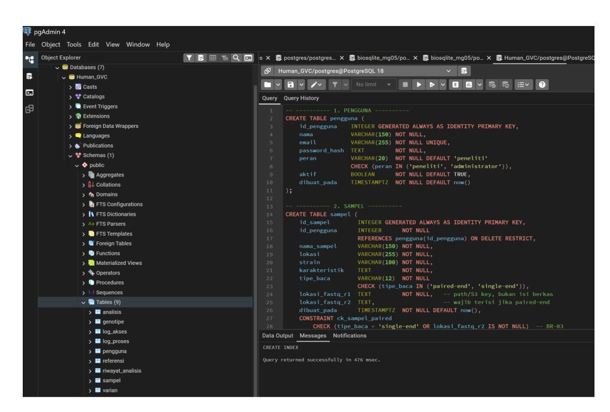

Gambar 1.1.3.2 Tangkapan layar pembuatan tabel

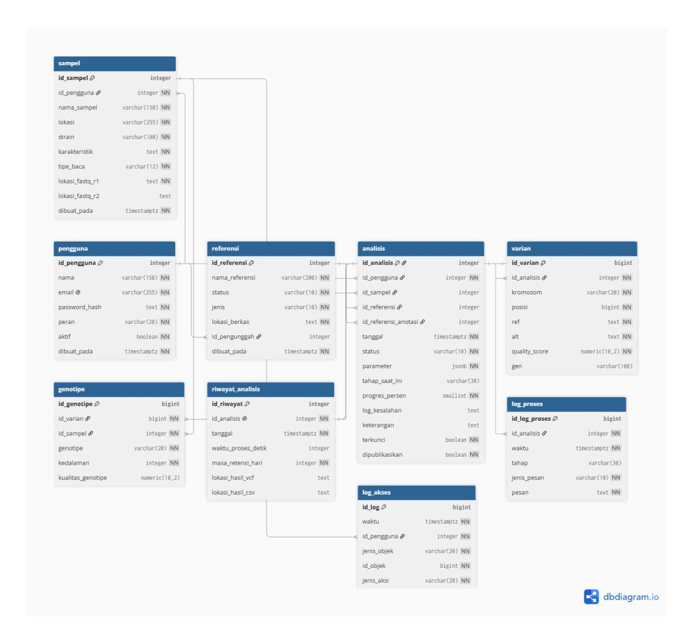

Gambar 1.1.3.3 Entity relationship diagram basis data Human GVC

## **1.2 Minggu 7**

Pada minggu ke-7 dikerjakan Issue #10 "Kerangka backend (API dan koneksi PostgreSQL)" dan Issue #11 "Kerangka frontend (Next.js) dan sambungan ke backend". Tujuannya membangun kerangka frontend dan backend yang dapat dijalankan di komputer pengembang serta tersambung dengan basis data PostgreSQL hasil pekerjaan minggu ke-6, sesuai target Pertemuan 6 pada modul praktikum. Pada tahap ini fitur yang dibangun masih terbatas pada fondasi aplikasi. Autentikasi, unggah berkas FASTQ, dan eksekusi pipeline dijadwalkan pada minggu berikutnya.

#### **1.2.1 Tautan**

- a. Tautan repository: [https://github.com/Pembangunan-Perangkat-Lunak-BIF-IPB/kelompok-03/tr](https://github.com/Pembangunan-Perangkat-Lunak-BIF-IPB/kelompok-03/tree/feat/kerangka-backend) [ee/feat/kerangka-backend](https://github.com/Pembangunan-Perangkat-Lunak-BIF-IPB/kelompok-03/tree/feat/kerangka-backend)
- b. Tautan GitHub Project: [https://github.com/orgs/Pembangunan-Perangkat-Lunak-BIF-IPB/projects/9/](https://github.com/orgs/Pembangunan-Perangkat-Lunak-BIF-IPB/projects/9/views/1) [views/1](https://github.com/orgs/Pembangunan-Perangkat-Lunak-BIF-IPB/projects/9/views/1)
- c. Tautan issue terkait: [https://github.com/Pembangunan-Perangkat-Lunak-BIF-IPB/kelompok-03/is](https://github.com/Pembangunan-Perangkat-Lunak-BIF-IPB/kelompok-03/issues/10) [sues/10](https://github.com/Pembangunan-Perangkat-Lunak-BIF-IPB/kelompok-03/issues/10) & [https://github.com/Pembangunan-Perangkat-Lunak-BIF-IPB/kelompok-03/is](https://github.com/Pembangunan-Perangkat-Lunak-BIF-IPB/kelompok-03/issues/11) [sues/11](https://github.com/Pembangunan-Perangkat-Lunak-BIF-IPB/kelompok-03/issues/11)
- d. Tautan pull request: [https://github.com/Pembangunan-Perangkat-Lunak-BIF-IPB/kelompok-03/p](https://github.com/Pembangunan-Perangkat-Lunak-BIF-IPB/kelompok-03/pull/12) [ull/12](https://github.com/Pembangunan-Perangkat-Lunak-BIF-IPB/kelompok-03/pull/12)

#### **1.2.2 Pembangunan Kerangka Backend**

Kerangka backend dibangun sebagai komponen UI/API pada arsitektur modular Human GVC dan ditempatkan pada folder backend/. Backend menggunakan framework FastAPI (Python) dan terhubung ke PostgreSQL melalui konfigurasi variabel lingkungan pada berkas .env, sehingga kredensial basis data tidak tersimpan di repositori. Seluruh kueri membaca skema yang telah dibangun pada minggu ke-6. Endpoint yang tersedia pada tahap ini disajikan pada Tabel [1.2.2.1](#page-7-2).

Tabel 1.2.2.1 Endpoint backend pada kerangka awal

| Endpoint        | Fungsi        | Rujukan              |
|-----------------|---------------|----------------------|
| GET /api/health | Memeriksa     | status API dan       |
|                 | koneksi basis | data                 |
|                 |               | Desain Modular Bab 2 |
| GET dan POST    |               |                      |
|                 | Menampilkan   | dan menambah         |
|                 | metadata      | sampel               |
|                 |               | UC-01, FR-04         |
|                 | Menyediakan   | daftar kolom tabel   |
|                 | sampel untuk  | pembentukan form     |

| Endpoint Fungsi                               | Rujukan |
|-----------------------------------------------|---------|
| GET /api/analisis Menampilkan daftar analisis |         |
| beserta statusnya                             |         |
| UC-03,                                        | UC-04   |
| Menampilkan log proses                        |         |
| kronologis analisis dari tabel                |         |
| UC-04,                                        | FR-07   |

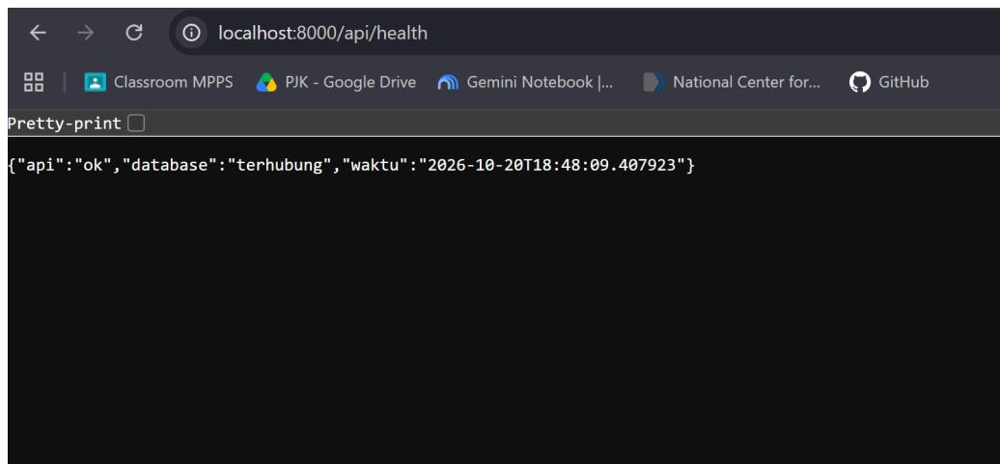

Gambar 1.2.2.2 Tangkapan layar dokumentasi hasil /api/health

Gambar 1.2.2.3 Tangkapan layar dokumentasi API (/docs) dan hasil /api/health

#### **1.2.3 Pembangunan Kerangka Frontend**

Kerangka frontend dibangun menggunakan Next.js dan ditempatkan pada folder frontend/. Alamat API diatur melalui variabel lingkungan sehingga frontend dapat disambungkan ke backend tanpa mengubah kode. Halaman yang tersedia pada tahap ini disajikan pada [Tabel](#page-9-1) [1.2.3.1](#page-9-1). Halaman analisis memantau log proses dengan polling berkala, sesuai rancangan bahwa antarmuka memantau log secara berkala.

Tabel 1.2.3.1 Halaman frontend pada kerangka awal

| Halaman  | Fokus       | (dari      | modul)    | Bobot                |
|----------|-------------|------------|-----------|----------------------|
| Beranda  | Menampilkan |            | status    | frontend,            |
|          | backend     | API,       | dan basis | data                 |
|          |             |            |           | Desain Modular Bab 2 |
| Sampel   | Form        | penambahan | dan       | tabel                |
|          | daftar      | sampel     |           |                      |
|          |             |            |           | UC-01, FR-04         |
| Analisis | Daftar      | analisis   | dan log   | proses               |
|          | yang        | diperbarui | berkala   |                      |
|          |             |            |           | UC-04, FR-07         |
| Masuk    | Tampilan    | awal       | halaman   | masuk                |
|          | (belum      | berfungsi) |           |                      |

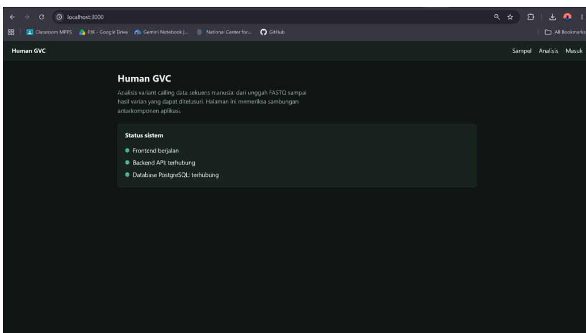

The screenshot displays a GitHub viewer with a human GVC sistem selected. The human GVC sistem is a selected button in the top section of the viewer with the text "Human GVC" at the top left. Below it, a section is divided into two parts: a dark grey background and a dark grey section on the left. In the dark grey section, the text "Status sistem" is visible, and the following icons are shown:

- Frontend berjalan
- Backend API: terhubung
- Database PostgreSQL: terhubung

To the right of the human GVC sistem is a section with a small human GVC logo and the text "Analisis Masuk". At the bottom of the section, there is a selected button "Sampel" and "Analisis" and "Masuk".

# Gambar 1.2.3.2 Tangkapan layar halaman beranda dengan status API dan basis data terhubung

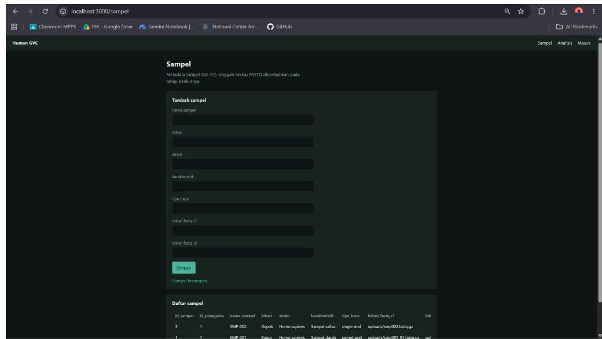

Gambar 1.2.3.3 Tangkapan layar halaman sampel

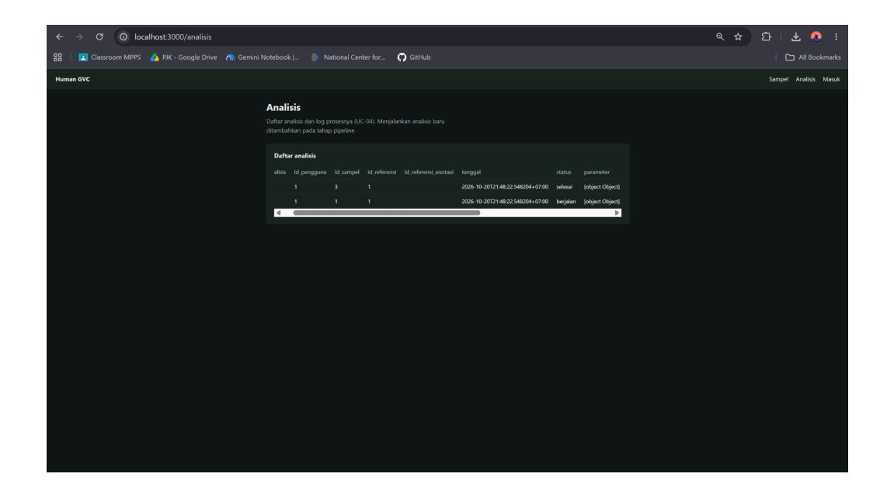

Gambar 1.2.3.4 Tangkapan layar halaman analisis

#### **1.3 Minggu 8**

Pada minggu ke-8 dikerjakan Issue #16 "Integrasi & Penyempurnaan Kerangka". Tujuannya mengintegrasikan frontend, backend, dan basis data PostgreSQL sehingga minimal satu alur utama pada SKPL dapat digunakan pengguna, mulai dari memasukkan data sampel hingga sistem memberikan hasil, sesuai target Pertemuan 8 pada modul praktikum. Alur yang terintegrasi mencakup autentikasi pengguna, unggah berkas FASTQ beserta metadata sampel, pengaturan referensi dan parameter analisis, eksekusi analisis, pemantauan status dan log proses, penyajian hasil (unduh, penguncian, dan publikasi ke basis data varian), pencarian pada Database Varian, serta pengelolaan akun dan data referensi oleh administrator. Pada tahap ini eksekusi pipeline masih berjalan dalam mode simulasi, sedangkan penjalanan perangkat bioinformatika yang sesungguhnya dijadwalkan pada minggu berikutnya. Rincian implementasi backend, frontend, verifikasi integrasi, dan kesesuaian dengan SKPL disajikan pada subbagian 1.3.2 sampai 1.3.5.

#### **1.3.1 Tautan**

- a. Tautan repository: [https://github.com/Pembangunan-Perangkat-Lunak-BIF-IPB/kelompok-03/tr](https://github.com/Pembangunan-Perangkat-Lunak-BIF-IPB/kelompok-03/tree/feat/integrasi) [ee/feat/integrasi](https://github.com/Pembangunan-Perangkat-Lunak-BIF-IPB/kelompok-03/tree/feat/integrasi)
- b. Tautan GitHub Project: <https://github.com/orgs/Pembangunan-Perangkat-Lunak-BIF-IPB/projects/9>
- c. Tautan issue terkait: [https://github.com/Pembangunan-Perangkat-Lunak-BIF-IPB/kelompok-03/is](https://github.com/Pembangunan-Perangkat-Lunak-BIF-IPB/kelompok-03/issues/16) [sues/16](https://github.com/Pembangunan-Perangkat-Lunak-BIF-IPB/kelompok-03/issues/16)
- d. Tautan pull request: [https://github.com/Pembangunan-Perangkat-Lunak-BIF-IPB/kelompok-03/p](https://github.com/Pembangunan-Perangkat-Lunak-BIF-IPB/kelompok-03/pull/15) [ull/15](https://github.com/Pembangunan-Perangkat-Lunak-BIF-IPB/kelompok-03/pull/15)

#### **1.3.2 Integrasi Backend**

Pada minggu ke-8, kerangka backend minggu ke-7 dikembangkan menjadi backend terintegrasi yang melayani alur utama Human GVC, mulai dari autentikasi pengguna, unggah data sekuens FASTQ, pengaturan dan eksekusi analisis, pemantauan status dan log, hingga penyimpanan hasil varian pada basis data bersama. Backend dibangun dengan FastAPI (Python) dan dijalankan sebagai satu proses yang memuat komponen UI/API, Job Manager, dan Workflow Engine pada Desain Modular. Data terstruktur disimpan pada PostgreSQL, sedangkan berkas berukuran besar disimpan pada folder penyimpanan lokal sebagai komponen Storage. Realisasi setiap komponen Desain Modular disajikan pada Tabel [1.3.2.1.](#page-13-0)

Tabel 1.3.2.1 Realisasi komponen Desain Modular pada backend

|             |            | Realisasi       |            |                    | Berkas                          |
|-------------|------------|-----------------|------------|--------------------|---------------------------------|
| UI/API      | Backend    | FastAPI         | yang       | melayani           | frontend                        |
|             | Next.js    | melalui         | REST       |                    |                                 |
| Job Manager | Menerima   |                 | permintaan | analisis,          | mencatat                        |
|             | parameter, | dan             |            | mengantrekan       | analisis ke                     |
|             | thread     | pool            |            | (PIPELINE_WORKERS, |                                 |
|             | bawaan     | 2)              |            |                    |                                 |
|             |            |                 |            |                    | backend/app/pipeline.py (kirim) |
|             |            | Menjalankan     | enam       | tahap              | berurutan,                      |
|             | menulis    | log_proses,     |            | memperbarui        | status,                         |
|             |            | tahap_saat_ini, | dan        | progres_persen,    | serta                           |
|             | menandai   | analisis        |            | gagal saat         | satu tahap                      |
| Database    |            | PostgreSQL      | dengan 10  | tabel              | database/01_schema.sql,         |
| Storage     | Folder     | lokal           |            | STORAGE_DIR        | (uploads/,                      |
|             |            | references/,    | results/,  | work/);            | basis data                      |
|             | hanya      | menyimpan       | lokasi     | berkas             |                                 |

Backend menyediakan 29 endpoint yang dikelompokkan menjadi sistem, akun, sampel, referensi, analisis, varian, dan pengguna sebagaimana disajikan pada Tabel [1.3.2.2](#page-14-0). Dokumentasi interaktif dihasilkan otomatis dan dapat dibuka pada alamat /docs, sedangkan kontrak lengkap antarmuka dicatat pada frontend/docs/API\_CONTRACT.md.

Tabel 1.3.2.2 Endpoint backend

| Kelompok Endpoint Fungsi                                   |              |                |            |
|------------------------------------------------------------|--------------|----------------|------------|
| Sistem GET /api/health Status                              | API,         | basis data,    | dan        |
| Akun POST /api/auth/login, GET /api/auth/me Masuk          | (menolak     | akun           | nonaktif   |
| atau                                                       | belum        | terverifikasi) | dan        |
| profil                                                     | pengguna     |                |            |
| Akun POST /api/auth/daftar, /verifikasi,                   |              |                |            |
| /kirim-ulang, /lupa, /reset                                |              |                |            |
| Registrasi                                                 | mandiri,     |                | verifikasi |
| email,                                                     | kirim ulang, | lupa           | dan atur   |
| ulang                                                      | kata sandi   |                |            |
| Sampel POST /api/sampel Unggah                             | FASTQ        | dan            | metadata,  |
| membentuk                                                  | sampel       | dan            | analisis   |
| berstatus                                                  | draf         |                |            |
| Referensi GET /api/referensi, POST /api/referensi,         |              |                |            |
| DELETE /api/referensi/{id}                                 |              |                |            |
| Daftar,                                                    | unggah,      | dan            | hapus      |
| referensi                                                  |              | (hapus         | hanya      |
| administrator;                                             | ditolak      | bila           | dipakai    |
| Analisis GET /api/analisis, GET /api/analisis/{id} Riwayat | milik        | sendiri        | dalam      |
| masa                                                       | retensi, dan | detail         | analisis   |
| Analisis PATCH /api/analisis/{id} Menyimpan                | konfigurasi  |                | (validasi  |
| rentang;                                                   | ditolak      | bila           | sudah      |
| dijalankan                                                 | atau         | terkunci)      |            |
| Analisis POST /api/analisis/{id}/jalankan Memeriksa        | prasyarat,   |                | mengubah   |
| status                                                     | menjadi      | menunggu,      | lalu       |
| menyerahkan                                                | ke           | Job Manager    |            |
| Analisis GET /api/analisis/{id}/log Log proses             | kronologis   |                |            |

| Kelompok Endpoint Fungsi                               |             |            |               |
|--------------------------------------------------------|-------------|------------|---------------|
| Analisis POST /api/analisis/{id}/salin Membuat         | analisis    |            | baru (draf)   |
| dengan                                                 | konfigurasi | yang       | sama          |
| Analisis GET /api/analisis/{id}/ringkasan, GET         |             |            |               |
| Statistik                                              | hasil       | dan        | daftar varian |
| bernomor                                               | halaman     |            | (409 bila     |
| belum                                                  | selesai)    |            |               |
| Analisis POST /api/analisis/{id}/kunci, POST           |             |            |               |
| Mengunci                                               |             | hasil      | dan           |
| mempublikasikan                                        |             | ke         | basis data    |
| varian                                                 | (hanya      | status     | selesai)      |
| Analisis GET /api/analisis/{id}/unduh (format vcf      |             |            |               |
| atau csv)                                              |             |            |               |
| Mengunduh                                              |             | hasil      |               |
| Varian GET /api/varian, GET /api/varian/{id} Pencarian |             | pada       | basis data    |
| bersama                                                |             | (hanya     | analisis      |
| terpublikasi)                                          |             | dan detail | varian        |
| Pengguna GET /api/pengguna, POST /api/pengguna,        |             |            |               |
| PATCH /api/pengguna/{id}, DELETE                       |             |            |               |
| Pengelolaan                                            |             | akun       | oleh          |

Dari 29 endpoint tersebut, tujuh endpoint (kesehatan sistem, masuk, dan lima endpoint alur akun) dapat diakses tanpa token, 17 endpoint mensyaratkan pengguna yang sudah masuk, dan lima endpoint hanya dapat diakses administrator.

Kata sandi disimpan sebagai hash bcrypt menggunakan ekstensi pgcrypto pada PostgreSQL, dan pencocokan dilakukan di basis data sehingga kata sandi asli tidak pernah disimpan. Setelah masuk, pengguna menerima token bertanda tangan HMAC-SHA256 yang memuat identitas pengguna dan waktu kedaluwarsa (12 jam) dan dikirim pada header Authorization di setiap permintaan. Permintaan tanpa token yang sah atau dari akun nonaktif ditolak dengan kode 401, sedangkan

pengelolaan akun dan penghapusan referensi dibatasi bagi peran administrator dengan kode 403. Pada fitur registrasi mandiri, verifikasi email, dan atur ulang kata sandi, token tautan dibangkitkan acak dan hanya hash SHA-256-nya yang disimpan pada tabel token\_email; token verifikasi berlaku 24 jam, token atur ulang berlaku 60 menit, dan keduanya hanya dapat dipakai satu kali. Pembatas percobaan membatasi pendaftaran, kirim ulang verifikasi, dan permintaan lupa kata sandi hingga 5 kali per 15 menit per alamat IP, serta percobaan masuk hingga 10 kali per 15 menit (per kombinasi email dan alamat IP), dengan jawaban 429. Aksi penting pengguna (masuk, unggah, jalankan, lihat, unduh, cari, ubah, hapus) dicatat pada tabel log\_akses (FR-13).

Aturan bisnis SKPL ditegakkan pada lapisan API dan, untuk aturan yang paling kritis, juga pada basis data agar tetap berlaku walaupun data diubah langsung lewat SQL. Lokasi penegakan setiap aturan disajikan pada Tabel [1.3.2.3](#page-16-0).

Tabel 1.3.2.3 Penegakan aturan bisnis

| Aturan      | Penegakan            | Lokasi                                                  |
|-------------|----------------------|---------------------------------------------------------|
| BR-01       | Menjalankan          | analisis tanpa genom referensi atau data                |
|             | sekuens              | ditolak (422) dengan daftar kekurangan                  |
| BR-02 Hanya | berkas               | .fastq atau .fastq.gz diterima (422) routers/sampel.py, |
| BR-03 Dua   | berkas               | harus berpasangan (R1 dan R2 dengan                     |
| nama        | dasar                | sama); selain itu ditolak. Pada basis data              |
| dijaga      | constraint           | ck_sampel_paired                                        |
| BR-04       | Parameter            | di luar rentang ditolak (422). Rentang                  |
| adalah      | asumsi               | implementasi                                            |
|             |                      | services.py, config.py                                  |
| BR-05       | Analisis             | non-draf atau terkunci tidak dapat diubah               |
| (409).      |                      | Pada basis data dijaga constraint                       |
|             | ck_analisis_terkunci | dan trigger trg_analisis_terkunci.                      |
|             | Pengulangan          | dilakukan sebagai analisis baru (/salin)                |

| Aturan | Penegakan                                              | Lokasi      |
|--------|--------------------------------------------------------|-------------|
| BR-06  | Publikasi hanya untuk status selesai (409). Pada basis |             |
|        | data dijaga constraint ck_analisis_publikasi           |             |
| BR-07  | Analisis milik pengguna lain dijawab 404               | services.py |
| BR-08  | Analisis yang melewati masa retensi (bawaan 90 hari)   |             |
|        | disembunyikan dan tidak dapat diakses. Penghapusan     |             |
|        | fisik belum dilakukan (penegakan sebagian)             |             |

Mesin pipeline terdiri atas Job Manager dan Workflow Engine yang berjalan pada proses yang sama dengan API. Saat pengguna menjalankan analisis, status berubah menjadi menunggu, lalu analisis diserahkan ke thread pool dan Workflow Engine menjalankan enam tahap berurutan: QC & Trimming, Alignment, Pemrosesan BAM, Variant Calling, Filtering, dan Anotasi. Setiap tahap menulis baris pada tabel log\_proses (jenis pesan info, berjalan, berhasil, atau error) dan memperbarui status, tahap\_saat\_ini, serta progres\_persen pada tabel analisis, yang dipantau frontend melalui polling. Jika sebuah tahap gagal, analisis dihentikan, ditandai gagal, dan penyebabnya disimpan pada log\_kesalahan (UC-03 alur alternatif 2). Bila basis data anotasi tidak dipilih, tahap Anotasi dilewati (UC-03 alur alternatif 3). Analisis yang tertinggal berstatus menunggu atau berjalan saat server mati ditandai gagal ketika server dihidupkan kembali. Perbedaan perilaku kedua mode pipeline disajikan pada Tabel [1.3.2.4](#page-17-0).

Tabel 1.3.2.4 Tahap pipeline pada mode simulasi dan mode nyata

| Tahap |     | Mode simulasi (bawaan)  | Mode  | nyata | (belum |
|-------|-----|-------------------------|-------|-------|--------|
| QC    | dan |                         |       |       |        |
|       |     | Menunggu beberapa detik | fastp |       |        |

| Tahap Mode                    | simulasi (bawaan)    |            |          | Mode nyata (belum       |
|-------------------------------|----------------------|------------|----------|-------------------------|
| Alignment Menunggu; sampel    | bernama mengandung   |            |          |                         |
| "gagal" sengaja               | digagalkan untuk     | uji        |          |                         |
|                               |                      |            | bwa      | mem, lalu samtools view |
| Menunggu                      |                      |            | samtools | sort, index, faidx      |
| Menunggu                      |                      |            | bcftools | mpileup dan call        |
| Filtering Varian dibangkitkan | acak; hanya          | filter Min |          |                         |
| Depth dan Min                 | QUAL yang diterapkan |            |          |                         |
|                               |                      |            | bcftools | view dengan kriteria    |
|                               |                      |            | QUAL     | dan DP                  |
| Anotasi Dilewati bila         | tidak ada berkas     | anotasi;   | bila     |                         |
| ada, nama gen                 | acak dipertahankan   |            |          |                         |
|                               |                      |            | bcftools | annotate (hanya berkas  |
|                               |                      |            | VCF;     | GTF/GFF dilewati)       |

Pada mode simulasi, berkas FASTQ yang diunggah tidak dibaca dan varian, berkas VCF, serta CSV dibangkitkan secara acak, sehingga hasil yang ditampilkan bukan temuan biologis. Mode nyata sudah ditulis tetapi belum dijalankan pada data sekuens sungguhan; pemakaiannya mensyaratkan keempat alat bioinformatika terpasang dan berkas referensi tersedia pada backend/storage/references/. Berkas referensi bawaan (GRCh38.fasta dan dbSNP\_v155.vcf.gz) baru tercatat sebagai baris pada tabel referensi, sedangkan berkas aslinya belum tersedia di server.

Berkas hasil analisis disimpan pada results/<id\_analisis>/ sebagai hasil.vcf dan hasil.csv, berkas FASTQ unggahan pada uploads/, dan berkas kerja sementara pada work/ yang dihapus setelah analisis selesai. Tabel riwayat\_analisis hanya menyimpan lokasi berkas hasil, waktu proses, dan masa retensi. Dua cuplikan kode berikut menunjukkan penegakan BR-04 dan alur tahap pada Workflow Engine.

#### Cuplikan kode Validasi rentang parameter (BR-04), backend/app/services.py

def validasi\_parameter(p: dict, dasar: dict | None = None) -> dict: hasil = {\*\*PARAM\_DEFAULT, \*\*(dasar or {})} for k, v in (p or {}).items(): if k not in PARAM\_RANGE: raise HTTPException(422, f"Parameter tidak dikenal: {k}.") if isinstance(v, bool) or not isinstance(v, (int, float)): raise HTTPException(422, f"Parameter {k} harus berupa angka.") lo, hi = PARAM\_RANGE[k] if not lo <= v <= hi: raise HTTPException(422, f"Parameter {k} di luar rentang yang diizinkan ({lo} sampai {hi}).") hasil[k] = int(v) if float(v).is\_integer() else v return hasil

#### Cuplikan kode Perulangan tahap pada Workflow Engine, backend/app/pipeline.py (dipersingkat)

n = len(STAGES) for i, tahap in enumerate(STAGES): label = STAGE\_LABEL[tahap] \_set(id\_a, tahap\_saat\_ini=tahap, progres\_persen=int(i / n \* 100)) if tahap == "anotasi" and not anot: \_log(id\_a, tahap, "info", "Berkas anotasi tidak dipilih. Tahap anotasi dilewati.") ... \_log(id\_a, tahap, "info", f"Memulai tahap {label}...") hasil = (\_tahap\_sim if PIPELINE\_MODE == "simulasi" else \_tahap\_nyata)(tahap, ctx, id\_a) ...

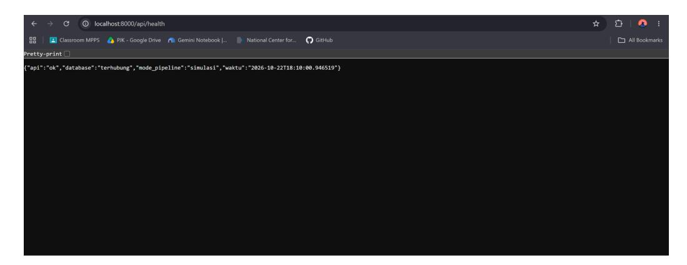

Gambar 1.3.2.5 Bukti database terhubung

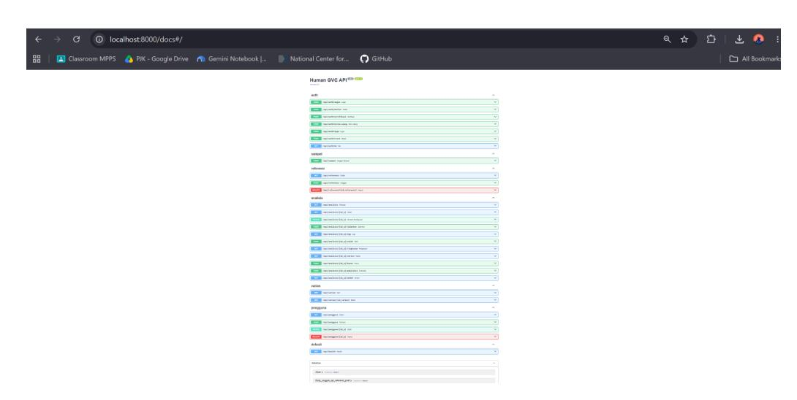

Gambar 1.3.2.6 Bukti halaman daftar endpoint

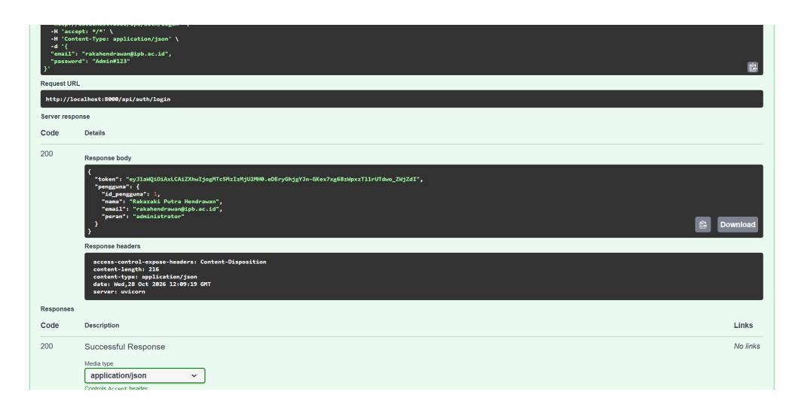

Gambar 1.3.2.7 Bukti contoh respons login

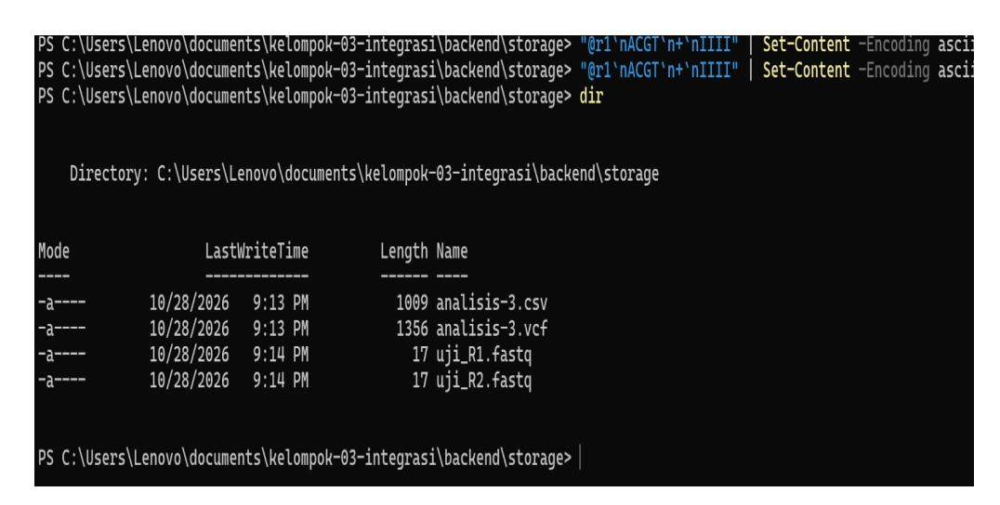

Gambar 1.3.2.8 Bukti hasil analisis (csv dan vcf) dengan fastq dummy tersimpan di storage

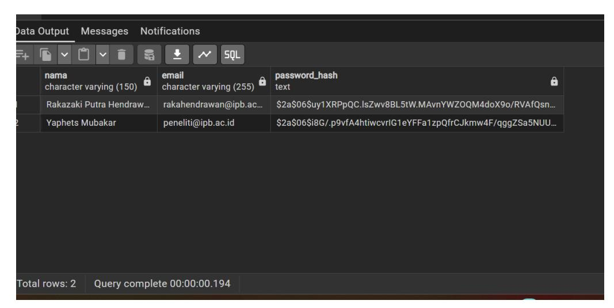

Gambar 1.3.2.9 Bukti password email tersimpan dalam bentuk hash

## **1.3.4 Integrasi Frontend**

Frontend aplikasi Human GVC dikembangkan menggunakan framework Next.js dengan App Router dan bahasa pemrograman JavaScript. Pada tahap pengembangan minggu ke-8, frontend telah diintegrasikan dengan backend FastAPI dan basis data PostgreSQL sehingga antarmuka dapat berkomunikasi dengan layanan backend untuk menjalankan fungsi-fungsi utama aplikasi. Komunikasi antara frontend dan backend dilakukan melalui alamat API yang diatur menggunakan variabel lingkungan, yaitu [ISI-MANUAL: nama variabel lingkungan dan alamat API yang digunakan]. Aplikasi juga menyediakan mode data tiruan (mock) yang diaktifkan melalui variabel NEXT\_PUBLIC\_USE\_MOCK=true agar frontend dapat dijalankan tanpa backend. Sebaliknya, pada proses integrasi dengan backend asli, mode tersebut dinonaktifkan dengan mengatur NEXT\_PUBLIC\_USE\_MOCK=false. Berdasarkan pelaksanaan minggu ke-8, frontend telah berhasil dijalankan dengan backend asli sehingga fungsi antarmuka dapat berkomunikasi dengan layanan backend dan basis data.

Implementasi frontend mencakup tujuh menu utama sesuai rancangan antarmuka, yaitu Unggah Data, Pengaturan Analisis, Eksekusi Analisis, Status & Log, Hasil Analisis, Database Varian, dan Kelola Sistem (Admin). Selain itu,

terdapat halaman pendukung untuk proses autentikasi dan pengelolaan akun. Secara keseluruhan, aplikasi memiliki 12 rute frontend.

Tabel 1.3.4.1 Daftar rute dan implementasi halaman frontend

| Rute Layar desain Fokus   | implementasi  | Rujukan        |
|---------------------------|---------------|----------------|
| /login Tidak terdapat     |               |                |
| pada desain               |               |                |
| Menyediakan               | halaman       | Masuk,         |
| tautan                    | menuju Daftar | dan Lupa       |
| sandi,                    | serta fitur   | kirim ulang    |
| Tidak terdapat            |               |                |
| pada desain               |               |                |
| Menyediakan               | alur          | pengelolaan    |
| akun yang                 | meliputi      | pendaftaran,   |
| verifikasi                | email,        | permintaan     |
| pengaturan                | ulang         | sandi, dan     |
| pengaturan                | ulang         | sandi.         |
|                           |               | Di luar        |
| /unggah 1. Unggah         |               |                |
| Menyediakan               |               | fitur unggah   |
| berkas                    | FASTQ         | melalui        |
| mekanisme                 |               | drag-and-drop, |
| deteksi                   | single-end    | dan            |
| paired-end,               | validasi      | berkas, serta  |
| pengisian                 | metadata      | sampel.        |
| /pengaturan 2. Pengaturan |               |                |
| Menyediakan               | pemilihan     | genom          |
| referensi,                | basis         | data anotasi,  |

| Rute Layar desain Fokus | implementasi | Rujukan              |
|-------------------------|--------------|----------------------|
|                         | pengaturan   | parameter analisis,  |
| dan                     | penyimpanan  | draf.                |
| /eksekusi 3. Eksekusi   |              |                      |
|                         | Menampilkan  | ringkasan            |
|                         | konfigurasi, | tahapan pipeline,    |
| serta                   | tombol       | untuk memulai        |
| /status 4. Status &     |              |                      |
|                         | Menampilkan  | progres analisis,    |
| log                     | proses,      | riwayat tahapan, dan |
| tindakan                | yang         | dapat dilakukan      |
| ketika                  | analisis     | gagal.               |
| /hasil 5. Hasil         |              |                      |
|                         | Menampilkan  | statistik dan tabel  |
| varian,                 | menyediakan  | fitur unduh          |
| hasil,                  | Kunci        | Hasil, serta         |
|                         | Publikasikan | ke Database          |
|                         |              | -12, FR-19           |
| /varian 6. Database     |              |                      |
|                         | Menyediakan  | pencarian,           |
|                         | penyaringan, | dan penampilan       |
| detail                  | varian       | yang telah           |

| Rute   | Layar desain | Fokus implementasi      |      | Rujukan |
|--------|--------------|-------------------------|------|---------|
| /admin | 7. Kelola    |                         |      |         |
|        |              | Menyediakan pengelolaan | akun |         |
|        |              | pengguna dan referensi  | yang |         |
|        |              | hanya dapat diakses     | oleh |         |

Alur end to end aplikasi secara keseluruhan dimulai dari proses masuk atau pendaftaran akun yang dilanjutkan dengan verifikasi email. Setelah berhasil masuk, pengguna dapat mengakses menu Unggah Data untuk mengunggah satu atau dua berkas FASTQ serta mengisi empat metadata sampel, yaitu nama sampel, lokasi pengambilan, karakteristik atau kondisi, dan strain. Setelah proses unggah berhasil, sistem membentuk sampel dan analisis dengan status draf. Selanjutnya, pengguna diarahkan ke Pengaturan Analisis untuk memilih genom referensi, menentukan basis data anotasi apabila diperlukan, serta mengatur tiga parameter analisis. Konfigurasi dapat disimpan sebagai draf atau dikonfirmasi sebelum memasuki halaman Eksekusi Analisis. Pada halaman tersebut, pengguna dapat melihat ringkasan konfigurasi dan daftar kekurangan apabila terdapat persyaratan yang belum terpenuhi sebelum menekan tombol Mulai Jalankan Analisis. Setelah analisis dimulai, pengguna dapat memantau perkembangan melalui halaman Status & Log yang menampilkan bilah progres, log proses, dan riwayat tahapan dengan mekanisme pembaruan setiap tiga detik. Ketika analisis selesai, pengguna dapat melihat statistik dan tabel varian pada halaman Hasil Analisis, mengunduh hasil dalam format CSV atau VCF, mengunci hasil, serta mempublikasikannya ke Database Varian. Selanjutnya, pengguna dapat mencari dan melihat detail varian yang telah dipublikasikan. Sementara itu, pengguna dengan hak administrator dapat mengakses Kelola Sistem (Admin) untuk mengelola akun dan referensi.

Pada sisi frontend, validasi diterapkan guna memastikan data yang dimasukkan pengguna memenuhi ketentuan sebelum dikirimkan ke backend. Validasi unggahan berkas FASTQ mencakup pemeriksaan format berkas .fastq atau .fastq.gz, pemeriksaan struktur empat baris pertama, serta deteksi jenis unggahan single-end atau paired-end. Pada unggahan paired-end, sistem memeriksa kecocokan pasangan berkas R1 dan R2 berdasarkan nama berkas. Implementasi menggunakan pola penamaan \_R1 dan \_R2, maupun \_1 dan \_2, untuk mengenali pasangan berkas. Selain itu, sistem mewajibkan pengisian empat metadata sampel, yaitu nama sampel, lokasi pengambilan, karakteristik atau kondisi, dan strain. Pada halaman Pengaturan Analisis, frontend memvalidasi nilai parameter Batas Kualitas Pemangkasan (Min Quality), Kedalaman Minimal (Min Depth), dan Batas QUAL Filtering (Min QUAL) agar berada dalam rentang yang ditetapkan pada implementasi. Validasi juga diterapkan pada kolom pencarian posisi varian dengan format chrN:posisi. Apabila data yang dimasukkan tidak memenuhi ketentuan, sistem menampilkan pesan kesalahan dalam bahasa Indonesia sehingga pengguna dapat mengetahui bagian yang perlu diperbaiki sebelum melanjutkan proses.

Selain implementasi fungsi utama, antarmuka frontend mengalami sejumlah penyesuaian terhadap rancangan high-fidelity Figma. Perubahan tersebut dilakukan untuk menyesuaikan kebutuhan fungsional, alur penggunaan aplikasi, dan integrasi dengan backend serta basis data. Perbandingan antara rancangan awal dan implementasi frontend disajikan pada Tabel [1.3.4.2.](#page-26-0)

Tabel 1.3.4.2 Perbandingan rancangan dengan implementasi frontend

| ID Layar Rancangan |                     |
|--------------------|---------------------|
|                    | Alasan perubahan    |
| P-10 Halaman       |                     |
| Tidak terdapat     |                     |
| Masuk pada         |                     |
| halaman            | Masuk,              |
| Daftar,            | Verifikasi,         |
| Lupa               | sandi, dan          |
| Atur               | ulang sandi.        |
|                    | kebutuhan prasyarat |
|                    | use case dan        |
|                    | penambahan fitur    |
|                    | P-04 sampai P-07.   |

| ID Layar Rancangan |                     |
|--------------------|---------------------|
|                    | Alasan perubahan    |
| P-11 Pengatur      |                     |
| dua parameter,     |                     |
| yaitu Min          |                     |
| Quality dan        |                     |
| Min Depth.         |                     |
| parameter          | ketiga,             |
| yaitu              | Min QUAL            |
| untuk              | proses              |
|                    | Parameter tersebut  |
|                    | sudah tersedia      |
|                    | dalam JSON          |
|                    | bawaan analisis     |
| P-12 Database      |                     |
| Kolom yang         |                     |
| Posisi, Mutasi,    |                     |
| kolom              | QUAL pada           |
| tabel              | varian.             |
|                    | posisi dan kualitas |
|                    | varian ditampilkan. |
| P-13 Eksekusi      |                     |
| Status &           |                     |
| lima chip          |                     |
| empat tahapan.     |                     |
| Tahapan            | diperbarui          |
| menjadi            | enam,               |
| yaitu              | QC &                |
| Pemrosesan         | BAM,                |
| Variant            | Calling,            |
| Filtering,         | dan                 |
|                    | dengan enum         |
|                    | tahapan pada basis  |
|                    | data dan Desain     |
| P-14 Eksekusi      |                     |
| menampilkan        | nilai               |
| parameter          | aktual              |
| dengan             | label               |
|                    | Menjaga konsistensi |
|                    | informasi antara    |
|                    | halaman Pengaturan  |

| ID Layar Rancangan |                     |
|--------------------|---------------------|
|                    | Alasan perubahan    |
| Default            | atau                |
|                    | Analisis dan        |
|                    | Eksekusi Analisis.  |
| P-15 Pengatur      |                     |
| Basis Data         |                     |
| bidang "Pilih      |                     |
| pilihan            | opsional            |
| "Tanpa             | anotasi"            |
| sehingga           | tahap               |
| Anotasi            | dapat               |
| dilewati,          | serta               |
| tombol             | unggah              |
| referensi          | baru dari           |
| halaman            | tersebut.           |
|                    | pemilihan atau      |
|                    | referensi sesuai    |
|                    | UC-02 dan           |
|                    | alternatif ketiga   |
| P-16 Header Tidak  |                     |
| pemilih analisis   |                     |
| Ditambahkan        | chip                |
| Analisis           | aktif yang          |
| mencakup           | riwayat,            |
| pemilih            | analisis,           |
| dan tombol         | Analisis            |
|                    | Mendukung alur      |
|                    | penggunaan analisis |
|                    | aktif dan kebutuhan |
|                    | riwayat analisis    |
|                    | pada FR-17.         |
| P-17 Hasil         |                     |
| Status &           |                     |
| Halaman hasil      |                     |
| fitur unduh        |                     |
| CSV dan VCF.       |                     |
| Ditambahkan        | Kunci               |
| Hasil,             | Publikasikan        |
| ke Database        | Varian,             |
| menjalankan        | ulang               |
| sebagai            | analisis            |
| baru,              | serta tindakan      |
| membuat            | analisis            |
| baru               | dengan              |
|                    | FR-10, FR-11,       |
|                    | BR-05, dan          |
|                    | alternatif kedua    |

| ID Layar Rancangan       |                    |
|--------------------------|--------------------|
|                          | Alasan perubahan   |
| konfigurasi              | yang               |
| sama                     | ketika analisis    |
| P-18 Database            |                    |
| tampilan detail          |                    |
| modal                    | detail varian      |
| yang                     | menampilkan        |
| kedalaman,               | sampel,            |
| dan                      | pengunggah.        |
|                          | penampilan detail  |
|                          | varian pada FR-18. |
| P-19 Database            |                    |
| tombol "Semua            |                    |
| dan "Filter              |                    |
| Diubah                   | menjadi            |
| kromosom,                | kolom              |
| pengisian                | QUAL               |
| minimum,                 | dan                |
| validasi                 | format             |
|                          | alternatif pertama |
| P-20 Kelola              |                    |
| Tabel akun               |                    |
| tombol Edit.             |                    |
| kolom                    | Verifikasi,        |
| tombol                   | Hapus akun,        |
| serta                    | dialog             |
|                          | dengan kebutuhan   |
|                          | pengelolaan akun   |
|                          | pada P-09.         |
| P-21 Navigasi Menu Admin |                    |
| untuk peran              |                    |
| Menu                     | dan rute           |
| Admin                    | dibatasi           |
| khusus                   | untuk              |
|                          | pembatasan hak     |
|                          | akses pada UC-07.  |

| ID   | Layar  | Rancangan        |                   |                  |
|------|--------|------------------|-------------------|------------------|
|      |        |                  |                   | Alasan perubahan |
| P-22 | Header | Nama dan         |                   |                  |
|      |        | contoh yang      |                   |                  |
|      |        | bersifat statis. |                   |                  |
|      |        |                  | Nama dan peran    |                  |
|      |        |                  | berdasarkan akun  |                  |
|      |        |                  | yang sedang masuk |                  |
|      |        |                  | ke aplikasi.      |                  |
|      |        |                  |                   | antarmuka dengan |
|      |        |                  |                   | identitas akun   |
|      |        |                  |                   | pengguna yang    |

Berdasarkan tabel tersebut, implementasi frontend tidak sepenuhnya sama dengan rancangan awal Figma karena terdapat penambahan dan penyesuaian komponen untuk mendukung fungsi aplikasi. Perubahan mencakup penambahan halaman autentikasi, parameter analisis, informasi varian, tahapan pipeline, serta fitur pengelolaan hasil dan akun. Selain itu, terdapat penyesuaian navigasi dan hak akses untuk memastikan bahwa menu Kelola Sistem (Admin) hanya tersedia bagi administrator. Dengan demikian, desain Figma digunakan sebagai acuan pengembangan, sedangkan implementasi disesuaikan dengan kebutuhan fungsional dan mekanisme integrasi sistem.

Penyesuaian juga dilakukan terhadap penanganan keadaan khusus dalam aplikasi. Ketika analisis mengalami kegagalan, halaman Status & Log menampilkan status gagal beserta informasi kegagalan dan menyediakan tindakan untuk membuat analisis baru dengan konfigurasi yang sama. Ketika hasil analisis belum tersedia, antarmuka menangani kondisi tersebut sehingga hasil yang belum selesai tidak diperlakukan sebagai hasil yang dapat diakses. Pada analisis yang telah dikunci, antarmuka menerapkan kondisi hanya-baca (read-only) sehingga pengguna tidak dapat melakukan perubahan terhadap konfigurasi analisis tersebut. Pembatasan ini juga didukung oleh backend yang menolak perubahan terhadap analisis non-draf atau terkunci. Selain itu, akses menuju halaman Kelola Sistem

(Admin) dibatasi berdasarkan peran pengguna, sehingga hanya administrator yang dapat menggunakan fitur pengelolaan akun dan referensi.

## **1.3.5 Kesesuaian dengan SKPL**

Pelaksanaan integrasi sistem pada minggu ke-8 mencakup pemetaan kebutuhan fungsional dan aturan bisnis yang tercantum dalam Spesifikasi Kebutuhan Perangkat Lunak (SKPL) terhadap implementasi sistem Human GVC. Arsitektur sistem terdiri atas komponen UI/API, Job Manager, Workflow Engine, Database, dan Storage yang mengacu pada pembagian komponen dalam Desain Modular. Meskipun sebagian kebutuhan telah diimplementasikan, beberapa kebutuhan masih dipenuhi sebagian atau belum dapat diverifikasi melalui eksekusi pipeline nyata karena sistem masih menggunakan mode simulasi. Oleh karena itu, penilaian kesesuaian dilakukan dengan membedakan fitur yang telah tersedia dari fitur yang masih memiliki keterbatasan implementasi. Tabel [1.3.4.3](#page-31-0) menyajikan keterlacakan ringkas antara use case dan kebutuhan fungsional dengan status implementasi serta catatan yang relevan. Status pada tabel perlu dicocokkan kembali dengan SKPL, khususnya Tabel Keterlacakan pada Bagian 3.7, termasuk prioritas Must, Should, dan Could.

Tabel 1.3.4.3 Keterlacakan use case dan kebutuhan fungsional

| ID Kategori/Deskrip |                                         |
|---------------------|-----------------------------------------|
|                     | Status Catatan Implementasi             |
| Mengunggah          | data                                    |
| dan                 | metadata                                |
|                     | Must Terpenuhi Unggah FASTQ dan         |
|                     | metadata melalui API                    |
|                     | sampel, disertai validasi               |
|                     | format dan kelengkapan                  |
| referensi           | dan                                     |
| parameter           | analisis                                |
|                     | Must Terpenuhi Pengaturan referensi dan |
|                     | parameter tersedia melalui              |
|                     | API referensi dan analisis.             |

| ID         | Kategori/Deskrip                             |
|------------|----------------------------------------------|
|            | Status Catatan Implementasi                  |
| analisis   | variant                                      |
|            | Must Sebagian Alur pipeline enam tahap       |
|            | tersedia dalam mode                          |
|            | simulasi; eksekusi                           |
|            | menggunakan perangkat                        |
|            | bioinformatika nyata belum                   |
| Memantau   | status                                       |
| dan log    | analisis                                     |
|            | Must Terpenuhi Status, tahap, progres, dan   |
|            | log proses dapat dipantau                    |
|            | melalui API analisis.                        |
| Melihat    | dan                                          |
| mengunduh  | hasil                                        |
|            | Must Terpenuhi Sistem menyediakan            |
|            | tampilan hasil, unduhan                      |
|            | VCF/CSV, penguncian, dan                     |
|            | publikasi hasil sesuai                       |
|            | implementasi yang tersedia.                  |
| Mencari    | varian                                       |
| pada       | basis data                                   |
|            | Must Terpenuhi Pencarian varian tersedia     |
|            | berdasarkan kriteria yang                    |
|            | didukung sistem, termasuk                    |
|            | gen, posisi, kode sampel, dan                |
|            | filter kualitas.                             |
| Mengelola  | akun                                         |
| dan data   | referensi                                    |
|            | Could Terpenuhi Fitur administratif tersedia |
|            | untuk pengelolaan akun dan                   |
|            | data referensi.                              |
| fungsional | utama                                        |
|            | Must Perlu                                   |
|            | dirinci per                                  |
|            | Status setiap FR harus                       |
|            | diperiksa satu per satu                      |
|            | berdasarkan SKPL dan hasil                   |
|            | pengujian; status kelompok                   |

| ID | Kategori/Deskrip   |        |          |                              |
|----|--------------------|--------|----------|------------------------------|
|    |                    |        | Status   | Catatan Implementasi         |
|    |                    |        |          | tidak menggantikan           |
|    |                    |        |          | keterlacakan individual.     |
|    | kualitas dan       |        |          |                              |
|    |                    | Should | Belum    |                              |
|    |                    |        |          | Tahap tersedia dalam alur    |
|    |                    |        |          | simulasi, tetapi pelaksanaan |
|    |                    |        |          | perangkat bioinformatika     |
|    |                    |        |          | sebenarnya belum             |
|    |                    | Should | Belum    |                              |
|    |                    |        |          | Informasi jumlah reads yang  |
|    |                    |        |          | berhasil ter-align belum     |
|    |                    |        |          | disajikan secara lengkap.    |
|    | Anotasi varian     | Should | Sebagian | Hasil anotasi dalam mode     |
|    |                    |        |          | simulasi belum membuktikan   |
|    |                    |        |          | pelaksanaan anotasi          |
|    |                    |        |          | menggunakan perangkat        |
|    | Riwayat, detail    |        |          |                              |
|    | varian, dan unduh  |        |          |                              |
|    |                    | Should | Perlu    |                              |
|    |                    |        | i per FR |                              |
|    |                    |        |          | Periksa implementasi dan     |
|    |                    |        |          | pengujian setiap kebutuhan   |
|    |                    |        |          | sebelum menyatakan seluruh   |
|    |                    |        |          | kelompok terpenuhi.          |
|    | distribusi varian  |        |          |                              |
|    |                    | Could  | Belum    |                              |
|    |                    |        |          | Fitur belum                  |
|    | Pengelolaan akun   |        |          |                              |
|    | dan data referensi |        |          |                              |
|    |                    | Could  | Perlu    |                              |
|    |                    |        |          | Cocokkan cakupan             |
|    |                    |        |          | kebutuhan FR-21 dengan       |
|    |                    |        |          | fitur administratif yang     |
|    |                    |        |          | benar-benar tersedia.        |

Selain kebutuhan fungsional, sistem menerapkan aturan bisnis BR-01 sampai BR-08 melalui validasi API dan, pada aturan tertentu, pembatasan integritas basis data PostgreSQL. Tabel [1.3.4.3](#page-31-0) merangkum aturan bisnis beserta mekanisme penegakannya berdasarkan catatan implementasi yang tersedia.

Tabel 1.3.4.3 Penegakan aturan bisnis

| ID Aturan Bisnis    | Lokasi                              |
|---------------------|-------------------------------------|
| Analisis wajib      |                                     |
| memiliki genom      |                                     |
|                     | API menolak permintaan yang         |
|                     | tidak memenuhi persyaratan          |
| Format berkas       |                                     |
| masukan harus       |                                     |
| sampel              | dan                                 |
|                     | Validasi format berkas FASTQ.       |
| Berkas paired-end   |                                     |
| harus lengkap dan   |                                     |
| sesuai pasangan.    |                                     |
| validasi            | dan                                 |
| basis               | data                                |
|                     | Pemeriksaan pasangan berkas R1      |
|                     | dan R2.                             |
| Parameter analisis  |                                     |
| harus berada dalam  |                                     |
| rentang yang        |                                     |
| analisis            | dan                                 |
|                     | API menolak nilai parameter di luar |
|                     | rentang yang ditetapkan. Rentang    |
|                     | tersebut perlu dicatat sebagai      |
|                     | asumsi implementasi jika tidak      |
|                     | ditentukan dalam SKPL.              |
| Hasil yang telah    |                                     |
| selesai dan dikunci |                                     |
| tidak dapat diubah. |                                     |
| API                 | dan                                 |
| basis               | data                                |
|                     | Pembatasan perubahan melalui API    |
|                     | dan mekanisme basis data, sesuai    |
|                     | implementasi aktual.                |
| Hanya hasil yang    |                                     |
| memenuhi syarat     |                                     |
| API                 | dan                                 |
| basis               | data                                |
|                     | Publikasi dibatasi pada analisis    |
|                     | berstatus selesai.                  |

| ID Aturan  | Bisnis Lokasi                     |
|------------|-----------------------------------|
| yang       | dapat                             |
| Pengguna   | tidak                             |
| boleh      | mengakses                         |
| analisis   | milik                             |
| pengguna   | lain.                             |
|            | Pemeriksaan kepemilikan sebelum   |
|            | data diberikan kepada pengguna.   |
| Riwayat    | analisis                          |
| mengikuti  | ketentuan                         |
| retensi 90 | hari.                             |
|            | Layanan dan                       |
|            | Analisis yang melewati masa       |
|            | retensi disembunyikan dari daftar |
|            | aktif; penghapusan fisik belum    |
|            | dipastikan dilakukan.             |

## **1.4 Minggu 9**

Pekerjaan minggu 9 berfokus pada pembangunan pipeline utama agar dapat berjalan secara nyata, tidak lagi sekadar simulasi seperti pada minggu 8. Pekerjaan ini dicatat pada issue #18 dengan judul Pipeline Utama dan diajukan melalui pull request #17. Tujuannya adalah agar analisis variant calling dapat dijalankan dari antarmuka web melewati enam tahap, yaitu QC & Trimming, Alignment, Pemrosesan BAM, Variant Calling, Filtering, dan Anotasi, sampai hasilnya tersimpan di basis data. Agar dapat dikerjakan secara paralel, pekerjaan dibagi menjadi lima paket kerja yang mengikuti kontrak antarmodul yang sama. Bagian 1.4.1 memuat tautan pendukung, sedangkan bagian 1.4.2 sampai 1.4.7 menjelaskan hasil tiap paket kerja dan penerimaannya.

## **1.4.1 Tautan**

- a. Tautan repository: [pok-03/tree/pipeline](https://github.com/Pembangunan-Perangkat-Lunak-BIF-IPB/kelompok-03/tree/pipeline)

[https://github.com/Pembangunan-Perangkat-Lunak-BIF-IPB/kelom](https://github.com/Pembangunan-Perangkat-Lunak-BIF-IPB/kelompok-03/tree/pipeline)

- b. Tautan GitHub Project: [https://github.com/orgs/Pembangunan-Perangkat-Lunak-BIF-IPB/p](https://github.com/orgs/Pembangunan-Perangkat-Lunak-BIF-IPB/projects/9/views/1) [rojects/9/views/1](https://github.com/orgs/Pembangunan-Perangkat-Lunak-BIF-IPB/projects/9/views/1)
- c. Tautan issue terkait: [https://github.com/Pembangunan-Perangkat-Lunak-BIF-IPB/kelom](https://github.com/Pembangunan-Perangkat-Lunak-BIF-IPB/kelompok-03/issues/18) [pok-03/issues/18](https://github.com/Pembangunan-Perangkat-Lunak-BIF-IPB/kelompok-03/issues/18)
- d. Tautan pull request: [https://github.com/Pembangunan-Perangkat-Lunak-BIF-IPB/kelom](https://github.com/Pembangunan-Perangkat-Lunak-BIF-IPB/kelompok-03/pull/17) [pok-03/pull/17](https://github.com/Pembangunan-Perangkat-Lunak-BIF-IPB/kelompok-03/pull/17)

#### **1.4.2 Inti Engine Pipeline**

 Bagian ini menjelaskan inti engine pipeline yang dibangun yaitu bagian yang menjalankan keenam tahap analisis secara berurutan dan menyimpan hasilnya ke basis data. Engine ini merealisasikan komponen Job Manager dan Workflow Engine pada Desain Modular, serta menambahkan satu komponen baru bernama Runner sebagai pelaksana perintah perangkat. Rujukan kebutuhannya adalah FR-05 (eksekusi pipeline otomatis), FR-07 dan FR-08 (log proses), serta BR-04 (parameter analisis). Pada minggu 8, seluruh logika pipeline masih berada dalam satu berkas backend/app/pipeline.py dan mode nyata belum pernah dijalankan pada data sungguhan. Karena itu pada minggu ini kode dipisah menjadi paket backend/app/pipeline/ agar setiap tahap dapt dikerjakan anggota yang berbeda secara bersamaan dan satu tahap berada pada satu berkas (P-36). Mode simulasi tetap dipertahankan sebagai mode bawaan untuk pengujian cepat, sedangkan mode nyata diaktifkan melalui PIPELINE\_MODE pada berkas .env.

# **1.4.2.1 Struktur Paket Pipeline**

 Struktur paket backend/app/pipeline/ ditunjukkan pada Gambar 1.4.2.1 dan peran tiap berkas dirangkum pada Tabel 1.4.2.1. Objek Konteks memuat data yang dibutuhkan setiap tahap, yaitu id analisis, id sampel, nama sampel, folder kerja, referensi, anotasi (opsional), berkas FASTQ R1

dan R2, parameter, jumlah thread, kumpulan berkas keluaran antar tahap, dan ringkasan. Bila R2 kosong, data diperlakukan sebagai single-end.

Gambar 1.4.2.1 Tangkapan layar struktur folder backend/app/pipeline/

Tabel 1.4.2.1 Struktur paket pipeline

 Setiap tahap ditulis sebagai fungsi jalankan(ctx, sh), dengan ctx adalah objek Konteks dan sh adalah Runner. Tahap tidak saling memanggil. Pertukaran data antar tahap hanya lewat kunci baku pada ctx.berkas seperti pada Tabel 1.4.2.1. Dengan kontrak ini, tahap yang satu dapat diuji tanpa menjalankan tahap lainnya.

Tabel 1.4.2.1 Kunci ctx.berkas sebagai kontrak antar tahap

| Berkas Fungsi                   |                     | Rujukan                                  |
|---------------------------------|---------------------|------------------------------------------|
| engine.py Antrean               | thread              | pool (kirim), pemulihan saat             |
| server                          | mulai               | (pulihkan_saat_start), perulangan        |
| enam                            | tahap, manajer      | indeks referensi dengan                  |
| kunci,                          | penyimpanan         | varian dan hasil,                        |
| pembersihan                     | folder              | kerja                                    |
|                                 |                     | FR-05, Desain                            |
|                                 |                     | Modular (Job                             |
| runner.py Kelas                 | Runner (run,        | run_pipe, catat, progres),               |
|                                 | preflight_pipeline, | dan versi_perangkat                      |
|                                 |                     | FR-05, FR-08                             |
| konteks.py Kelas                | Konteks dan         | pengecualian TahapGagal FR-05            |
| stages/qc_trimming.py Tahap     | QC &                | Trimming (fastp) FR-05, FR-14            |
| stages/alignment.py Tahap       | Alignment           | (bwa mem) FR-05                          |
| stages/bam_processing.py Tahap  | Pemrosesan          | BAM (sort, index, flagstat) FR-05, FR-15 |
| stages/variant_calling.py Tahap | Variant Calling     | FR-05                                    |
| stages/filtering.py Tahap       | Filtering           | FR-05, FR-06                             |
| stages/anotasi.py Tahap         | Anotasi             | FR-16                                    |
| ringkasan.py Pengurai           | fastp.json          | dan keluaran flagstat FR-14, FR-15       |
| vcfio.py parse_vcf,             | bangun_vcf,         | dan bangun_csv yang                      |
| dipindahkan                     | dari                | berkas lama                              |
| __init__.py Mengekspor          | fungsi              | dan kelas inti paket Desain Modular      |

| Tahap         | Membaca            |        | Menulis            |       |          |             |
|---------------|--------------------|--------|--------------------|-------|----------|-------------|
| QC & Trimming | fastq_r1, fastq_r2 | (lewat |                    |       |          |             |
|               |                    |        | reads_r1, reads_r2 | (bila | paired), | fastp_json, |

#### **1.4.2.2 Runner**

 Runner adalah jalur eksekusi perangkat eksternal untuk semua tahap. Metode run lebih dulu mencatat perintah yang akan dijalankan ke tabel log\_proses dengan jenis pesan berjalan, memeriksa bahwa perangkatnya ada di PATH, lalu menjalankannya dengan subprocess.Popen dan menunggu sampai selesai dengan batas waktu bawaan 1800 detik. Keluaran standar dapat diarahkan ke berkas dan masukan standar dapat dibaca dari berkas. Bila kode keluar bukan nol, Runner melempar TahapGagal yang memuat nama perintah, kode keluar, dan 500 karakter terakhir dari stderr. Bila batas waktu terlewati, proses dihentikan dan TahapGagal dilempar dengan pesan melebihi batas waktu. Metode run\_pipe menyambungkan keluaran satu perintah ke masukan perintah berikutnya, misalnya bwa mem ke samtools view pada tahap Alignment, dan memeriksa batas waktu setiap setengah detik. Runner juga menyediakan catat untuk menulis log (dipotong 2000 karakter) dan progres untuk memperbarui progres\_persen global dari persentase di dalam tahap. Engine lalu menangkap TahapGagal, menandai analisis gagal, dan Status & Log menampilkan alasannya. Rancangan ini menjawab dugaan masalah R5 (tidak ada timeout). Untuk R6 hanya sebagian, karena pada implementasi ini keluaran perangkat tidak dialirkan

| Tahap           | Membaca               | Menulis                                |        |
|-----------------|-----------------------|----------------------------------------|--------|
| Alignment       | reads_r1, reads_r2,   |                                        |        |
|                 | bam_mentah            | bam (terurut dan terindeks), flagstat  |        |
| Variant Calling | bam, referensi        | vcf_mentah                             |        |
| Filtering       | vcf_mentah, parameter | vcf_filter                             |        |
| Anotasi         | vcf_filter, anotasi   | vcf_akhir (bila anotasi dilewati, sama | dengan |

baris demi baris. Log yang muncul berupa perintah yang dijalankan, pesan mulai dan selesai tiap tahap dari engine, serta potongan stderr saat gagal, dan belum ada pembatasan laju log seperti yang direncanakan pada P-39.

Cuplikan inti Runner.run ditunjukkan pada Gambar 1.4.2.2.

Gambar 1.4.2.2 Cuplikan Runner.run

 Tes unit Runner ada pada backend/tests/test\_engine\_wp1\_unittest.py dan mencakup perintah sukses, gagal dengan kode keluar bukan nol, timeout, run\_pipe, perangkat tidak ada, preflight dengan berkas referensi hilang, dan versi\_perangkat.

#### **1.4.2.3 Orkestrasi Tahap, Progres, dan Pembersihan**

 Engine menjalankan enam tahap secara berurutan, yaitu QC & Trimming, Alignment, Pemrosesan BAM, Variant Calling, Filtering, dan Anotasi. Pada setiap tahap engine memperbarui tahap\_saat\_ini dan progres\_persen, serta mencatat pesan mulai dan selesai ke log\_proses. Tahap Anotasi dilewati dengan keterangan bila tidak ada berkas anotasi (UC-03 alternatif 3). Ringkasan QC diambil dari fastp\_json setelah tahap QC & Trimming, dan ringkasan alignment diambil dari flagstat setelah tahap Pemrosesan BAM. Setelah semua tahap selesai, engine membaca vcf\_akhir dengan parse\_vcf, menyimpan hasilnya ke tabel varian dan

genotipe (varian yang kembar dilewati lewat constraint uq\_varian), menulis results/<id>/hasil.vcf dan hasil.csv, mencatat riwayat\_analisis, lalu menyimpan ringkasan ke kolom analisis.ringkasan. Bila migrasi 04 belum dijalankan, penyimpanan diulang tanpa ringkasan. Folder kerja storage/work/<id> dihapus pada blok finally, jadi baik saat sukses maupun saat gagal (P-40, R7). Ketika server dimulai ulang, pulihkan\_saat\_start menandai analisis yang tertinggal berstatus menunggu atau berjalan sebagai gagal. Pada mode simulasi, ringkasan QC dan alignment diisi angka tiruan supaya kartu ringkasan tetap tampil di antarmuka, sehingga angka tersebut bukan hasil analisis sungguhan.

# **1.4.2.4 Preflight**

 Preflight adalah pemeriksaan awal sebelum analisis dimasukkan ke antrean. Fungsi preflight\_pipeline memeriksa empat hal, yaitu keberadaan perangkat fastp, bwa, samtools, dan bcftools di PATH, berkas referensi, berkas anotasi bila dipilih, serta berkas FASTQ R1 (dan R2 bila paired-end). Pemeriksaan ini dipanggil pada POST /api/analisis/{id}/jalankan hanya ketika PIPELINE\_MODE bernilai nyata. Bila ada kendala, endpoint menolak dengan kode 422 dan pesan yang diawali "Preflight pipeline nyata gagal" diikuti daftar kendala, sehingga pengguna mengetahui masalahnya sebelum analisis berjalan dan status analisis tidak berubah (P-37). Selain itu GET /api/health kini menampilkan mode\_pipeline dan versi tiap perangkat.

# **1.4.2.5 Manajer Indeks Referensi**

 Pada kode lama, indeks bwa dibuat di dalam tahap alignment tanpa kunci sehingga lambat dan rawan balapan ketika dua analisis memakai referensi yang sama (R2). Pada minggu ini pembuatan indeks dipindahkan ke fungsi pastikan\_indeks\_referensi di engine.py. Fungsi ini memakai satu kunci threading.Lock untuk setiap jalur referensi, memeriksa berkas .bwt (atau .bwt.2bit.64) dan .fai, lalu menjalankan bwa index dan samtools faidx hanya bila indeksnya belum ada. Fungsi ini dipanggil tepat sebelum tahap Alignment, sehingga analisis berikutnya langsung memakai indeks yang sudah ada (P-38).

## **1.4.2.6 Pengaturan Pekerja**

 Jumlah analisis yang berjalan bersamaan diatur lewat PIPELINE\_WORKERS. Nilai bawaan di config.py adalah 2, yang berisiko menghabiskan RAM dan CPU bila dua analisis nyata berjalan bersamaan di laptop (R12). Berkas env.example memakai nilai 1 dengan catatan bahwa 1 disarankan untuk mode nyata (P-53).

# **1.4.3 Tahap QC & Trimming, Alignment, Pemrosesan BAM, dan Lingkungan**

Bagian ini menjelaskan tiga tahap awal pipeline beserta lingkungan perangkat yang dipakai. Ketiga tahap merupakan bagian dari Workflow Engine pada Desain Modular dan merealisasikan FR-05, FR-14, dan FR-15. Setiap tahap dibuat sebagai berkas tersendiri yang membaca dan menulis berkas antar tahap melalui objek konteks, sehingga keluaran satu tahap langsung menjadi masukan tahap berikutnya. Ringkasan masukan dan keluaran tiap tahap disajikan pada Tabel [1.4.3.1.](#page-42-2)

Tabel 1.4.3.1 Ringkasan tahap qc & trimming, alignment, dan pemrosesan

|                |                                    | bam                                 |                                            |              |
|----------------|------------------------------------|-------------------------------------|--------------------------------------------|--------------|
| Tahap          | Perangkat                          | Masukan                             | Keluaran                                   | Rujukan      |
| QC &           |                                    |                                     |                                            |              |
|                | fastp                              | fastq_r1,                           |                                            |              |
|                |                                    | fastq_r2 (jika                      |                                            |              |
| Trimming       |                                    | paired-end)                         | reads_r1, reads_r2, fastp_json, fastp_html | FR-05, FR-14 |
| Alignment      | bwa mem                            |                                     |                                            |              |
|                | dan samtools view                  | reads_r1, reads_r2, genom referensi | bam_mentah                                 | FR-05        |
| Pemrosesan BAM | samtools sort, index, dan flagstat | bam_mentah                          | bam, flagstat                              | FR-05, FR-15 |

Lingkungan perangkat didefinisikan pada berkas environment.yml dengan nama lingkungan human-gvc agar mudah dibuat ulang oleh anggota lain. Lingkungan ini memakai channel conda-forge dan bioconda, dengan Python 3.11, fastp, bwa, samtools, bcftools, wgsim, dan pytest sebagai komponennya. Pemasangan dilakukan pada komputer dengan sistem operasi macOS dan versi perangkat yang terpasang ditunjukkan pada Tabel [1.4.3.2](#page-43-0).

Tabel 1.4.3.2 Versi perangkat yang terpasang

| Perangkat | Versi              |
|-----------|--------------------|
| fastp     | 1.4.0              |
| bwa       | 0.7.19-r1273       |
| samtools  | 1.25 (htslib 1.25) |
| bcftools  | 1.25 (htslib 1.25) |

Tahap QC & Trimming dijalankan dengan fastp dan mendukung data single-end maupun paired-end. Tahap ini mengenali data paired-end dari ada atau tidaknya berkas R2, lalu menyimpan hasil pemangkasan beserta laporan fastp.json dan fastp.html. Nilai parameter Batas Kualitas Pemangkasan (Min Quality) dipetakan ke pemangkasan berbasis jendela geser, yaitu opsi cut\_right dan cut\_tail pada fastp, dan nilai yang sama juga dipakai sebagai penyaring kualitas read melalui opsi -q. Pemetaan ini dipilih karena opsi -q pada fastp merupakan ambang basa dianggap berkualitas untuk penyaringan read, sehingga jika dipakai sendirian tidak benar-benar memangkas ujung read yang berkualitas rendah. Bagian perintah yang menerapkan pemetaan tersebut ditunjukkan pada Kode 1.

Kode 1 Pemetaan Batas Kualitas Pemangkasan pada tahap QC &

Trimming

"--cut\_right",

"--cut\_right\_window\_size", "4",

"--cut\_right\_mean\_quality", str(q\_min),

"--cut\_tail",

"--cut\_tail\_mean\_quality", str(q\_min),

"-q", str(q\_min),

Tahap Alignment memakai bwa mem untuk menyelaraskan reads hasil pemangkasan ke genom referensi. Nama sampel yang masuk ke tag read group dibersihkan terlebih dahulu sehingga hanya berisi huruf, angka, titik, garis bawah, dan tanda hubung. Hal ini mencegah tab, spasi, atau karakter khusus pada nama sampel merusak tag read group. Cara kerjanya ditunjukkan pada Kode 2. Selain itu, keluaran bwa mem tidak ditulis dahulu sebagai berkas SAM, tetapi langsung dialirkan ke samtools view sehingga langsung tersimpan sebagai BAM. Cara ini menghemat ruang penyimpanan dan mengurangi proses tulis baca pada disk.

#### Kode 2 Pembersihan nama sampel untuk tag read group

def \_sanitasi\_string\_rg(teks: str) -> str: if not teks: return "SAMPLE" bersih = re.sub(r"[^A-Za-z0-9\_.-]", "\_", str(teks).strip()) return bersih or "SAMPLE"

Tahap Pemrosesan BAM mengurutkan BAM dengan samtools sort, membuat indeksnya dengan samtools index, lalu menjalankan samtools flagstat dan menyimpan keluarannya ke berkas teks. Keluaran flagstat ini yang kemudian dibaca untuk ringkasan alignment pada FR-15. Setelah BAM terurut berhasil dibuat, BAM mentah dihapus untuk menghemat ruang disk. Pada tahap ini penandaan duplikat PCR belum diterapkan. Setiap tahap juga memeriksa keberadaan berkas keluarannya dan menghentikan proses dengan pesan kesalahan yang jelas apabila berkas tidak terbentuk atau kosong, sehingga kegagalan di tengah jalan tidak terlewat begitu saja.

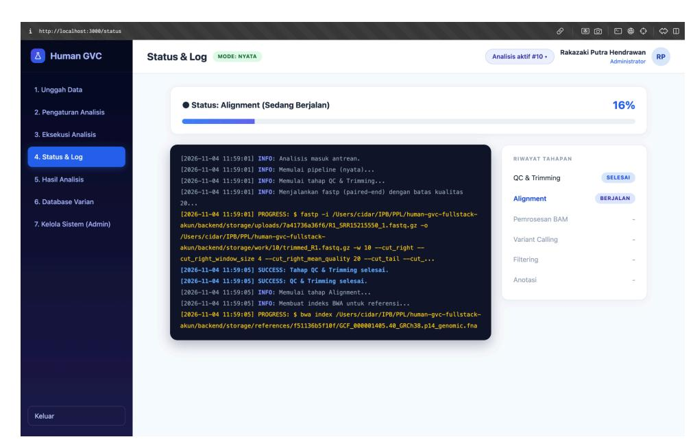

Gambar 1.4.3.3 Tangkapan layar pelaksanaan tahap QC & Trimming, Alignment, dan Pemrosesan BAM

#### **1.4.4 Tahap Variant Calling, Filtering, dan Anotasi**

Pada minggu ke-9 dikerjakan Issue Pipeline Utama: #18 untuk tahap Variant Calling, Filtering, dan Anotasi beserta pemetaan parameter. Tujuannya menyediakan tiga tahap inti bioinformatika pada pipeline nyata yang menghasilkan berkas vcf\_akhir dari BAM terurut dan terindeks. Pekerjaan ini merujuk FR-05, FR-06, FR-16, dan BR-04 pada SKPL serta komponen Workflow Engine pada Desain Modular. Pada minggu ke-8 mode nyata sudah ditulis tetapi belum pernah dijalankan pada data sekuens, sehingga seluruh pemeriksaan pada subbagian ini dilakukan pada data uji kecil dan bukan pada genom manusia penuh. Setiap tahap dirancang sebagai fungsi jalankan (ctx, sh) pada berkas tersendiri di backend/app/pipeline/stages/ dan membaca serta menulis keluaran antartahap melalui kamus ctx.berkas. Rangkuman ketiga tahap disajikan pada Tabel [1.4.4.1.](#page-45-1)

Tabel 1.4.4.1. Ringkasan tahap Variant Calling, Filtering, dan Anotasi

| Tahap | Perangkat | Masukan 
(ctx.berkas)
 | Keluaran 
(ctx.berkas)
 | Rujukan |
|-------|-----------|-----------------------------|------------------------------|---------|

| mpileup dan                         |           |
|-------------------------------------|-----------|
| call, disertai                      |           |
| normalisasi alel                    |           |
| vcf_mentah                          | FR-05,    |
| Filtering bcftools view vcf_mentah, |           |
| vcf_filter                          | FR-05,    |
| Anotasi bcftools                    |           |
| vcf_akhir                           | (bila     |
| anotasi                             | dilewati, |
| sama                                | dengan    |

## **Pemetaan Parameter**

Parameter yang dapat diubah pengguna harus benar-benar memengaruhi hasil analisis (FR-06, BR-04). Karena itu dibuat dokumen docs/PEMETAAN\_PARAMETER.md yang memetakan setiap parameter SKPL ke flag atau ekspresi perangkat pada tahap yang bersangkutan, lengkap dengan alasannya. Isi dokumen tersebut disajikan pada Tabel 1.4.4.2 . Rentang nilai pada tabel merupakan asumsi implementasi yang sudah dicatat pada minggu ke-8 karena SKPL tidak menetapkan angka.

Tabel 1.4.4.2 Pemetaan parameter SKPL ke perangkat

| Nama di basis |            |
|---------------|------------|
| Flag          | atau       |
| i 99%)        |            |
| ndow_size     | 4          |
| <val>         | -q         |
|               | ( sliding  |
|               | window )   |
|               | dari ujung |

|   |                          |               |                            |                         | error tinggi tanpa | dipangkas membuan                          |
|---|--------------------------|---------------|----------------------------|-------------------------|--------------------|--------------------------------------------|
|   |                          |               |                            |                         | g                  | read secara prematur (K4/R1)               |
| l | (Min                     |               |                            |                         |                    |                                            |
|   |                          | kedalaman_min | 10x 1                      |                         |                    |                                            |
|   | Kedala man Minima Depth) |               | sam pai                    | FMT/DP Filter ing <val> | >= posisi oleh n   | Menjamin varian didukung kedalama pembacaa |
|   |                          |               |                            |                         | n untuk kan        | yang cukup membeda variasi biologis        |
|   |                          |               |                            |                         | nyata galat        | vs PCR/seku ensing. Dipetakan              |
|   |                          |               |                            |                         | ke el              | tag per-samp FMT/DP                        |
| g | (Min                     |               |                            |                         |                    |                                            |
|   |                          | qual_min      | 30                         |                         |                    |                                            |
|   | Batas QUAL Filterin      |               | (Q30 sam = pai             | QUAL Filter ing <val>   | >= led             | Phred-sca probabilit                       |
|   | QUAL)                    |               | proba bilitas varian benar |                         | y posisi ar        | bahwa tersebut benar-ben polimorfi         |

k. Ambang ≥ 30 adalah batas standar germline variant filtering

Temuan penting pada pemetaan ini adalah pemetaan Batas Kualitas Pemangkasan ke fastp -q pada kode lama. Pemetaan yang tepat diputuskan bersama Project Manager (K4) dan dicatat sebagai P-35 pada Lampiran 4.4.

#### Variant Calling

Tahap Variant Calling menjalankan bcftools mpileup untuk menghitung pileup dari BAM terhadap referensi, lalu bcftools call untuk memanggil varian. Hasilnya ditulis sebagai vcf\_mentah. Pada kode awal, fungsi parse\_vcf hanya membaca alel ALT pertama sehingga varian multi-alel akan hilang tanpa disadari (R9). Untuk mengatasinya direncanakan normalisasi dengan bcftools norm -myang memecah baris multi-alel menjadi baris biner sebelum berkas diteruskan ke tahap berikutnya (P-42).

## **Filtering**

Tahap Filtering menerapkan qual\_min dan kedalaman\_min pada vcf\_mentah sehingga menghasilkan vcf\_filter. Ekspresi filter pada kode awal belum terverifikasi, terutama pilihan antara FMT/DP dan INFO/DP untuk kedalaman (R8). Karena itu ekspresi diperiksa terlebih dahulu terhadap keluaran bcftools yang sebenarnya sebelum diterapkan (P-41). Tahap ini juga mencatat jumlah varian sebelum dan sesudah penyaringan ke log proses sehingga pengaruh parameter dapat dilihat pada Status & Log.

#### **Anotasi**

Tahap Anotasi menempelkan informasi dari basis data anotasi berformat VCF ke vcf\_filter menggunakan bcftools annotate dan menghasilkan vcf\_akhir. Terdapat tiga hal yang ditangani pada tahap ini. Pertama, nama kromosom pada basis data anotasi dapat berbeda dari referensi, misalnya 1 dan chr1, sehingga anotasi tidak menempel tanpa pesan kesalahan (R10). Penanganannya adalah pemetaan nama kontig dengan opsi --rename-chrs berdasarkan kecocokan kontig dan peringatan pada log bila tidak ada kontig yang cocok (P-43). Kedua, kode awal hanya mengambil nama gen dari INFO GENE= atau GENEINFO= (R11), sehingga pengambilan nama gen disesuaikan dengan INFO yang benar-benar ada pada berkas anotasi (P-44). Isi INFO yang dipakai adalah ##INFO=<ID=GENE,Number=1,Type=String,Description="Gene Symbol">. Ketiga, format GTF dan GFF berada di luar cakupan minggu ini sehingga tahap melewatinya dengan keterangan jelas pada hasil (P-52, K5). Perilaku ini sejalan dengan UC-03 alur alternatif 3 dan AC-16 yang mengizinkan analisis selesai tanpa anotasi disertai keterangan.

## **Cuplikan perintah**

PROGRESS: \$ bcftools mpileup ... | bcftools call -mv ... | bcftools norm -m- ..

# **Bukti**

Bukti yang dirujuk pada subbagian ini disajikan pada Tabel 1.4.4.3 dan dirujuk dari paragraf terkait.

Tabel 1.4.4.3 Daftar bukti subbagian 1.4.4

| Kode  | Isi                                              | Status       |
|-------|--------------------------------------------------|--------------|
| Y9-01 | Tabel pemetaan parameter dari                    |              |
|       |                                                  | Sudah Teruji |
| Y9-02 | Perintah bcftools tiap tahap                     | Sudah Teruji |
| Y9-03 | Contoh baris VCF sebelum dan sesudah anotasi     | Sudah Teruji |
| Y9-04 | Log peringatan kontig tidak cocok (bila diuji)   | Sudah Teruji |
| Y9-05 | Jumlah varian sebelum dan sesudah filtering dari |              |
|       |                                                  | Sudah Teruji |

#### **1.4.5 Ringkasan QC dan Alignment pada Antarmuka**

Bagian ini menjelaskan penyimpanan dan penampilan ringkasan hasil QC dan alignment pada antarmuka, yang merealisasikan FR-14 dan FR-15. Pada minggu 8 kedua ringkasan ini belum ada, sehingga pengguna hanya melihat bahwa analisis selesai tanpa mengetahui kualitas data dan jumlah reads yang berhasil dipetakan. Alurnya dimulai dari berkas keluaran perangkat, yaitu fastp.json dari tahap QC & Trimming dan keluaran samtools flagstat dari tahap Pemrosesan BAM. Kedua berkas tersebut diurai menjadi ringkasan, disimpan

SQL ALTER TABLE analisis ADD COLUMN ringkasan JSONB DEFAULT NULL;

pada basis data, dikirim melalui API, lalu ditampilkan pada antarmuka. Bentuk ringkasan yang disimpan disajikan pada Tabel 15.

**Tabel 1.4.5.1** Bentuk ringkasan QC dan alignment

| Ringkasan | Isi            | Sumber     | Rujukan |
|-----------|----------------|------------|---------|
| qc        | reads_sebelum, |            |         |
|           |                | fastp.json | FR-14   |
| alignment | total_reads,   |            |         |

Penyimpanan ringkasan memerlukan satu kolom baru pada tabel analisis. Kolom tersebut dibuat melalui berkas migrasi 04\_ringkasan\_analisis.sql dengan nama ringkasan dan tipe JSONB, serta bernilai kosong secara bawaan. Migrasi memeriksa terlebih dahulu apakah kolom sudah ada sebelum menambahkannya sehingga aman dijalankan berulang kali. Tipe JSONB dipilih agar ringkasan kedua tahap dapat disimpan dalam satu kolom tanpa menambah banyak kolom baru. Perubahan ini dicatat pada Lampiran Perubahan Rancangan. Cuplikan perintah utama migrasi ditunjukkan pada Kode 3.

**Kode 3** Penambahan kolom ringkasan pada tabel analisis

Pengurai ringkasan dibuat pada berkas ringkasan.py dalam bentuk dua fungsi yang terpisah dari proses pipeline, sehingga dapat diuji sendiri. Fungsi ringkasan\_qc membaca bagian summary pada fastp.json, yaitu jumlah reads dan laju Q30 sebelum dan sesudah penyaringan. Laju Q30 yang berupa rasio diubah menjadi persen dan dibulatkan dua angka di belakang koma. Fungsi ringkasan\_alignment membaca teks flagstat, mengambil jumlah total reads dari baris in total, lalu jumlah reads teralign dan persentasenya dari baris mapped. Python if tahap == "qc\_trimming" and ctx.berkas.get("fastp\_json"): ctx.ringkasan["qc"] = ringkasan\_qc(ctx.berkas["fastp\_json"]) elif tahap == "bam\_processing" and ctx.berkas.get("flagstat"): ctx.ringkasan["alignment"] = ringkasan\_alignment(ctx.berkas["flagstat"])

Apabila berkas atau baris yang dibutuhkan tidak ditemukan, nilai yang dikembalikan adalah nol.

Pemanggilan pengurai dilakukan oleh engine pipeline segera setelah tahap yang bersangkutan selesai, seperti ditunjukkan pada Kode 4. Ringkasan QC diambil setelah tahap QC & Trimming dan ringkasan alignment diambil setelah tahap Pemrosesan BAM. Pada akhir analisis, ringkasan dari kedua tahap disimpan ke kolom ringkasan dalam satu proses bersama status selesai, kemudian API mengembalikannya pada detail analisis.

**Kode 4** Pengambilan ringkasan setelah tahap selesai

Contoh isi ringkasan dari satu analisis nyata pada data uji adalah sebagai berikut. Pada tahap QC & Trimming, jumlah reads sebelum dan sesudah penyaringan sama-sama 3500 dengan Q30 sebesar 100 persen pada kedua kondisi, artinya seluruh reads lolos penyaringan. Pada tahap alignment, dari 3500 reads seluruhnya teralign sehingga persentase teralign mencapai 100 persen. Nilai-nilai ini ditampilkan pada kartu ringkasan seperti pada Gambar 24.

**Gambar 24** Tangkapan layar kartu ringkasan QC dan alignment Selain kartu ringkasan, antarmuka mengalami beberapa penyesuaian lain agar sesuai dengan pipeline yang kini nyata. Perubahan tersebut dirangkum pada Tabel 16 dan dicatat pula pada Lampiran Perubahan Rancangan.

**Tabel 1.4.5.2** Perubahan antarmuka pada minggu 9

| ID Perubahan Minggu | 8 Minggu 9 Rujukan      |
|---------------------|-------------------------|
| P-46 Kartu          |                         |
| QC dan              |                         |
| Belum               | ada                     |
|                     | Kartu ringkasan tampil  |
|                     | dari data analisis      |
| P-47 Lencana        |                         |
| Mode                | pipeline                |
| tidak               | terlihat oleh           |
|                     | Lencana simulasi atau   |
|                     | nyata berdasarkan       |
|                     | endpoint kesehatan API  |
| P-48 Pesan          |                         |
| Pesan               | kegagalan               |
| ditampilkan         | apa                     |
|                     | Pesan kegagalan tahap   |
|                     | ditampilkan lebih jelas |

| P-49 Pesan      |                |
|-----------------|----------------|
| n awal          |                |
| Tidak ada Pesan | penolakan dari |
| pemeriksaan     | awal           |
| ditampilkan     | pada           |
| Eksekusi        | Analisis       |

Lencana mode pipeline ditambahkan karena pada mode simulasi engine mengisi ringkasan tiruan supaya kartu tetap dapat tampil. Dengan lencana ini pengguna dapat membedakan angka hasil perangkat sungguhan dari angka simulasi. Lencana mode nyata ditunjukkan pada Gambar 25, sedangkan kartu yang belum memiliki data pada tahap yang belum selesai menampilkan keterangan belum tersedia seperti pada Gambar 26. Pesan kegagalan tahap serta log nyata pada halaman Status & Log ditunjukkan pada Gambar 27. Mode data tiruan pada frontend juga diperbarui dengan menambahkan objek ringkasan berisi qc dan alignment pada data analisis contoh, sehingga bentuk datanya sama dengan respons backend.

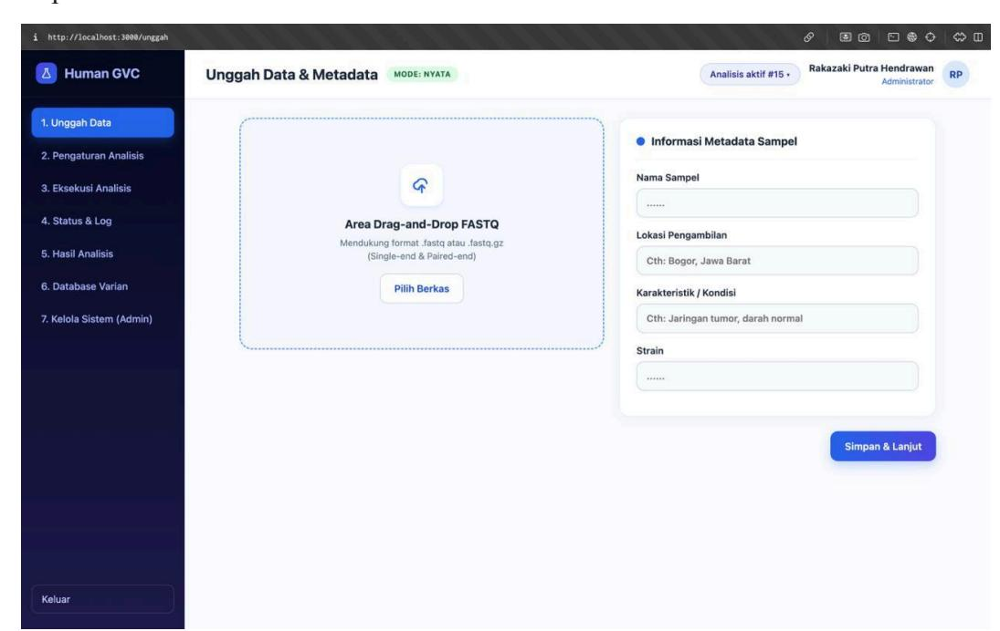

**Gambar 27** Tangkapan layar lencana mode pipeline

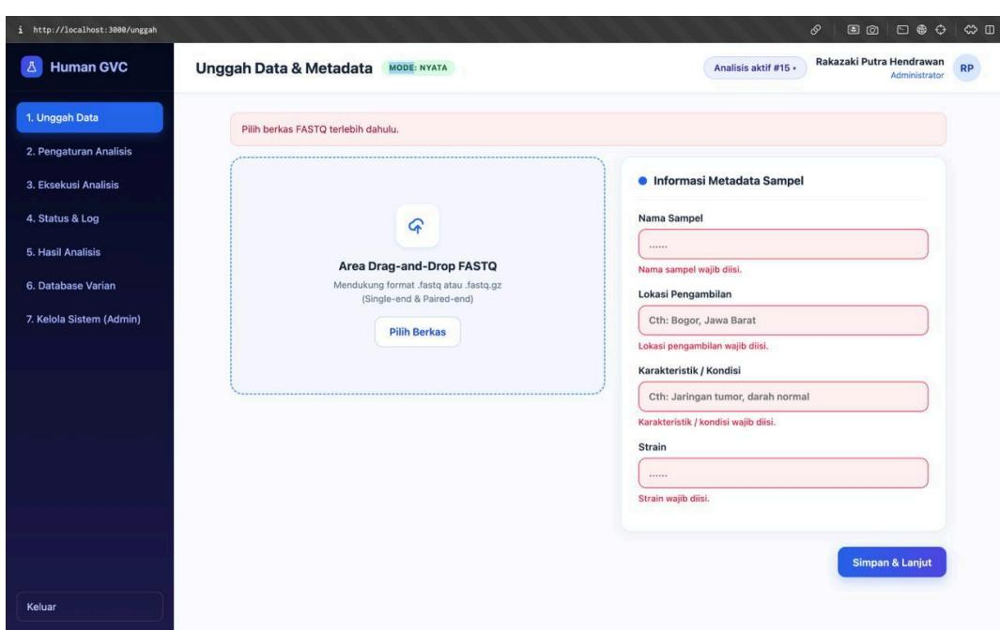

![Screenshot of the Human GVC system showing the 'Unggah Data & Metadata' section. It includes a header section with a 'Human GVC' button, a 'Unggah Data & Metadata' title bar, a 'MODE: NYATA' button, and a 'Rakazaki Putra Hendrawan Administrator' button. The 'Unggah Data & Metadata' section contains a detailed description of the Area Drag-and-Drop FASTQ system, including a logo icon, text 'Pilih berkas FASTQ terlebih dahulu.', a 'Pilih Berkas' button, and a 'Informasi Metadata Sampel' section with a 'Nama Sampel' field.]()

## **Gambar 28** Tangkapan layar ringkasan dengan keterangan belum tersedia

**Gambar 29** Tangkapan layar Status & Log dengan log pipeline dan pesan kegagalan tahap

#### **1.4.6 Data Uji, Validasi, dan Tes Integrasi**

Pengujian dirancang menggunakan data genom berukuran kecil dengan posisi varian yang telah diketahui sehingga hasil pipeline dapat dibandingkan dengan data kebenaran tanpa memerlukan penggunaan genom manusia berukuran penuh. Pelaksanaan pekerjaan ini mencakup pembuatan referensi sintetis, simulasi reads *paired-end* dan *single-end*, penyediaan basis data anotasi uji, serta pengembangan skrip untuk membandingkan hasil VCF dengan VCF kebenaran.

Pada tahap awal, disiapkan referensi genom mini sintetis dengan nama kontig chr21 dan panjang 10.000 bp (10 Kb). Penggunaan referensi sintetis berukuran kecil bertujuan mengurangi beban komputasi selama proses pengujian, terutama ketika pipeline menjalankan proses pengindeksan referensi dan pemetaan reads. Referensi tersebut dibangkitkan menggunakan komposisi basa dengan kandungan GC sekitar 42%. Dengan demikian, referensi yang digunakan merupakan sekuens sintetis untuk pengujian terkontrol, bukan sekuens kromosom 21 manusia yang diambil langsung dari genom GRCh38. Berdasarkan konfigurasi pada skrip tools/buat\_data\_uji.py, pembuatan referensi dilakukan secara deterministik menggunakan *seed* 42. Selanjutnya, skrip menyisipkan 20 varian SNP pada posisi yang telah ditentukan menggunakan *seed* 101. Posisi, basa referensi, dan basa alternatif setiap varian dicatat dalam berkas truth.vcf sebagai *ground truth* atau data kebenaran. Data tersebut digunakan sebagai acuan untuk mengevaluasi kesesuaian varian yang dihasilkan pipeline dengan varian yang sebelumnya disisipkan ke dalam sekuens donor.

Setelah proses penyisipan varian, dilakukan simulasi pembacaan sekuens dengan kedalaman yang dirancang sekitar 35× untuk dua jenis data, yaitu *paired-end* dan *single-end*. Data *paired-end* terdiri atas dua berkas FASTQ, yaitu sample\_R1.fastq.gz dan sample\_R2.fastq.gz, sedangkan data *single-end* disimpan dalam sample\_single.fastq.gz. Panjang setiap read ditetapkan sebesar 100 bp. Pembuatan reads menggunakan generator berbasis Python dengan *seed* 202 untuk *paired-end* dan *seed* 303 untuk *single-end*, sehingga proses pembentukan data dirancang dapat direproduksi dengan konfigurasi yang sama. Pada implementasi skrip, ukuran fragmen untuk *paired-end* dibangkitkan secara acak dalam rentang 220–320 bp. Hasil proses tersebut disimpan dalam direktori data\_uji/, bersama referensi dan VCF kebenaran. Berkas yang dihasilkan dari proses pembuatan data uji disajikan pada Tabel 1.4.6.1 berikut.

| Nama berkas                | Keterangan |           |                  |                    |                 |
|----------------------------|------------|-----------|------------------|--------------------|-----------------|
| ref.fa                     | Referensi  | genom     | sintetis         | dengan             | kontig          |
|                            | chr21      | sepanjang | 10.000           | bp.                |                 |
| truth.vcf                  | Berisi     | 20 varian | SNP              | yang               | disisipkan pada |
|                            | posisi     | yang      | telah diketahui. |                    |                 |
| sample_R1.fastq.gz         | Berkas     | reads     | pertama          | untuk              | data            |
| sample_R2.fastq.gz         | Berkas     | reads     | kedua            | untuk              | data paired-end |
| sample_single.fastq.gz     | Berkas     | reads     | untuk            | pengujian          | single-end      |
| anotasi_dbsnp.vcf.gz       | Basis      | data      | anotasi          | sintetis           | dengan nama     |
|                            | kontig     | yang      | sama             | seperti referensi. |                 |
| anotasi_beda_kontig.vcf.gz | Basis      | data      | anotasi          | sintetis           | dengan nama     |
|                            | kontig     | tanpa     | prefix           | chr.               |                 |

Selain referensi dan data sekuens, disiapkan dua berkas anotasi VCF sintetis untuk menguji kesesuaian proses anotasi pada tahap akhir pipeline. Berkas pertama, anotasi\_dbsnp.vcf.gz, menggunakan nama kontig yang sama dengan referensi, yaitu chr21. Berkas tersebut memuat ID varian dengan pola rs1000 sampai rs1019 serta informasi simbol gen sintetis, antara lain BRCA1, TP53, EGFR, KRAS, PTEN, dan CFTR. Berkas kedua, anotasi\_beda\_kontig.vcf.gz, menggunakan nama kontig tanpa prefix chr, yaitu 21. Penyiapan kedua berkas tersebut bertujuan menyediakan kondisi pengujian untuk melihat penanganan perbedaan penamaan kontig antara referensi genom dan basis data anotasi. Dengan adanya variasi tersebut, pengujian dapat digunakan untuk mengevaluasi mekanisme pemetaan nama kontig pada tahap Anotasi, termasuk penggunaan opsi --rename-chrs yang menjadi bagian pekerjaan WP-3. Informasi simbol gen pada

berkas tersebut merupakan anotasi sintetis yang dibuat untuk kebutuhan pengujian format dan pencocokan data, bukan bukti hubungan biologis sebenarnya antara varian dan gen.

Selain referensi dan data sekuens, disiapkan dua berkas anotasi VCF sintetis untuk menguji kesesuaian proses anotasi pada tahap akhir pipeline. Berkas pertama, anotasi\_dbsnp.vcf.gz, menggunakan nama kontig yang sama dengan referensi, yaitu chr21. Berkas tersebut memuat ID varian dengan pola rs1000 sampai rs1019 serta informasi simbol gen sintetis, antara lain BRCA1, TP53, EGFR, KRAS, PTEN, dan CFTR. Berkas kedua, anotasi\_beda\_kontig.vcf.gz, menggunakan nama kontig tanpa prefix chr, yaitu 21. Penyiapan kedua berkas tersebut bertujuan menyediakan kondisi pengujian untuk melihat penanganan perbedaan penamaan kontig antara referensi genom dan basis data anotasi. Dengan adanya variasi tersebut, pengujian dapat digunakan untuk mengevaluasi mekanisme pemetaan nama kontig pada tahap Anotasi, termasuk penggunaan opsi --rename-chrs yang menjadi bagian pekerjaan WP-3. Informasi simbol gen pada berkas tersebut merupakan anotasi sintetis yang dibuat untuk kebutuhan pengujian format dan pencocokan data, bukan bukti hubungan biologis sebenarnya antara varian dan gen.

Untuk mengevaluasi kesesuaian hasil *variant calling* terhadap data kebenaran, dikembangkan skrip tools/bandingkan\_vcf.py. Skrip ini digunakan untuk membandingkan VCF hasil pipeline dengan truth.vcf melalui pencocokan nama kontig, posisi varian, basa referensi, dan basa alternatif. Dalam proses pembandingan, prefix chr pada nama kontig dinormalisasi agar perbedaan penulisan nama kontig tidak langsung menyebabkan ketidakcocokan data. Mekanisme pembandingan menghasilkan tiga komponen utama, yaitu *True Positive* (TP), *False Positive* (FP), dan *False Negative* (FN). TP menunjukkan varian yang berhasil ditemukan oleh pipeline dan sesuai dengan VCF kebenaran. FP menunjukkan varian yang terdeteksi pada hasil pipeline tetapi tidak tercatat dalam VCF kebenaran, sedangkan FN menunjukkan varian yang terdapat dalam VCF kebenaran tetapi tidak berhasil terdeteksi oleh pipeline. Evaluasi dilakukan dengan menghitung nilai *recall* dan presisi. Recall menunjukkan proporsi varian yang terdapat dalam data kebenaran dan berhasil ditemukan oleh pipeline,

sedangkan presisi menunjukkan proporsi varian yang diprediksi oleh pipeline dan benar-benar sesuai dengan data kebenaran.

Tes integrasi merupakan bagian yang direncanakan untuk memastikan bahwa seluruh tahapan pipeline dapat bekerja secara berurutan, baik menggunakan data *paired-end* maupun *single-end*. Berdasarkan WP-5, pengujian seharusnya mencakup skenario keberhasilan pipeline, penanganan FASTQ yang rusak, perangkat bioinformatika yang tidak tersedia, referensi genom yang tidak ditemukan, serta kesesuaian hasil VCF terhadap *truth set*. Pengujian tersebut direncanakan menggunakan berkas backend/tests/test\_pipeline\_nyata.py dengan penanda @pytest.mark.nyata dan dijalankan melalui perintah pytest -m nyata.

## **1.4.7 Penerimaan dan Kesesuaian dengan SKPL**

Setelah seluruh paket kerja digabungkan ke branch integrasi, dilakukan uji penerimaan terhadap tujuh gerbang yang telah ditetapkan untuk menilai apakah pipeline utama sudah berjalan. Hasil penerimaan disajikan pada [Tabel 1.4.7.1](#page-58-1) dan seluruh gerbang dinyatakan terpenuhi.

Tabel 1.4.7.1 Hasil penerimaan gerbang G1 sampai G7

| Gerbang Kriteria Status Keterangan         |              |             |
|--------------------------------------------|--------------|-------------|
| G1 Analisis nyata melewati                 |              |             |
| enam tahap dari antarmuka                  |              |             |
| tanpa intervensi manual                    |              |             |
| Terpenuhi Analisis                         | dijalankan   | dari        |
| antarmuka                                  | dengan       | mode        |
| pipeline                                   | nyata        | pada data   |
| paired-end                                 | dan          | single-end, |
| berstatus                                  | selesai      |             |
| G2 Status & Log menampilkan                |              |             |
| keluaran nyata dan                         |              |             |
| kegagalan tahap ditangani                  |              |             |
| Terpenuhi Log menampilkan                  |              | keluaran    |
| perangkat                                  | tiap         | tahap,      |
| progres                                    | bergerak,    | dan         |
| kegagalan                                  | tahap        | berstatus   |
| gagal                                      | dengan pesan | jelas       |
| G3 Varian berasal dari VCF                 |              |             |
| bcftools dan sesuai data uji               |              |             |
| berkebenaran diketahui                     |              |             |
| Terpenuhi Varian                           | tersimpan    | dari VCF    |
| hasil                                      | bcftools     | dan         |
| dibandingkan                               |              | dengan data |
| uji,                                       | angkanya     | dijelaskan  |
| pada subbagian                             |              | 1.4.6       |
| G4 Ringkasan QC dan                        |              |             |
| alignment (FR-14 dan                       |              |             |
| FR-15) tampil dan tersimpan                |              |             |
| Terpenuhi Ringkasan                        |              | tampil di   |
| antarmuka,                                 | dijelaskan   | pada        |
| subbagian                                  | 1.4.5        |             |
| G5 Anotasi (FR-16) berjalan Terpenuhi Nama | gen terisi   | pada varian |

| Gerbang Kriteria            | Status    | Keterangan    |                      |
|-----------------------------|-----------|---------------|----------------------|
| dengan basis data           | anotasi   |               |                      |
|                             |           | yang          | teranotasi, dan jika |
|                             |           | anotasi       | dilewati             |
|                             |           | keterangannya | tercatat             |
| G6 Tes lama tetap lulus dan | tes       |               |                      |
| mode nyata lulus            | pada      |               |                      |
| minimal dua laptop          |           |               |                      |
|                             | Terpenuhi | Lima          | belas tes lama lulus |
|                             |           | dan           | tes mode nyata lulus |
|                             |           | pada          | dua laptop anggota   |
| G7 Dokumentasi menjalankan  |           |               |                      |
| dari nol dapat              | diikuti   |               |                      |
| anggota lain                |           |               |                      |
|                             | Terpenuhi | Dokumentasi   | dapat diikuti        |
|                             |           | anggota       | lain tanpa bantuan   |

Penilaian memakai Tabel 17 SKPL (Prioritas dan Traceability Matrix) sebagai acuan prioritas Must, Should, dan Could serta rujukan acceptance criteria dan kasus uji. Arsitektur mengacu pada Desain Modular, yaitu UI/API, Job Manager, Workflow Engine, Database, dan Storage, dengan tambahan Runner dan tahap terpisah di dalam proses API. Status aktual diisi hanya berdasarkan hasil gerbang penerimaan G1 sampai G7 yang dicatat pada bagian penerimaan oleh Project Manager. Keterlacakan *use case* disajikan pada Tabel 1.4.7.2 dan kebutuhan fungsional yang berubah disajikan pada Tabel 1.4.7.3.

Tabel 1.4.7.2. Keterlacakan use case

| UC Deskripsi      | Status akhir   |
|-------------------|----------------|
|                   | minggu 8       |
|                   | minggu 9       |
| UC-03 Menjalankan | analisis       |
| variant           | calling        |
|                   | pada mode      |
| Unggah,           | pengaturan,    |
| pemantauan,       | hasil,         |
| pencarian,        | dan            |
| pengelolaan       | akun           |
|                   | Sesuai Tabel 1 |
|                   | LKP minggu 8   |

Tabel 1.4.7.3. Keterlacakan kebutuhan fungsional yang terdampak

| FR | Prioritas | Acceptance |          |          |
|----|-----------|------------|----------|----------|
|    |           |            | minggu 8 |          |
|    |           |            |          | minggu 9 |

| Must   | AC-05 | TC-05 |           |                 |           |
|--------|-------|-------|-----------|-----------------|-----------|
|        |       |       |           | Terpenuhi       | Terpenuhi |
| Must   | AC-06 | TC-06 |           |                 |           |
|        |       |       | Terpenuhi | Terpenuhi,      |           |
| Must   | AC-09 | TC-09 | Terpenuhi |                 |           |
|        |       |       |           | Isi hasil nyata | Terpenuhi |
| Should | AC-14 | TC-14 | Belum     |                 |           |
|        |       |       |           | Terpenuhi       | Terpenuhi |
| Should | AC-15 | TC-15 | Belum     |                 |           |
|        |       |       |           | Terpenuhi       | Terpenuhi |
| Should | AC-16 | TC-16 | Sebagian  | Terpenuhi       |           |
|        |       |       |           | untuk basis     |           |
|        |       |       |           | data anotasi    |           |
|        |       |       |           | VCF, GTF dan    |           |
|        |       |       |           | GFF di luar     |           |

Kebutuhan lain, termasuk FR-20 yang belum diimplementasikan, tidak berubah dibanding minggu ke-8. Perlu dicatat bahwa pengujian formal berdasarkan AC dan TC belum dilakukan pada minggu ini, karena yang dilakukan adalah validasi pipeline pada data uji kecil. Aturan bisnis BR-01 sampai BR-08 tetap ditegakkan seperti pada minggu ke-8. Tambahan pada minggu ini adalah pemeriksaan awal (preflight) pada POST /api/analisis/{id}/jalankan yang menolak permintaan bila perangkat atau berkas referensi tidak tersedia. Penegakan aturan bisnis disajikan pada Tabel 1.4.7.4.

Tabel 1.4.7.4. Penegakan aturan bisnis pada minggu 9

| Aturan Penegakan Perubahan                       |           | minggu   |            | 9         |
|--------------------------------------------------|-----------|----------|------------|-----------|
| BR-01 Analisis tanpa referensi atau data sekuens |           |          |            |           |
| ditolak dengan kode 422                          |           |          |            |           |
| Preflight                                        |           | menambah |            | penolakan |
| bila                                             | perangkat |          | atau       | berkas    |
| referensi                                        |           | tidak    | ada dengan | kode      |
| status                                           | 422       | dan      | pesan      | preflight |
| pipeline                                         | nyata     |          | gagal      |           |
| BR-02 Hanya berkas .fastq atau .fastq.gz         |           |          |            |           |
| Tidak                                            | berubah   |          |            |           |

| BR-03 | Dua berkas paired-end harus              |                  |            |
|-------|------------------------------------------|------------------|------------|
|       | berpasangan, dijaga pula oleh constraint |                  |            |
|       |                                          | Tidak berubah    |            |
| BR-04 | Parameter di luar rentang ditolak dengan |                  |            |
|       | kode 422                                 |                  |            |
|       |                                          | Pemetaan ke      | perangkat  |
|       |                                          | didokumentasikan | (Tabel Y2) |
| BR-05 | Analisis non-draf atau terkunci tidak    |                  |            |
|       | dapat diubah                             |                  |            |
|       |                                          | Tidak berubah    |            |
| BR-06 | Publikasi hanya untuk status selesai     | Tidak berubah    |            |
| BR-07 | Analisis milik pengguna lain dijawab 404 | Tidak berubah    |            |
| BR-08 | Analisis melewati masa retensi           |                  |            |
|       | disembunyikan, penghapusan fisik belum   |                  |            |
|       |                                          | Tidak berubah    | (penegakan |

# **2. Persentase Penyelesaian dan Target Berikutnya**

## **2.1 Minggu 6**

Persentase penyelesaian sistem saat laporan ini dibuat diperkirakan sebesar 7% dari keseluruhan proyek, mencakup penyiapan repository dan penyusunan skema basis data untuk seluruh entitas data pada SKPL.

Target pekerjaan pada minggu berikutnya adalah inisialisasi kerangka frontend dan backend, meliputi pembuatan struktur tampilan sesuai desain high-fidelity serta penyambungan awal antara frontend, backend, dan basis data, sehingga aplikasi dapat dijalankan secara utuh di lingkungan pengembangan lokal. Untuk detail lebih jelas kami sertakan tabel matriks pengerjaan secara lengkap dari minggu ke-6 sampai minggu ke-11.

Tabel 2.1.1 Target pekerjaan

| Pertemuan | Fokus (dari modul)           | Bobot | Kumulatif |
|-----------|------------------------------|-------|-----------|
| 6         | Setup repo dan pembuatan     |       |           |
|           | skema database               |       |           |
|           |                              | 7%    | 7%        |
| 7         | Pembuatan kerangka FE/BE     | 25%   | 32%       |
| 8         | Pengintegrasian BE, FE, dan  |       |           |
|           | Database                     | 20%   | 52%       |
| 9         | Pipeline utama bisa berjalan | 18%   | 70%       |
| 10        | Fitur tambahan bisa jalan    | 15%   | 85%       |
| 11        | Pengujian/ testing software  | 15%   | 100%      |

#### **2.2 Minggu 7**

Persentase penyelesaian sistem saat laporan ini dibuat diperkirakan sebesar 32% dari keseluruhan proyek, mencakup penyiapan repository, skema basis data, serta kerangka frontend dan backend yang telah tersambung dengan basis data. Sesuai [Tabel](#page-62-2) 2.1.1, target pekerjaan minggu berikutnya adalah pengintegrasian backend, frontend, dan basis data, meliputi penyesuaian tampilan dengan desain high-fidelity, autentikasi, serta alur unggah sampel dari antarmuka hingga tersimpan pada basis data.

## **2.3 Minggu 8**

Persentase penyelesaian sistem saat laporan ini dibuat diperkirakan sebesar 52% dari keseluruhan proyek, mencakup penyiapan repository, skema basis data, kerangka frontend dan backend, serta pengintegrasian ketiganya sehingga alur utama dari unggah data hingga penyajian hasil dan pencarian varian dapat digunakan. Sesuai [Tabel](#page-62-2) 2.1.1, target pekerjaan minggu berikutnya adalah menjalankan pipeline utama secara nyata, meliputi pemasangan perangkat fastp, BWA, SAMtools, dan BCFtools, serta penyiapan berkas referensi dan data FASTQ berukuran kecil untuk uji. Pengujian mode eksekusi nyata hingga hasil varian tersimpan pada basis data, pemeriksaan kesesuaian penamaan kromosom antara referensi genom dan basis data anotasi, serta pengujian pengiriman email verifikasi menggunakan layanan SMTP. Pekerjaan tersebut sekaligus melengkapi kebutuhan yang saat ini belum terpenuhi sepenuhnya, yaitu FR-14 (pemeriksaan kualitas dan trimming), FR-15 (ringkasan alignment), dan FR-16 (anotasi varian).

#### **2.4 Minggu 9**

Persentase penyelesaian kumulatif pada akhir minggu 9 adalah 70 persen. Angka ini diperoleh dari penambahan bobot minggu 9 sebesar 18 persen terhadap capaian minggu 8 sebesar 52 persen. Dasarnya adalah gerbang G1 sampai G7 telah terpenuhi, yaitu pipeline nyata sudah berjalan dari antarmuka sampai hasil tersimpan di basis data, ringkasan QC dan alignment sudah tampil, serta anotasi sudah berjalan. Sisa pekerjaan berupa fitur tambahan pada minggu 10 dan pengujian perangkat lunak pada minggu 11.

Target minggu 10 adalah fitur tambahan dapat berjalan dengan bobot 15 persen sehingga capaian kumulatif menjadi 85 persen. Pekerjaan yang direncanakan antara lain halaman riwayat akses untuk FR-13, visualisasi hasil untuk FR-20, pengujian pengiriman email verifikasi melalui Gmail SMTP, penghapusan data yang melewati masa retensi pada BR-08, dan fitur pembatalan analisis yang sedang berjalan.

# **3. Kesimpulan Mingguan**

#### **3.1 Minggu 6**

Secara keseluruhan, pelaksanaan kegiatan pada minggu ke-6 proyek Human GVC telah berhasil mencapai target inisialisasi awal pembangunan sistem secara menyeluruh. Pengelolaan kolaborasi tim dimantapkan melalui konfigurasi repositori GitHub dengan alur pengerjaan berbasis branch dan pull request. Pada aspek arsitektur data, skema basis data PostgreSQL telah dirancang dan diimplementasikan secara terstruktur untuk mendukung kebutuhan fungsional sistem, mencakup penambahan kolom pendukung pada entitas utama serta pembuatan tabel log\_proses guna mencatat alur eksekusi analisis secara detail. Implementasi skema ini juga telah melalui pengujian awal menggunakan skrip DDL SQL untuk memastikan integritas data dan aturan bisnis berjalan dengan baik. Berdasarkan capaian kumulatif sebesar 7%, proyek ini siap dilanjutkan ke tahap berikutnya yang berfokus pada inisialisasi kerangka frontend dan backend, dilanjutkan dengan pengintegrasian komponen utama hingga pengujian akhir sistem sesuai matriks perencanaan proyek.

#### **3.2 Minggu 7**

Pelaksanaan kegiatan pada minggu ke-7 proyek Human GVC telah menghasilkan kerangka frontend dan backend yang dapat dijalankan di lingkungan pengembangan lokal dan tersambung dengan basis data PostgreSQL. Backend menyediakan endpoint dasar untuk pemeriksaan status sistem, sampel, analisis, dan log proses, sedangkan frontend menyediakan tata letak, navigasi, dan halaman awal yang memanfaatkan endpoint tersebut. Pengerjaan dikelola melalui issue, GitHub Project, dan pull request sesuai alur yang ditetapkan pada minggu ke-6. Berdasarkan capaian kumulatif sebesar 32%, proyek siap dilanjutkan ke tahap pengintegrasian BE, FE, dan basis data.

#### **3.3 Minggu 8**

Pelaksanaan kegiatan pada minggu ke-8 proyek Human GVC telah menghasilkan aplikasi yang frontend, backend, dan basis datanya terintegrasi dan dapat dijalankan di lingkungan pengembangan lokal. Backend menyediakan 29 endpoint untuk autentikasi, unggah sampel, pengelolaan referensi, siklus analisis, pencarian varian, dan pengelolaan pengguna, sedangkan frontend menyediakan 12 halaman yang mengikuti desain high-fidelity beserta halaman pendukung akun, serta pengiriman email verifikasi yang sudah diuji menggunakan layanan SMTP sesungguhnya. Seluruh data tersimpan pada PostgreSQL dan berkas besar disimpan pada folder penyimpanan, sesuai pembagian pada Desain Modular. Aturan bisnis BR-01 sampai BR-07 telah ditegakkan, sedangkan BR-08 baru sebatas menyembunyikan analisis yang melewati masa retensi. Kendala utama pada minggu ini adalah eksekusi pipeline yang masih berupa simulasi karena perangkat bioinformatika dan berkas referensi bawaan belum tersedia di lokal. Sejumlah perubahan dari SKPL dan desain high-fidelity yang muncul selama implementasi dicatat pada bagian 4.3. Berdasarkan capaian kumulatif sebesar 52%, proyek siap dilanjutkan ke tahap pipeline utama.

#### **3.4 Minggu 9**

Pada minggu 9 pipeline utama berhasil dijalankan secara nyata. Analisis dapat dimulai dari antarmuka web, melewati enam tahap menggunakan fastp, bwa, samtools, dan bcftools, lalu hasilnya tersimpan di basis data beserta ringkasan QC dan alignment. Seluruh gerbang penerimaan G1 sampai G7 telah terpenuhi. Kendala dan keterbatasan yang perlu dicatat adalah pipeline nyata baru diuji pada data uji berukuran kecil sehingga belum menggambarkan waktu dan kebutuhan memori pada genom manusia penuh, mode simulasi masih dipertahankan untuk pengujian cepat, dan anotasi baru mendukung basis data berformat VCF. Dengan capaian ini, kelompok siap melanjutkan ke minggu 10 untuk mengerjakan fitur tambahan.

# **4. Lampiran Perubahan Rancangan**

#### **4.1 Minggu 6**

Skema basis data dirancang berdasarkan SKPL Bab 8 Tabel 7, yang memuat 8 entitas beserta atribut utama dan primary key. Selama implementasi, ditemukan bahwa Tabel 7 hanya mendefinisikan atribut utama, sehingga belum cukup untuk mendukung seluruh use case, aturan bisnis, dan wireframe yang telah disepakati. Oleh karena itu dilakukan dua jenis perubahan, yaitu penambahan kolom pendukung pada entitas yang sudah ada dan penambahan satu tabel baru.

Seluruh atribut dan primary key pada Tabel 7 tetap dipertahankan dan tidak diubah. Nama primary key mengikuti SKPL (id\_pengguna, id\_sampel, id\_referensi, id\_analisis, id\_varian, id\_genotipe, id\_riwayat, id\_log).

#### **4.1.1 Perubahan 1: Penambahan Kolom Pendukung**

Kolom *foreign key* (misalnya id\_pengguna pada sampel dan analisis, id\_analisis pada varian) tidak dicantumkan karena merupakan konsekuensi relasi antar entitas, bukan atribut baru. Kolom tambahan disajikan pada Tabel [4.1.1.1.1.](#page-66-3)

Tabel 4.1.1.1.1 Kolom tambahan di luar SKPL tabel 7

| Entitas Kolom tambahan Rujukan | Alasan                           |
|--------------------------------|----------------------------------|
| Pengguna password_hash UC-01   | s.d. UC-07                       |
| (prakondisi                    | "telah                           |
| masuk"),                       | NFR-02                           |
|                                | Autentikasi pengguna: kata       |
|                                | sandi disimpan dalam bentuk      |
|                                | hash bcrypt                      |
| peran SKPL                     | Tabel 3;                         |
| wireframe                      | UC-07                            |
| (kolom                         | "Peran")                         |
|                                | Membedakan Peneliti dan          |
| aktif, dibuat_pada Keputusan   | desain Akun dinonaktifkan, bukan |
|                                | dihapus, agar jejak pada         |
|                                | log_akses tetap utuh             |
| Sampel tipe_baca FR-01,        | BR-03 Membedakan paired-end dan  |
|                                | single-end untuk validasi        |
|                                | pasangan berkas                  |
| Desain                         | Modular Bab                      |
| 2 (Storage)                    |                                  |
|                                | Basis data hanya menyimpan       |
|                                | lokasi berkas FASTQ, bukan       |

| Entitas Kolom tambahan Rujukan Alasan                |           |                  |
|------------------------------------------------------|-----------|------------------|
| Referensi jenis (genom atau                          |           |                  |
| FR-03; wireframe                                     |           |                  |
| UC-07 (kolom "Jenis                                  |           |                  |
| Tabel                                                | yang      | sama menampung   |
| genom                                                | referensi | dan basis        |
| data                                                 | anotasi   |                  |
| Desain Modular Bab                                   |           |                  |
| 2; UC-07                                             |           |                  |
| Lokasi                                               | berkas    | referensi dan    |
| pencatatan                                           |           | siapa yang       |
| Analisis id_sampel,                                  |           |                  |
| FR-03, FR-16 Menghubungkan                           |           | analisis         |
| dengan                                               | sampel    | dan basis data   |
| anotasi                                              | yang      | dipakai          |
| UC-04; wireframe                                     |           |                  |
| UC-04; NFR-05                                        |           |                  |
| Menampilkan                                          |           | tahap dan        |
| persentase                                           |           | progres          |
| UC-03 (alur alternatif                               |           |                  |
| 2 dan 3); NFR-08                                     |           |                  |
| Ringkasan                                            |           | penyebab gagal   |
| dan                                                  | catatan   | hasil (misalnya  |
| anotasi                                              | dilewati) |                  |
| terkunci FR-10, BR-05 Penguncian                     |           | hasil analisis   |
| yang                                                 | telah     | selesai          |
| dipublikasikan FR-11, BR-06 Penanda                  | bahwa     | hasil masuk      |
| ke basis                                             | data      | varian bersama   |
| Varian gen Wireframe UC-06                           |           |                  |
| berdasarkan ID, gen,                                 |           |                  |
| Mendukung                                            |           | pencarian varian |
| berdasarkan                                          |           | gen dari hasil   |
| Genotipe id_sampel Desain Modular; SDP               |           |                  |
| Tabel 8                                              |           |                  |
| Mengaitkan                                           |           | genotipe dengan  |
| sampel                                               | dan       | varian           |
| FR-09, FR-19 Atribut                                 | "lokasi   | berkas hasil"    |
| dipecah                                              | per       | format keluaran  |
| Log akses jenis_objek, id_objek FR-13, AC-13 Atribut | "objek    | yang diakses"    |
| direalisasikan                                       |           | sebagai jenis    |
| objek                                                | dan ID    | objek            |

## **4.1.2 Perubahan 2: Penambahan Tabel log\_proses**

Pada rancangan awal SKPL, basis data hanya memuat delapan entitas dengan catatan proses yang terbatas pada atribut analisis.log\_kesalahan. Namun, wireframe UC-04 dan kriteria penerimaan AC-07 menuntut perekaman log kronologis yang mendetail dan diperbarui secara berkelanjutan selama analisis berjalan, sehingga penggunaan satu kolom teks tidak lagi memadai. Untuk mengakomodasi kebutuhan fungsional tersebut, struktur basis data diperbarui dengan menambahkan entitas kesembilan, yaitu log\_proses, sebagaimana dijabarkan pada Tabel [4.1.2.1.](#page-68-1)

Tabel 4.1.2.1 Struktur tabel log\_proses.

| Kolom         | Tipe         | Keterangan                                                |
|---------------|--------------|-----------------------------------------------------------|
| id_log_proses | BIGINT (PK)  | Pengenal baris log                                        |
| id_analisis   | INTEGER (FK) | Analisis pemilik log, ikut terhapus jika analisis dihapus |
| waktu         | TIMESTAMPTZ  | Waktu kejadian                                            |
| tahap         | VARCHAR(30)  | Tahap pipeline terkait (boleh kosong untuk pesan umum)    |
| jenis_pesan   | VARCHAR(10)  | info, berjalan, berhasil, atau error                      |
| pesan         | TEXT         | Isi catatan proses                                        |

## **4.1.3 Dampak Perubahan**

Penambahan entitas dan pembaruan struktur basis data tersebut memberikan sejumlah implikasi terhadap komponen sistem secara keseluruhan. Rincian mengenai dampak dari perubahan rancangan ini terhadap berbagai aspek pengembangan, seperti kesesuaian spesifikasi awal, arsitektur basis data, implementasi backend, hingga tahapan pengujian, dijabarkan secara lengkap pada Tabel [4.1.3.1](#page-68-2) berikut.

Tabel 4.1.3.1 Dampak perubahan rancangan

| Aspek      |        | Dampak                                                              |
|------------|--------|---------------------------------------------------------------------|
| Kesesuaian | dengan |                                                                     |
|            |        | Seluruh atribut dan primary key Tabel 7 tetap ada. Kolom dan tabel  |
|            |        | tambahan bersifat pelengkap dan tidak mengubah fungsi entitas asli. |
| ERD        |        | Perlu diperbarui menjadi 9 entitas beserta kolom tambahan.          |

| Aspek     | Dampak                                                                 |
|-----------|------------------------------------------------------------------------|
|           | Worker menulis satu baris log_proses pada setiap kejadian tahap        |
|           | pipeline. Antarmuka memantau log dengan polling berdasarkan            |
| Pengujian | Skrip skema, data awal, dan contoh insert/select telah dijalankan pada |
|           | PostgreSQL 16 tanpa galat. Pelanggaran BR-01, BR-03, BR-05, BR-06,     |
|           | dan duplikasi email terbukti ditolak.                                  |

## **4.2 Minggu 7**

Pada implementasi kerangka, tidak ditemukan perubahan terhadap fungsi dan kebutuhan pada SKPL maupun skema basis data

## **4.3 Lampiran Perubahan Rancangan Minggu 8**

Selama proses integrasi dan implementasi pada minggu ke-8, ditemukan sejumlah kebutuhan dan penyesuaian yang belum sepenuhnya tercakup dalam rancangan sebelumnya. Perubahan tersebut meliputi penambahan struktur basis data untuk mendukung verifikasi email dan pengaturan ulang kata sandi, penambahan fitur pengelolaan akun mandiri, penyesuaian antarmuka berdasarkan desain high-fidelity, serta penetapan sejumlah asumsi teknis yang belum dirinci dalam SKPL. Seluruh perubahan perlu dicatat agar keterlacakan antara kebutuhan, rancangan, dan implementasi tetap terjaga. Status persetujuan setiap perubahan harus disesuaikan dengan hasil konfirmasi kepada Project Manager dan keputusan akhir tim.

## **4.3.1 Perubahan 1: Struktur Basis Data**

Implementasi fitur akun mandiri memerlukan penyesuaian struktur basis data PostgreSQL. Penyesuaian tersebut mencakup penambahan kolom verifikasi email pada entitas pengguna dan penambahan tabel untuk menyimpan informasi token keamanan. Perubahan pertama (P-01) adalah penambahan kolom pengguna.email\_terverifikasi dengan tipe data BOOLEAN NOT NULL DEFAULT FALSE. Kolom ini digunakan untuk menunjukkan apakah alamat

email pengguna telah diverifikasi. Berdasarkan rancangan perubahan, akun yang telah tersedia sebelum migrasi ditetapkan sebagai terverifikasi, sedangkan akun yang dibuat oleh administrator juga langsung ditandai terverifikasi. Akun hasil registrasi mandiri harus menyelesaikan proses verifikasi sebelum dapat digunakan untuk masuk. Ketentuan tersebut perlu dicocokkan dengan skrip migrasi dan implementasi autentikasi.

Perubahan kedua (P-02) adalah penambahan tabel token\_email untuk mendukung verifikasi email dan pengaturan ulang kata sandi. Tabel ini dirancang memiliki atribut id\_token sebagai primary key, id\_pengguna sebagai foreign key, jenis untuk membedakan token verifikasi dan reset kata sandi, token\_hash untuk menyimpan hash token, kedaluwarsa untuk waktu berakhirnya token, dipakai\_pada untuk mencatat penggunaan token, serta dibuat\_pada untuk mencatat waktu pembuatannya. Token asli tidak disimpan secara langsung; sistem menyimpan hash SHA-256 sesuai rancangan yang diberikan. Nama atribut, tipe data, batasan, dan relasi akhirnya harus mengikuti skrip migrasi yang benar-benar digunakan. Perubahan ketiga (P-03) berkaitan dengan prasyarat basis data dan data awal. Rincian perubahan ini perlu diperiksa pada skrip inisialisasi dan migrasi, termasuk kebutuhan ekstensi basis data serta data awal yang digunakan dalam lingkungan pengembangan.

## **4.3.2 Perubahan 2: Penambahan Fitur di Luar SKPL**

Selama implementasi, kebutuhan pengelolaan akun secara mandiri dikembangkan untuk melengkapi alur autentikasi pengguna. Perubahan P-04 menambahkan registrasi mandiri yang memungkinkan pengguna mendaftarkan akun menggunakan alamat email dari berbagai domain. Akun hasil registrasi memperoleh peran peneliti secara otomatis dan kata sandi harus memenuhi panjang minimum delapan karakter.

Perubahan P-05 menambahkan verifikasi email melalui tautan dengan token sekali pakai yang berlaku selama 24 jam. Setelah proses verifikasi berhasil, akun dapat digunakan tanpa memerlukan persetujuan administrator. Perubahan P-06 menyediakan fitur pengiriman ulang email verifikasi. Ketika pengguna meminta tautan baru, token sebelumnya dinyatakan tidak berlaku dan sistem memberikan respons umum sesuai rancangan fitur.

Perubahan P-07 menambahkan fitur lupa dan pengaturan ulang kata sandi melalui tautan token sekali pakai yang berlaku selama 60 menit. Berdasarkan catatan perubahan, pembukaan tautan pengaturan ulang kata sandi juga dapat memicu verifikasi email. Perilaku ini perlu dipastikan sesuai dengan implementasi aktual dan keputusan tim.

Perubahan P-08 menambahkan pembatasan percobaan atau *rate limiting* untuk mengurangi penyalahgunaan endpoint autentikasi. Batas yang dicatat adalah maksimal lima permintaan dalam 15 menit per alamat IP untuk registrasi, pengiriman ulang verifikasi, dan lupa kata sandi, serta maksimal sepuluh percobaan masuk. Data pembatasan disimpan di memori server sehingga dapat hilang ketika server dimulai ulang; hal ini merupakan keterbatasan implementasi yang perlu dinyatakan secara terbuka.

Perubahan P-09 menambahkan pengelolaan akun oleh administrator, termasuk melihat status verifikasi dan menghapus akun dalam kondisi tertentu. Penghapusan hanya diizinkan apabila akun tidak memiliki riwayat sampel, analisis, atau log akses. Apabila riwayat tersebut masih ada, akun perlu dinonaktifkan agar keterkaitan data tetap terjaga.

## **4.3.3 Perubahan 3: Penyesuaian terhadap Desain High-Fidelity**

Implementasi antarmuka disesuaikan dengan kebutuhan operasional yang ditemukan selama integrasi. Perubahan P-10 sampai P-22 mencakup penambahan halaman autentikasi dan halaman pendukung akun yang belum tercakup dalam rancangan visual awal, termasuk halaman masuk, registrasi, verifikasi email, lupa kata sandi, dan pengaturan ulang kata sandi.

Penyesuaian juga dilakukan pada halaman Pengaturan dengan menambahkan parameter Min QUAL, serta pada halaman Database Varian dengan menambahkan kolom QUAL untuk mendukung kebutuhan pencarian dan penyaringan varian. Alur pipeline ditampilkan dalam enam tahap, yaitu QC dan Trimming, Alignment, Pemrosesan BAM, Variant Calling, Filtering, dan Anotasi.

Selain itu, antarmuka menyediakan penanda analisis aktif pada riwayat dan pemilih analisis, modal detail varian untuk mendukung peninjauan hasil, serta penyesuaian tombol pembuatan analisis berdasarkan kondisi analisis yang ada. Pengguna peneliti juga dapat mengunggah referensi melalui halaman Pengaturan sesuai implementasi yang dicatat. Setiap penyesuaian perlu dicocokkan dengan desain high-fidelity dan nomor perubahan P yang tercantum dalam dokumen sumber.

#### **4.3.4 Perubahan 4: Penyesuaian terhadap Kerangka Minggu 7**

Perubahan P-23 dan P-24 mencakup penyesuaian kerangka aplikasi minggu ke-7 agar mendukung alur integrasi minggu ke-8. Penyesuaian dilakukan terhadap endpoint dan mekanisme pengiriman data sampel. Berdasarkan catatan implementasi, endpoint pengambilan informasi kolom sampel disesuaikan dengan kebutuhan antarmuka, sedangkan endpoint penambahan sampel menerima berkas FASTQ dan metadata dalam satu permintaan. Alur tersebut digunakan untuk membuat sampel sekaligus menyiapkan analisis berstatus draf. Rincian endpoint sebelum dan sesudah perubahan perlu dicocokkan dengan kode sumber serta kontrak API agar dokumentasi tidak menyatakan perubahan yang tidak terjadi.

#### **4.3.5 Keputusan Implementasi dan Asumsi**

Sejumlah keputusan teknis ditetapkan untuk memungkinkan aplikasi berjalan dalam lingkungan pengembangan. Perubahan P-25 sampai P-33 mencakup rentang parameter analisis, batas ukuran unggahan, penggunaan pipeline simulasi, serta keterbatasan autentikasi dan pengelolaan data. Rentang parameter yang dicatat adalah Min Quality sebesar 0–40, Min Depth sebesar 1–1000, dan Min QUAL sebesar 0–1000. Batas ukuran unggahan yang dicatat adalah 2048 MB untuk berkas FASTQ dan 4096 MB untuk berkas referensi. Rentang dan batas tersebut perlu diperlakukan sebagai keputusan implementasi apabila tidak dinyatakan secara eksplisit dalam SKPL.

Pipeline saat ini menggunakan mode simulasi yang menghasilkan data contoh karena perangkat bioinformatika dan berkas referensi yang dibutuhkan untuk eksekusi nyata belum tersedia atau belum dikonfigurasi sepenuhnya pada lingkungan pengembangan. Dengan demikian, keberadaan tahapan pipeline tidak dapat dianggap sebagai bukti bahwa analisis bioinformatika nyata telah berhasil dijalankan.

Terdapat pula sejumlah keterbatasan yang perlu dicatat. Pengiriman email melalui Gmail SMTP belum diverifikasi secara langsung apabila pengujian hanya dilakukan menggunakan mode pengembangan. Sesi masuk yang telah aktif tidak langsung berakhir setelah kata sandi diatur ulang dan masih dapat berlaku hingga batas sesi 12 jam. Respons registrasi yang menyatakan bahwa email sudah terdaftar berpotensi memungkinkan pihak luar menebak keberadaan akun. Selain itu, data *rate limiter* yang disimpan di memori server akan hilang ketika server dimulai ulang. Enkripsi data genom saat tersimpan, FR-15, FR-20, dan halaman riwayat akses juga dicatat sebagai bagian yang belum diimplementasikan. Status setiap butir P-25 sampai P-33 serta keputusan yang masih menunggu persetujuan tim perlu dicantumkan sesuai catatan keputusan aktual.

## **4.4 Lampiran Perubahan Rancangan Minggu 9**

Selama implementasi pipeline nyata pada minggu ke-9 ditemukan hal-hal yang belum tercakup dalam rancangan sebelumnya. Temuan utama adalah pemetaan parameter pemangkasan ke fastp -q yang ternyata merupakan ambang penyaringan read, kebutuhan tempat penyimpanan untuk ringkasan QC dan alignment (FR-14 dan FR-15), serta sejumlah risiko pada kode awal yang diduga dari pembacaan kode dan perlu dibuktikan melalui eksekusi. Perubahan dicatat dengan penomoran lanjutan dari minggu ke-8 mulai P-34. Kolom Status pada tabel di bawah mengikuti Daftar Perubahan saat draf ini disusun. Status Perlu-setuju berarti belum disepakati tim dan Rencana berarti belum tentu dikerjakan, sehingga seluruhnya harus diperbarui sesuai kenyataan sebelum laporan dikumpulkan.

# **4.4.1 Perubahan 1: Struktur Basis Data**

Perubahan pertama adalah penambahan satu kolom pada tabel analisis melalui berkas migrasi database/04\_ringkasan\_analisis.sql (P-34). Kolom ini menyimpan ringkasan QC dan alignment per analisis dalam bentuk JSONB karena FR-15 menuntut jumlah reads teralign ditampilkan. Migrasi ditulis idempoten

mengikuti gaya 03\_akun\_verifikasi.sql sehingga aman dijalankan dua kali. Rincian kolom disajikan pada Tabel 4.4.1.1.

Tabel 4.4.4.1. Kolom tambahan pada tabel analisis

| Kolom Tipe Isi        |             | Rujukan Alasan Status |
|-----------------------|-------------|-----------------------|
| ringkasan JSONB Kunci | qc berisi   | reads                 |
| sebelum               | dan         | sesudah               |
| serta                 | Q30 sebelum | dan                   |
| sesudah.              |             | Kunci                 |
| alignment             | berisi      | total                 |
| reads,                | reads       | teralign,             |
| dan persen            | teralign    |                       |
|                       |             | belum ada             |

Bentuk ringkasan di atas merupakan usulan dan dikonfirmasi dari keluaran asli fastp.json dan samtools flagstat. Atribut dan primary key pada Tabel 7 SKPL tidak berubah. ERD minggu ke-8 yang memuat 10 entitas diperbarui dengan kolom baru ini bila migrasi dipakai (Gambar Y1) dan cuplikan skrip migrasi dilampirkan pada Gambar sebagai bukti E9-01 dan E9-02. Konfirmasi migrasi dapat dijalankan dua kali tanpa galat.

# **4.4.2 Perubahan 2: Perubahan Engine dan Perilaku Tahap**

Perubahan kedua mencakup struktur kode pipeline dan perilaku tahap dibanding rancangan awal. Perubahan ini disajikan pada Tabel 4.4.2.1 dan sebagian besar bersumber dari risiko R1 sampai R13 pada kode awal. Hasil verifikasi tiap risiko ditulis hanya bila sudah terbukti melalui eksekusi.

Tabel 4.4.2.1. Perubahan engine dan perilaku tahap

| ID | Perubahan | Dari | Menjadi          | Alasan        | Rujukan | Status |
|----|-----------|------|------------------|---------------|---------|--------|
|    |           |      | Keputusan K4     | -q adalah     |         |        |
|    |           |      |                  | read dan      |         |        |
|    |           |      | Paket pipeline/  |               |         |        |
|    |           |      | dengan satu      |               |         |        |
|    |           |      | tahap per berkas |               |         |        |
|    |           |      |                  | Kerja paralel |         |        |

| Ditolak dengan     |              |
|--------------------|--------------|
| kode 422 dan       |              |
| pesan jelas,       |              |
| GET /api/health    |              |
| menambah versi     |              |
|                    | FR-05 Rencan |
| Dibuat sekali      |              |
| per referensi      |              |
| dengan kunci       |              |
| balapan            | dan          |
| indeks             | yang         |
|                    | FR-05 Rencan |
| Log proses Perinta |              |
| h dan              |              |
| bertahap dengan    |              |
| batas laju         |              |
| menuntut           | log          |
| selama             | proses       |
|                    | FR-07 Rencan |
| folder kerja       |              |
| Saat sukses dan    |              |
| saat gagal         |              |
| disk               | penuh        |
|                    | FR-05 Rencan |
| Min                | Depth        |
| dan                | Min          |
| QUAL               | harus        |
| Dipecah dengan     |              |
| bcftools norm      |              |
| ALT                | pertama      |
|                    | FR-09 Rencan |
| Pemetaan nama      |              |
| kontig dan         |              |
| peringatan di      |              |
| basis              | data         |
| anotasi            | dapat        |
| berbeda            | dari         |
|                    | FR-16 Rencan |
| nama gen           |              |
| = dan              |              |
| ene Symbol">       |              |
| Nama               | gen          |
| harus              | terisi       |
| dari               | berkas       |
| anotasi            | nyata        |
|                    | FR-16 Rencan |

| Alignment Read |              |
|----------------|--------------|
| , SAM          |              |
| ke disk        |              |
| Nama           | sampel       |
| penulisan      | SAM          |
| diganti        | pipa         |
|                | read group   |
|                | rusak dan    |
|                | FR-05 Rencan |

# **4.4.3 Perubahan 3: Perubahan Antarmuka**

Perubahan ketiga menyangkut antarmuka agar mencerminkan pipeline nyata, disajikan pada Tabel 4.4.3.1. Mode data tiruan (lib/mock.js) diperbarui agar bentuk datanya sama dengan respons baru, dan kontrak API (docs/API\_CONTRACT.md) diperbarui bila diperlukan. Tujuh layar desain di luar daftar ini tidak diubah.

Tabel 4.4.3.1. Perubahan antarmuka dibanding minggu 8

| ID Layar Minggu 8 Minggu | 9 Alasan Status      |
|--------------------------|----------------------|
| P-46 Hasil               |                      |
| Tidak ada                |                      |
| QC dan                   |                      |
| Kartu                    | ringkasan QC         |
| dan                      | alignment,           |
| dengan                   | keadaan              |
| belum                    | tersedia saat        |
| simulasi                 | atau tahap           |
| belum                    | selesai              |
| P-47 Header              |                      |
| atau layar               |                      |
| tidak terlihat           |                      |
| Lencana                  | mode                 |
| pipeline                 | (simulasi            |
| atau                     | nyata) dari          |
| GET                      | /api/health          |
|                          | antara hasil         |
|                          | simulasi dan         |
| P-48 Status &            |                      |
| tahap apa                |                      |
| Penampilan               | pesan                |
| kegagalan                | tahap                |
| yang                     | lebih jelas          |
| P-49 Eksekusi            |                      |
| tampil dari              |                      |
| Ditolak                  | dengan kode          |
| 422                      | dan pesan            |
| preflight                | pipeline             |
| nyata                    | gagal                |
|                          | Terkait P-37 Rencana |

# **4.4.4 Dampak Perubahan**

Dampak perubahan terhadap rancangan disajikan pada Tabel 4.4.4.1. Bagian yang bergantung pada hasil nyata diisi setelah gerbang penerimaan selesai.

Tabel 4.4.4.1. Dampak perubahan rancangan minggu 9

| Aspek                  | Dampak             |           |             |            |              |               |
|------------------------|--------------------|-----------|-------------|------------|--------------|---------------|
| Kesesuaian dengan SKPL | Atribut            | dan       | primary key | Tabel      | 7 tidak      | diubah dan    |
| kolom                  | baru               | bersifat  |             | pelengkap. | Status       | FR-05, FR-14, |
| FR-15,                 | dan                | FR-16     | berubah     | sesuai     | Tabel        | Y5.           |
| ERD Tetap              |                    | 10        | entitas     | dengan     | tambahan     | kolom         |
|                        | analisis.ringkasan |           | bila        | migrasi 04 | dipakai      |               |
| Arsitektur Job         | Manager            |           | dan         | Workflow   | Engine       | tetap berada  |
| dalam                  |                    | proses    | API (thread | pool),     | ditambah     | Runner        |
| dan                    | tahap              | terpisah. | Storage     | tetap      | berupa       | folder lokal. |
| Pipeline               | Berubah            | dari      | simulasi    | menjadi    | nyata        | pada data uji |
| kecil                  |                    | dengan    | parameter   |            | dipetakan ke | perangkat     |
| sesuai                 |                    | dokumen   | pemetaan.   |            |              |               |
| Antarmuka              | Penambahan         |           | kartu       | ringkasan  | dan          | lencana mode  |
| (P-46                  | dan                | P-47).    | Layar       | desain     | lain         | tidak berubah |

Usulan revisi SKPL bila gerbang G1 sampai G5 tercapai adalah mengubah status FR-05, FR-14, FR-15, dan FR-16 menjadi Terpenuhi, mencatat bahwa FR-09 kini berisi hasil nyata, menambahkan kasus uji untuk mode nyata, serta mencatat batasan baru berupa anotasi yang hanya mendukung VCF dan validasi yang dilakukan pada data sintetis kecil. Usulan ini disesuaikan dengan status aktual pada Tabel 4.4.4.1.