# **PERANCANGAN DESAIN INTERFACE DAN WIREFRAME**

#### **Dosen Pengampu:**

Prof. Dr. Eng. Wisnu Ananta Kusuma, S.T., M.T.

#### **Asisten Praktikum:**

Said Thaufik Rizaldi, S.Kom., M.Kom. Gilland Fausta Putra Achyar, S.Mat., M.Kom.

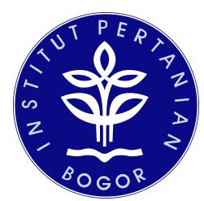

#### **Disusun Oleh Kelompok GenoSys (3):**

Dhafin Fasya Arifin G0401241017 Rakazaki Putra Hendrawan G0401241056 Yafits Mubarak G0401241001 Muhammad Fattha Akbarsyah G0401241008 Abid Ra'fad Aziz G0401241029

#### **MATA KULIAH PEMBANGUNAN PERANGKAT LUNAK BIOINFORMATIKA**

**PROGRAM STUDI BIOINFORMATIKA FAKULTAS MATEMATIKA DAN ILMU PENGETAHUAN ALAM INSTITUT PERTANIAN BOGOR 2026**

# **Daftar Isi**

| Daftar    |           |               |              |            |                                                                                                                       | Isi................................................................................................................. |                                                                                              | 1                                                            |
|-----------|-----------|---------------|--------------|------------|-----------------------------------------------------------------------------------------------------------------------|----------------------------------------------------------------------------------------------------------------------|----------------------------------------------------------------------------------------------|--------------------------------------------------------------|
|           | Gambaran  | Singkat       |              |            |                                                                                                                       |                                                                                                                      | Proyek....................................................................................2  |                                                              |
|           | Ringkasan | Pembelajaran  |              |            |                                                                                                                       |                                                                                                                      | Figma...........................................................................3            |                                                              |
| 1.        | Create    | your Figma    | account      |            | Dhafin                                                                                                                | Fasya                                                                                                                |                                                                                              | Arifin.........................................3             |
| 2.        | Navigate  | Figma         | Design       | files      | Dhafin                                                                                                                | Fasya                                                                                                                |                                                                                              | Arifin...................................... 3               |
| 3.        | Create    | a frame       | using frame  |            | Yafits                                                                                                                |                                                                                                                      |                                                                                              | Mubarak................................................ 4    |
| 4.        | Create    | the Button    | Figma        | Abid       |                                                                                                                       | Ra’fad                                                                                                               |                                                                                              | Aziz.................................................6       |
| 5.        | Auto      | Layout        | Fundamentals |            | Rakazaki                                                                                                              | Putra                                                                                                                |                                                                                              | Hendrawan............................. 7                     |
| 6.        |           | Components    | Fundamental  |            | Yafits                                                                                                                |                                                                                                                      |                                                                                              | Mubarak..................................................8   |
| 7.        | Prototype |               | Connection   | Muhammad   |                                                                                                                       | Fattha                                                                                                               |                                                                                              | Akbarsyah.................................9                  |
|           | Wireframe |               |              |            |                                                                                                                       | Low-Fidelity......................................................................................                   |                                                                                              | 11                                                           |
| 1.        | Wireframe | halaman       | unggah       | data       | dan                                                                                                                   | metadata                                                                                                             | sampel                                                                                       | (UC-01).................11                                   |
| 2.        | Wireframe | halaman       |              | pengaturan |                                                                                                                       | referensi                                                                                                            | dan parameter                                                                                | analisis (UC-02). 12                                         |
| 3.        | Wireframe | halaman       |              | eksekusi   | analisis                                                                                                              |                                                                                                                      |                                                                                              | (UC-03)............................................13        |
| 4.        | Wireframe | halaman       | status       | dan        | log                                                                                                                   | analisis                                                                                                             |                                                                                              | (UC-04)....................................14                |
| 5.        | Wireframe | halaman       | hasil        | analisis   |                                                                                                                       |                                                                                                                      |                                                                                              | (UC-05).................................................. 14 |
| 6.        | Wireframe | halaman       |              | database   | varian                                                                                                                | bersama                                                                                                              |                                                                                              | (UC-06)................................15                    |
| 7.        | Wireframe | halaman       | kelola       | akun       | dan                                                                                                                   | data                                                                                                                 | referensi                                                                                    | (UC-07).......................16                             |
| Desain    |           |               |              |            |                                                                                                                       | High-Fidelity............................................................................................            |                                                                                              | 18                                                           |
| 1.        | Wireframe | halaman       | unggah       | data       | dan                                                                                                                   | metadata                                                                                                             | sampel                                                                                       | (UC-01).................18                                   |
| 2.        | Desain    | high-fidelity |              | halaman    |                                                                                                                       | pengaturan                                                                                                           | referensi                                                                                    | dan parameter analisis                                       |
|           |           |               |              |            |                                                                                                                       | (UC-02)............................................................................................................  |                                                                                              | 20                                                           |
| 3.        | Wireframe | halaman       |              | eksekusi   | analisis                                                                                                              |                                                                                                                      |                                                                                              | (UC-03)............................................23        |
| 4.        | Wireframe | halaman       | status       | dan        | log                                                                                                                   | analisis                                                                                                             |                                                                                              | (UC-04)....................................25                |
| 5.        | Wireframe | halaman       | hasil        | analisis   |                                                                                                                       |                                                                                                                      |                                                                                              | (UC-05).................................................. 27 |
| 6.        | Wireframe | halaman       |              | database   | varian                                                                                                                | bersama                                                                                                              |                                                                                              | (UC-06)................................30                    |
| 7.        | Wireframe | halaman       |              | database   | Kelola                                                                                                                | Akun                                                                                                                 | dan Database                                                                                 | (UC-07).............32                                       |
| Integrasi |           | GitHub        |              |            |                                                                                                                       |                                                                                                                      | Project..................................................................................... | 36                                                           |
|           |           |               |              |            | Kesimpulan........................................................................................................... |                                                                                                                      |                                                                                              | 37                                                           |

# **Gambaran Singkat Proyek**

Human GVC (*Automated Web-Based Variant Calling Platform*) merupakan aplikasi berbasis web yang dirancang untuk mengintegrasikan proses analisis *variant calling* ke dalam satu alur kerja yang terstruktur dan otomatis. Sistem ini dikembangkan untuk membantu pengguna melakukan analisis data genomik tanpa harus menjalankan setiap tahapan menggunakan perangkat berbasis *command line* secara terpisah. Proses analisis dimulai dari pengunggahan data sekuens dan metadata sampel, penentuan referensi serta parameter analisis, hingga pemrosesan data dan penyimpanan hasil varian.

Pengguna utama sistem adalah peneliti atau pengguna analisis yang melakukan analisis terhadap data sekuens. Pengguna dapat mengunggah data FASTQ, memasukkan metadata sampel, menentukan referensi, mengatur parameter analisis, menjalankan analisis, memantau status dan log proses, serta melihat dan mengunduh hasil analisis. Selain pengguna analisis, sistem memiliki administrator yang bertanggung jawab terhadap pengelolaan akun pengguna dan data referensi.

Ruang lingkup Human GVC mencakup penerimaan data sekuens FASTQ, baik *single-end* maupun *paired-end*, metadata sampel, referensi FASTA, serta data anotasi. Sistem menyediakan validasi masukan, pengaturan parameter analisis, pelaksanaan *pipeline variant calling* secara otomatis, pemantauan proses, serta penyajian hasil dalam bentuk VCF, CSV, tabel varian, dan ringkasan analisis. Sistem berfokus pada pelaksanaan dan penelusuran proses analisis, bukan pada interpretasi klinis atau pemberian rekomendasi medis terhadap varian yang dihasilkan.

# **Ringkasan Pembelajaran Figma**

#### **1. Create your Figma account - Dhafin Fasya Arifin**

Pendaftaran akun Figma dilakukan melalui situs Figma dengan menggunakan alamat email atau akun Google. Dalam penerapannya pada proyek, seluruh anggota kelompok membuat akun Figma masing-masing menggunakan akun Google. Setelah akun berhasil dibuat, seluruh anggota kemudian diundang ke dalam satu *workspace* bersama yang digunakan untuk mengerjakan proyek sistem *variant calling*. Penggunaan satu *workspace* memungkinkan seluruh anggota kelompok bekerja pada lingkungan proyek yang sama dan memudahkan proses pengerjaan desain secara bersama-sama.

Figma menyediakan paket Starter secara gratis yang dapat digunakan oleh pengguna pemula, serta paket berbayar yang menyediakan fitur tambahan. Pada proyek ini, kelompok menggunakan paket Starter karena kebutuhan pengerjaan desain, mulai dari pembuatan *wireframe* hingga desain *high-fidelity*, telah dapat dilakukan menggunakan fitur dasar yang tersedia pada paket tersebut. Dengan demikian, kelompok dapat mengembangkan desain interface tanpa memerlukan paket berbayar.

Selain paket Starter, Figma juga menyediakan akses Professional plan secara gratis bagi mahasiswa dan pengajar yang memenuhi persyaratan setelah melakukan verifikasi status edukasi. Dalam penerapannya, anggota kelompok yang berstatus sebagai mahasiswa aktif melakukan verifikasi status edukasi untuk memperoleh akses tersebut. Akses ini digunakan untuk mendukung pengerjaan desain interface dan memanfaatkan fitur Figma yang diperlukan selama proses pengembangan proyek.

## **2. Navigate Figma Design files - Dhafin Fasya Arifin**

Figma memiliki beberapa bagian utama pada editor yang mendukung proses pembuatan dan pengelolaan desain. Toolbar digunakan untuk membuat berbagai elemen desain, seperti *frame*, bentuk, dan teks. *Left Sidebar* digunakan untuk mengelola *layer*, *pages*, dan *components*, sedangkan *Right Sidebar* digunakan untuk mengatur berbagai properti desain serta pengaturan *prototype*. Sementara itu, Canvas merupakan area kerja utama tempat pengguna menyusun dan mengatur elemen desain. Dalam penerapannya pada proyek, Toolbar digunakan

untuk membuat *frame* sebagai representasi setiap layar pada wireframe, khususnya pada halaman Status Proses *Pipeline*. *Left Sidebar* digunakan untuk mengatur struktur *layer*, seperti daftar *job*, sedangkan *Right Sidebar* digunakan untuk mengatur properti elemen yang menunjukkan status proses, seperti berjalan, selesai, dan menunggu.

Figma juga mendukung kolaborasi secara *real-time* serta pencadangan otomatis. File Figma bersifat *live*, sehingga beberapa pengguna dapat mengedit file yang sama secara bersamaan tanpa harus melakukan penyimpanan secara manual. Fitur ini diterapkan dalam proyek dengan memungkinkan anggota kelompok mengerjakan desain *wireframe* berdasarkan *use case* masing-masing secara bersamaan dalam satu file. Dengan demikian, setiap anggota dapat bekerja pada proyek yang sama tanpa harus membuat dan menggabungkan banyak versi file secara terpisah.

Selain itu, Figma menyediakan fitur *pages* yang digunakan untuk mengorganisasikan pekerjaan dengan memisahkan berbagai bagian atau tahapan desain. Penggunaan *pages* membantu menjaga agar elemen desain tidak menumpuk dalam satu area kerja sehingga proyek lebih mudah dikelola dan ditelusuri. Pada proyek ini, file dibagi menjadi beberapa *page*, yaitu *Wireframe*, *High-Fidelity*, dan *Components*. *Page Wireframe* digunakan untuk menyusun rancangan awal antarmuka, *page High-Fidelity* digunakan untuk mengembangkan tampilan antarmuka secara lebih detail, sedangkan *page Components* digunakan untuk menyimpan elemen yang digunakan secara berulang, seperti tombol dan label status. Pembagian tersebut membantu kelompok menjaga struktur file tetap terorganisasi selama proses pengembangan desain

### **3. Create a frame using frame - Yafits Mubarak**

Bagian ini membahas cara membuat struktur awal halaman *case study* untuk portofolio menggunakan fitur *Frame Preset* di Figma. *Case study* merupakan wadah untuk menampilkan sebuah proyek secara terstruktur, mulai dari permasalahan yang dihadapi, pendekatan atau solusi yang digunakan, hingga hasil akhir dari proyek tersebut. Melalui *case study*, seorang desainer dapat menunjukkan proses kerja dan kemampuan yang dimiliki kepada klien maupun pemberi kerja.

Dalam video dijelaskan bahwa sebuah halaman *case study* dapat terdiri dari beberapa elemen penting. Elemen pertama adalah *hero section*, yaitu bagian utama yang biasanya menggunakan teks yang menonjol dan latar belakang gambar untuk memberikan konteks mengenai proyek. Selanjutnya terdapat heading yang digunakan untuk membagi halaman menjadi beberapa bagian agar informasi lebih terorganisasi. Teks paragraf digunakan untuk memberikan penjelasan mengenai proyek dan kontribusi desainer, sedangkan gambar digunakan untuk menampilkan aset akhir maupun proses pengerjaan. Selain itu, terdapat *featured text block* yang dapat digunakan untuk menampilkan kutipan, wawasan, atau testimoni yang berkaitan dengan proyek. Elemen-elemen tersebut menjadi dasar dalam menyusun struktur halaman *case study* sebelum desain dikembangkan lebih lanjut.

Fitur utama yang diperkenalkan dalam video adalah *Frame Preset. Frame Preset* merupakan kumpulan ukuran *frame* yang telah disediakan oleh Figma berdasarkan berbagai kebutuhan desain, seperti ukuran untuk ponsel, tablet, desktop, presentasi, dan media sosial. Penggunaan *frame preset* membantu desainer karena tidak perlu menentukan atau menghafalkan sendiri ukuran layar yang umum digunakan. Selain mempermudah proses awal pembuatan desain, penggunaan ukuran yang sesuai juga membantu ketika desain akan digunakan dalam proses *prototyping*.

Proses pembuatan *frame* dilakukan dengan memilih *Frame Tool* pada Figma. Setelah itu, pengguna dapat melihat berbagai kategori *frame* yang tersedia pada sidebar sebelah kanan, kemudian memilih kategori yang sesuai, misalnya Desktop. Dari kategori tersebut, pengguna dapat memilih salah satu *preset* yang tersedia sebagai ukuran awal halaman. Setelah *frame* dibuat, nama *frame* dapat diubah agar lebih mudah dikenali dan membantu menjaga kerapian struktur pekerjaan, misalnya dengan memberikan nama seperti *Case Study Exploration*. Langkah ini membuat setiap bagian dalam proyek lebih mudah diidentifikasi ketika desain mulai menjadi lebih kompleks.

Video juga menjelaskan bahwa ukuran *frame* yang digunakan pada tahap awal tidak harus menjadi ukuran akhir. Jika konten yang dimasukkan ke dalam *frame* semakin panjang dan melebihi ruang yang tersedia, bagian bawah *frame*

dapat ditarik untuk memperluas area kerja. Dengan demikian, pengguna dapat menyesuaikan panjang halaman berdasarkan jumlah konten yang akan ditampilkan. Pada tahap ini, fokus pembelajaran masih berada pada penyusunan struktur dasar, bukan pada penentuan dimensi secara presisi. Pembahasan mengenai teknik pengaturan desain yang lebih lanjut akan dilakukan pada materi berikutnya.

## **4. Create the Button Figma - Abid Ra'fad Aziz**

Chapter ini membahas proses pembuatan elemen dasar *interface* berupa *button* di Figma, mulai dari elemen teks sederhana hingga menjadi komponen yang dapat digunakan secara berulang. Fokus utama pembelajaran adalah penggunaan *Auto Layout* dan *Component* dalam membuat elemen interaktif. Materi ini merupakan lanjutan dari pembelajaran mengenai *frame* dan tipografi, dengan tujuan menghasilkan tombol yang memiliki ukuran fleksibel, tampilan konsisten, dan dapat digunakan pada berbagai bagian desain.

Proses pembuatan tombol diawali dengan membuat layer teks menggunakan *Text Tool*. Teks kemudian diatur menggunakan font weight Semi Bold, ukuran 18, *line height* Auto, dan *alignment* Center. Setelah elemen teks selesai dibuat, layer tersebut dibungkus menjadi sebuah *frame* menggunakan fitur *Auto Layout* dengan pintasan Shift + A. Penggunaan *Auto Layout* membuat ukuran *frame* dapat menyesuaikan panjang teks di dalamnya secara otomatis sehingga tidak perlu menentukan ukuran secara manual. Setelah terbentuk, *frame* tersebut diberi nama *button* agar lebih mudah dikenali dan dikelola dalam struktur desain.

Setelah struktur dasar tombol terbentuk, dilakukan pengaturan tampilan dan properti *Auto Layout*. Warna teks diubah menjadi putih, sedangkan warna latar belakang *frame* diatur menjadi hitam melalui properti Fill. Tombol juga diberikan *Corner Radius* sebesar 8 untuk membuat sudutnya lebih halus. Pada pengaturan *resizing*, digunakan opsi *Hug Contents* agar ukuran tombol dapat mengikuti panjang teks yang terdapat di dalamnya. Selanjutnya, pengaturan jarak dan ruang di dalam tombol dilakukan melalui Gap dan Padding, yaitu *horizontal gap* sebesar 10, *horizontal padding* sebesar 16, dan *vertical padding* sebesar 10.

Pengaturan tersebut digunakan untuk menjaga proporsi dan konsistensi tampilan tombol.

Setelah tombol selesai dibuat, *frame* tersebut diubah menjadi *Main Component* menggunakan fitur *Create Component. Main Component* dapat dikenali melalui ikon empat berlian dan batas berwarna ungu. Dengan menjadikan tombol sebagai komponen, elemen tersebut dapat digunakan kembali sebagai *Instance* pada berbagai layar desain. Apabila terdapat perubahan pada gaya atau tampilan tombol, perubahan tersebut cukup dilakukan pada *Main Component* dan akan diterapkan pada *Instance* yang masih terhubung.

### **5. Auto Layout Fundamentals - Rakazaki Putra Hendrawan**

Video *Auto Layout Fundamentals* menjelaskan cara menggunakan fitur auto layout di Figma untuk membuat elemen antarmuka yang responsif dan fleksibel, seperti komponen tombol yang ukurannya dapat bertambah atau berkurang secara otomatis sesuai perubahan label teks. Materi ini menerangkan bahwa metode lama yang menggabungkan objek *rectangle, text layer,* dan *frame* secara terpisah menghasilkan desain yang kaku dan sulit disesuaikan jika isi label berubah di kemudian hari. Sebagai solusinya, video ini memperagakan cara menerapkan *auto layout* langsung pada *text layer* menggunakan pintasan tombol *Shift* A untuk membentuk *parent frame* otomatis dengan warna *fill* sebagai permukaan elemen.

Video ini juga menguraikan berbagai properti utama dalam *auto layout*, seperti pengaturan arah alur lapisan secara vertikal, horizontal, atau *wrap*, penyesuaian padding untuk menciptakan jarak visual, serta pengaturan *gap* dan *alignment* untuk menentukan jarak dan posisi elemen anak di dalam *parent frame*. Terkait mekanisme *resizing*, *parent frame* dapat disetel menjadi *Fixed* untuk ukuran tetap atau *Hug* untuk menyesuaikan ukuran elemen anak. Sementara itu, *child layer* dapat disetel menjadi *Fixed*, *Fill* untuk mengisi penuh *parent frame*, atau *Hug* jika memiliki elemen anak di dalamnya.

Penerapan kombinasi *resizing* ini dicontohkan pada komponen notifikasi aplikasi, di mana lebarnya diatur *Fixed* dan tingginya *Hug contents* agar lebar bingkai tetap konsisten namun tingginya fleksibel menampung teks yang panjang. Setelah elemen responsif berhasil dibuat, video ini memperagakan cara mengonversi elemen tersebut menjadi *main component* agar dapat digunakan kembali secara efisien pada berbagai tata letak desain lainnya. Di samping itu, disampaikan pula catatan pembaruan sistem per Mei 2025 di mana istilah *auto layout direction* kini disesuaikan menjadi *auto layout flow*.

### **6. Components Fundamental - Yafits Mubarak**

Video *Components Fundamentals: Figma Design for Beginners* menjelaskan konsep komponen dalam Figma sebagai elemen desain yang dapat digunakan kembali (*reusable*). Penggunaan komponen bertujuan untuk menghemat waktu, mengurangi pekerjaan yang berulang, serta menjaga konsistensi desain. Komponen dapat dibuat dari berbagai jenis elemen, mulai dari elemen sederhana seperti ikon dan tombol hingga elemen yang lebih kompleks seperti kartu (*card*) atau menu.

Dalam Figma, komponen terdiri atas dua bagian utama, yaitu *Main Component* dan *Instance*. *Main Component* merupakan komponen utama yang menjadi sumber atau acuan desain. Komponen ini ditandai dengan ikon empat berlian dan batas berwarna ungu. Sementara itu, *Instance* merupakan salinan dari *Main Component* yang digunakan dalam desain dan ditandai dengan ikon berlian kosong. *Main Component* dapat dibuat dengan memilih layer kemudian menggunakan fitur *Create component*, sedangkan beberapa objek dapat dibuat menjadi komponen secara bersamaan menggunakan *Create multiple components. Instance* dapat ditambahkan dengan menduplikasi komponen atau mengambilnya melalui tab Assets.

Salah satu kelebihan utama komponen adalah adanya hubungan antara *Main Component* dan *Instance*. Perubahan yang dilakukan pada *Main Component* akan diterapkan secara otomatis pada *Instance* yang masih terhubung. Meskipun demikian, *Instance* tetap dapat disesuaikan untuk kebutuhan tertentu. Beberapa properti seperti teks, *fill*, *stroke*, dan ukuran dapat diubah tanpa memutus hubungan dengan *Main Component*. Perubahan tersebut juga dapat dikembalikan menggunakan fitur *reset*. Jika

perubahan pada suatu *Instance* dianggap lebih sesuai dan ingin diterapkan sebagai desain utama, perubahan tersebut juga dapat didorong kembali ke *Main Component*.

Namun, tidak semua bagian *Instance* dapat diubah. Struktur komponen seperti penambahan atau penghapusan layer, perubahan urutan layer, dan beberapa pengaturan seperti *constraints* tetap mengikuti *Main Component*. Jika diperlukan perubahan yang lebih besar terhadap struktur tersebut, *Instance* dapat menggunakan fitur Detach instance. Fitur ini akan memutus hubungan antara *Instance* dan *Main Component*, sehingga *Instance* tidak lagi menerima pembaruan dari komponen utama. Setelah di-*detach*, komponen tersebut tidak dapat dihubungkan kembali secara otomatis. Jika *detach* dilakukan secara tidak sengaja, tindakan tersebut masih dapat dibatalkan menggunakan fitur Undo.

## **7. Prototype Connection - Muhammad Fattha Akbarsyah**

Konsep *Prototype Connections* digunakan untuk menghubungkan elemen interaktif, seperti tombol, dengan *frame* tujuan dalam sebuah prototipe. Koneksi dibuat dengan memilih elemen yang akan digunakan sebagai navigasi, kemudian mengklik dan menggeser ikon lingkaran atau tanda plus berwarna biru menuju *frame* tujuan sehingga terbentuk garis koneksi (*connection noodle*). Setelah koneksi dibuat, pengaturan interaksi dapat dilakukan melalui panel *prototype* pada *sidebar* sebelah kanan. Pengaturan tersebut mencakup *Trigger* sebagai pemicu interaksi, seperti *On click*, serta *Action* sebagai tindakan yang dilakukan setelah pemicu terjadi, misalnya berpindah ke halaman atau *frame* lain dan membuka tautan eksternal menggunakan *Open link*.

Selain membuat koneksi, pengguna juga dapat mengelola dan menghapus koneksi yang sudah dibuat apabila alur interaksi tersebut tidak lagi diperlukan. Koneksi dapat dihapus dengan menekan tombol *Delete* atau dengan menggeser garis koneksi menuju area kosong pada *canvas*. Setelah seluruh koneksi dibuat, alur prototipe dapat diuji menggunakan *Prototype Viewers*. Figma menyediakan *Inline viewer* untuk melakukan pratinjau secara langsung di dalam file serta *Presentation view* untuk menampilkan prototipe dalam tampilan penuh pada layar perangkat. Pengujian ini membantu memastikan bahwa setiap elemen navigasi dan perpindahan antarlayar berjalan sesuai dengan rancangan.

Dalam penerapannya pada proyek kelompok, terdapat dua konsep utama yang akan digunakan. Pertama, Koneksi Antarlayar (*Prototype Connections*) digunakan untuk menghubungkan setiap *frame* wireframe sehingga simulasi perpindahan halaman aplikasi dapat diuji sejak tahap awal pengembangan. Kedua, pengaturan *Trigger* dan *Action* digunakan untuk menentukan respons sistem ketika elemen navigasi diklik. Pengaturan tersebut dapat diterapkan untuk perpindahan antarmuka atau halaman maupun untuk membuka tautan eksternal sesuai kebutuhan rancangan prototipe.

# **Wireframe Low-Fidelity**

#### **1. Wireframe halaman unggah data dan metadata sampel (UC-01)**

Layar ini digunakan oleh Pengguna Analisis untuk mengunggah berkas sekuens FASTQ beserta metadata sampel sebelum data dapat digunakan pada tahap analisis berikutnya. Rancangan wireframe ditunjukkan pada [Gambar](#page-11-1) 1.

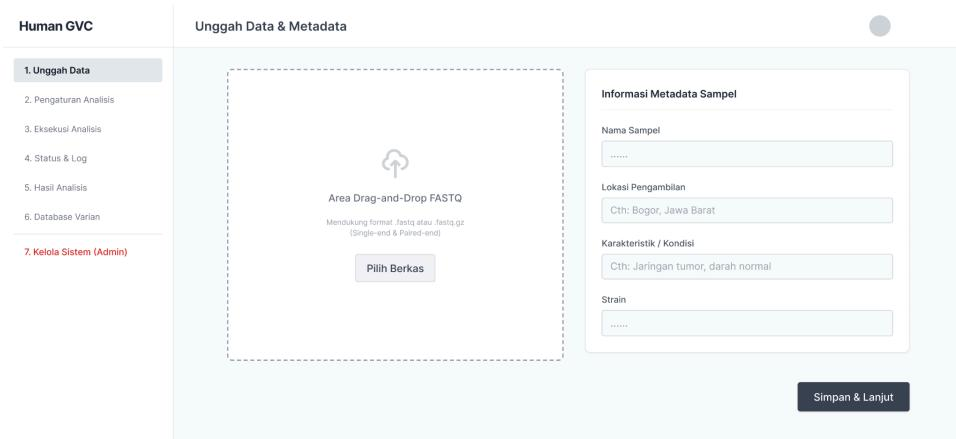

**Gambar 1** Wireframe low-fidelity (UC-01) - hasil rancangan kelompok Bagian pada [Gambar](#page-11-1) 1 dapat dijelaskan sebagai berikut:

- a. Navigasi sisi kiri menampilkan daftar tahapan alur analisis (Unggah Data, Pengaturan Analisis, Eksekusi Analisis, Status & Log, Hasil Analisis, Database Varian), dengan tahap yang sedang aktif ditandai secara visual.
- b. Area unggah berkas berupa *drag-and-drop* untuk berkas FASTQ, mendukung format .fastq dan .fastq.gz baik *single-end* maupun *paired-end*, dilengkapi tombol alternatif untuk memilih berkas secara manual.
- c. Formulir metadata sampel terdiri atas empat input: Nama sampel, Lokasi Pengambilan, Karakteristik/Kondisi, dan Strain, yang wajib diisi pengguna bersamaan dengan unggahan berkas.
- d. Tombol "Simpan & Lanjut" digunakan untuk menyimpan data yang telah diisi dan melanjutkan pengguna ke halaman Pengaturan Analisis (UC-02).

Setelah berkas dan metadata terisi lengkap, pengguna menekan tombol Simpan & Lanjut sehingga sistem menyimpan data unggahan dan mengarahkan pengguna ke halaman pengaturan referensi dan parameter analisis (UC-02).

# **2. Wireframe halaman pengaturan referensi dan parameter analisis (UC-02)**

Layar ini digunakan oleh Pengguna Analisis untuk menentukan referensi genom serta mengatur parameter analisis sebelum proses *variant calling* dijalankan. Rancangan wireframe ditunjukkan pada [Gambar](#page-12-1) 2.

**Gambar 2** Wireframe low-fidelity (UC-02) - hasil rancangan kelompok Bagian pada [Gambar](#page-12-1) 2 dapat dijelaskan sebagai berikut:

- a. Bagian Pengaturan Referensi memuat pilihan Genom Referensi (FASTA), dengan opsi bawaan sistem (GRCh38) atau unggahan referensi baru, serta pilihan Basis Data Anotasi.
- b. Bagian Parameter Analisis memuat nilai default yang disediakan sistem (Batas Kualitas Pemangkasan dan Kedalaman Minimal) yang dapat diubah oleh pengguna.
- c. Tombol "Simpan Draf" digunakan untuk menyimpan konfigurasi yang belum lengkap agar dapat dilanjutkan kemudian, sedangkan tombol "Konfirmasi Parameter" digunakan untuk menyimpan konfigurasi akhir dan melanjutkan ke tahap eksekusi analisis (UC-03).

Apabila referensi belum ditentukan atau nilai parameter berada di luar rentang yang diizinkan, sistem menampilkan pesan kesalahan pada layar yang sama dan menahan pengguna hingga input diperbaiki.

## **3. Wireframe halaman eksekusi analisis (UC-03)**

Layar ini digunakan oleh Pengguna Analisis untuk memeriksa kelengkapan konfigurasi sebelum menjalankan proses analisis variant calling. Rancangan wireframe ditunjukkan pada [Gambar](#page-13-1) 3.

**Gambar 3** Wireframe low-fidelity (UC-03) - hasil rancangan kelompok Bagian pada [Gambar](#page-13-1) 3 dapat dijelaskan sebagai berikut:

- a. Kartu Ringkasan Konfigurasi menampilkan status kelengkapan Data Masukan, Metadata, Referensi, dan Parameter yang telah diatur pada tahap sebelumnya.
- b. Diagram Alur Pemrosesan menampilkan tahapan pipeline yang akan dijalankan secara berurutan, yaitu QC, Trimming, Alignment, Variant Calling, dan Anotasi.
- c. Tombol "Mulai Jalankan Analisis" digunakan untuk memulai proses analisis apabila seluruh konfigurasi telah lengkap dan valid. Apabila salah satu komponen konfigurasi belum lengkap, sistem tidak mengizinkan analisis dijalankan dan menampilkan keterangan bagian yang belum lengkap pada layar yang sama. Setelah analisis dimulai, pengguna diarahkan ke halaman pemantauan status dan log analisis (UC-04).

### **4. Wireframe halaman status dan log analisis (UC-04)**

Layar ini digunakan oleh Pengguna Analisis untuk memantau status, progres, dan log dari analisis yang sedang atau telah dijalankan. Rancangan wireframe ditunjukkan pada [Gambar](#page-14-1) 4.

**Gambar 4** Wireframe low-fidelity (UC-04) - hasil rancangan kelompok Bagian pada [Gambar](#page-14-1) 4 dapat dijelaskan sebagai berikut:

- a. Kartu status menampilkan tahap proses yang sedang berlangsung beserta persentase progres analisis secara keseluruhan.
- b. Panel Riwayat Tahapan menampilkan status tiap tahap pipeline (QC & Trimming, Alignment, Variant Calling, Anotasi) yang diperbarui seiring berjalannya proses.
- c. Panel log menampilkan catatan proses secara kronologis lengkap dengan waktu dan jenis pesan (informasi, berhasil, sedang berjalan).

Apabila analisis mengalami kegagalan, sistem menampilkan status gagal beserta log kesalahan pada tahap terkait. Apabila log belum tersedia atau proses terhenti pada suatu tahap, sistem menampilkan keterangan kondisi tersebut pada layar yang sama.

## **5. Wireframe halaman hasil analisis (UC-05)**

Layar ini digunakan oleh Pengguna Analisis untuk melihat dan mengunduh hasil varian setelah analisis selesai dijalankan. Rancangan wireframe ditunjukkan pada [Gambar](#page-15-1) 5.

**Gambar 5** Wireframe low-fidelity (UC-05) - hasil rancangan kelompok Bagian pada [Gambar](#page-15-1) 5 dapat dijelaskan sebagai:

- a. Tiga kartu statistik ringkas menampilkan Total Varian, Rasio Ti/Tv, dan Rata-rata QUAL dari hasil analisis.
- b. Tabel Kandidat Varian menampilkan informasi tiap varian yang terdeteksi, meliputi kromosom, posisi, REF, ALT, dan nilai QUAL.
- c. Tombol "Unduh CSV" dan "Unduh VCF Akhir" digunakan untuk mengunduh hasil analisis dalam format masing-masing.

Halaman ini bersifat *read-only*, jika analisis belum selesai atau gagal, sistem tidak menampilkan hasil akhir dan menggantinya dengan keterangan status analisis pada layar yang sama.

## **6. Wireframe halaman database varian bersama (UC-06)**

Layar ini digunakan oleh Pengguna Analisis untuk mencari data varian pada basis data bersama berdasarkan ID, gen, posisi, kromosom, atau kualitas. Rancangan wireframe ditunjukkan pada [Gambar](#page-16-1) 6.

**Gambar 6** Wireframe low-fidelity (UC-06) - hasil rancangan kelompok Bagian pada [Gambar](#page-16-1) 6 dapat dijelaskan sebagai berikut:

- a. Bagian pencarian terdiri atas kolom pencarian berdasarkan ID, gen, atau posisi, dilengkapi filter Semua Kromosom dan Filter Kualitas (QUAL), serta tombol "Cari" untuk memproses permintaan.
- b. Tabel hasil menampilkan daftar varian yang sesuai kriteria, meliputi ID Analisis/Sampel, Kromosom, Posisi, Mutasi (REF>ALT), dan Pengunggah.
- c. Navigasi halaman (Prev/Next) beserta keterangan jumlah data digunakan untuk menelusuri hasil pencarian yang berjumlah banyak.

Apabila kriteria pencarian tidak valid, sistem menampilkan pesan kesalahan dan meminta kriteria diperbaiki. Apabila tidak ditemukan varian yang sesuai, sistem menampilkan keterangan bahwa hasil tidak tersedia. Apabila pengguna tidak memiliki hak akses terhadap suatu data varian, sistem menampilkan pesan kesalahan dan tidak menampilkan data tersebut.

## **7. Wireframe halaman kelola akun dan data referensi (UC-07)**

Layar ini digunakan oleh Administrator untuk mengelola akun pengguna serta data referensi sistem (genom referensi dan basis data anotasi). Rancangan wireframe ditunjukkan pada [Gambar](#page-17-0) 7.

**Gambar 7** Wireframe low-fidelity (UC-07) - hasil rancangan kelompok

Bagian pada [Gambar](#page-17-0) 7 dapat dijelaskan sebagai berikut:

- a. Kartu Manajemen Akun Pengguna menampilkan tabel akun (Nama Lengkap, Email, Peran) beserta tombol "Tambah Akun" dan aksi "Edit" untuk setiap akun.
- b. Kartu Manajemen Data Referensi Sistem menampilkan tabel berkas referensi (Nama Berkas, Jenis Referensi, Status) beserta tombol "Unggah Referensi Baru" dan aksi "Hapus".
- c. Menu "Kelola Sistem (Admin)" ditampilkan terpisah pada navigasi karena hanya dapat diakses oleh aktor Administrator.

Apabila data akun atau data referensi yang dimasukkan tidak valid, sistem menolak perubahan dan menampilkan pesan kesalahan pada layar yang sama. Apabila terjadi kegagalan penyimpanan, sistem mempertahankan data sebelumnya dan menampilkan pesan kegagalan.

# **Desain High-Fidelity**

# **1. Desain high-fidelity halaman unggah data dan metadata sampel (UC-01)**

Rancangan high-fidelity untuk halaman unggah data dikembangkan dari wireframe low-fidelity yang telah dibuat sebelumnya, dengan penambahan warna, tipografi, dan komponen visual yang konsisten. Tampilan high-fidelity ditunjukkan pada [Gambar](#page-18-2) 8.

**Gambar 8** Desain high-fidelity (UC-01) - hasil rancangan kelompok Bagian pada [Gambar](#page-18-2) 8 dapat dijelaskan sebagai berikut:

- a. Navigasi sisi kiri menggunakan latar gelap (*dark navy*) dengan aksen warna biru pada menu yang sedang aktif, sehingga tahap "1. Unggah Data" mudah dibedakan dari tahap lainnya.
- b. Area unggah berkas FASTQ menggunakan gaya *dashed border* berwarna biru dengan ikon unggah di tengah, menegaskan area tersebut sebagai target *drag-and-drop*, dilengkapi tombol "Pilih Berkas" sebagai alternatif pemilihan berkas secara manual.
- c. Panel Informasi Metadata Sampel menampilkan empat input (Nama Sampel, Lokasi Pengambilan, Karakteristik/Kondisi, Strain) dengan label tebal dan teks contoh (*placeholder*) pada tiap kolom untuk memandu pengisian.

- d. Header halaman menampilkan identitas pengguna yang sedang masuk beserta perannya, sebagai indikator sesi aktif.
- e. Tombol "Simpan & Lanjut" menggunakan warna aksen utama (biru) untuk menegaskan sebagai aksi utama pada halaman ini.

Warna aksen biru digunakan secara konsisten pada elemen interaktif (menu aktif, ikon unggah, tombol, indikator status) sebagai identitas visual utama aplikasi Human GVC, sementara latar halaman dan panel menggunakan warna netral (putih dan abu-abu muda) untuk menjaga keterbacaan konten. Setelah data dan metadata terisi lengkap, tombol "Simpan & Lanjut" ditekan sehingga pengguna diarahkan ke halaman Pengaturan Analisis (UC-02), sesuai alur yang telah ditentukan pada tahap wireframe.

Selain tampilan normal, sistem juga menyediakan tampilan kondisi gagal apabila berkas atau metadata yang diunggah tidak valid. Contoh kondisi tersebut ditunjukkan pada [Gambar](#page-19-0) 9.

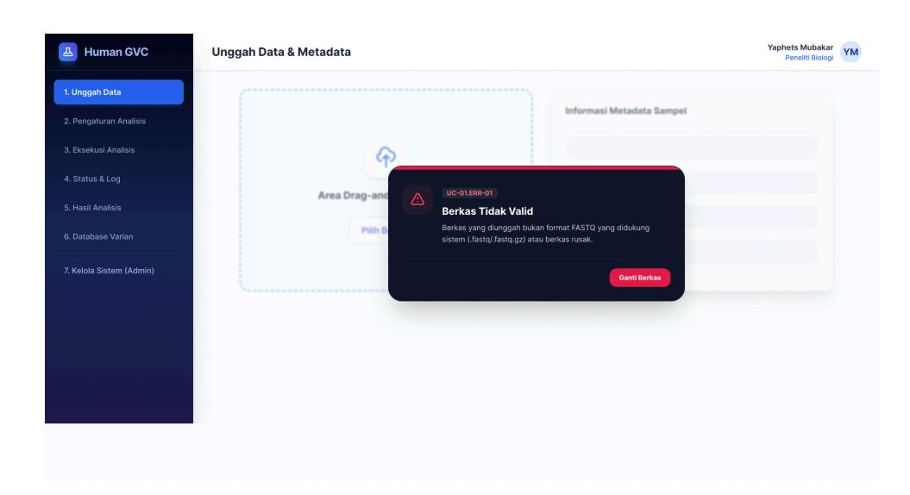

**Gambar 9** Notifikasi kesalahan UC-01.ERR-01 - hasil rancangan kelompok

Selain kondisi tersebut, sistem juga menampilkan notifikasi serupa untuk dua kondisi lain pada halaman ini menggunakan komponen yang sama, yaitu UC-02.ERR-02 (Parameter Di Luar Rentang) apabila nilai parameter berada di luar batas yang diizinkan seperti yang ditunjukkan pada [Gambar](#page-20-1) 10, dan UC-02.ERR-03 (Referensi Belum Ditentukan) apabila pengguna melanjutkan tanpa memilih referensi terlebih dahulu seperti yang ditunjukkan pada [Gambar](#page-20-2) 11.

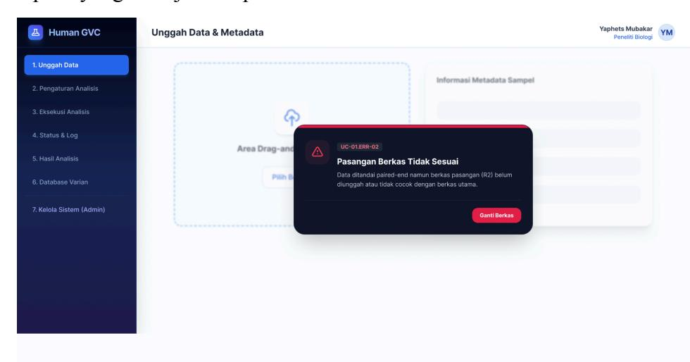

**Gambar 10** Notifikasi kesalahan UC-01.ERR-02 - hasil rancangan

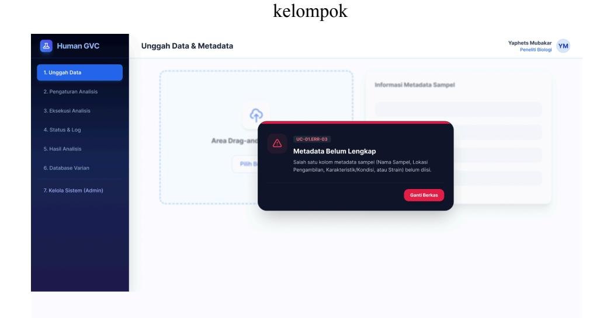

**Gambar 11** Notifikasi kesalahan UC-01.ERR-03 - hasil rancangan kelompok

# **2. Desain high-fidelity halaman pengaturan referensi dan parameter analisis (UC-02)**

Rancangan high-fidelity untuk halaman pengaturan analisis dikembangkan dari wireframe low-fidelity yang telah dibuat sebelumnya, dengan penambahan warna, tipografi, dan komponen visual yang konsisten dengan halaman lain. Tampilan high-fidelity ditunjukkan pada [Gambar](#page-21-0) 12.

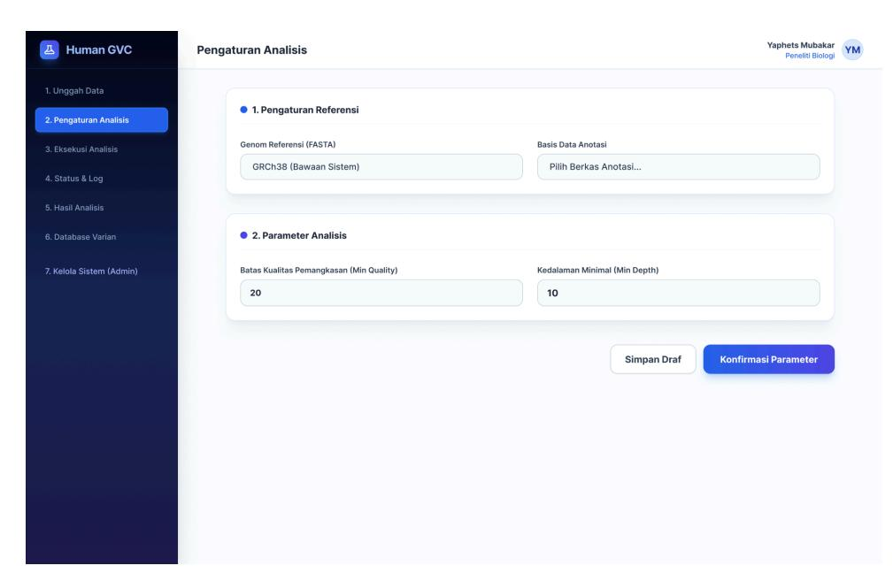

**Gambar 12** Desain high-fidelity (UC-02) - hasil rancangan kelompok Bagian pada [Gambar](#page-21-0) 12 dapat dijelaskan sebagai berikut.

- a. Navigasi sisi kiri menampilkan tahap "2. Pengaturan Analisis" sebagai menu aktif dengan latar biru, konsisten dengan pola penandaan tahap aktif pada halaman Unggah Data.
- b. Kartu "1. Pengaturan Referensi" menampilkan pilihan Genom Referensi (FASTA) dengan nilai bawaan GRCh38, serta pilihan Basis Data Anotasi, masing-masing ditandai indikator bulat berwarna biru pada judul kartu.
- c. Kartu "2. Parameter Analisis" menampilkan nilai default yang telah disediakan sistem untuk Batas Kualitas Pemangkasan (Min Quality: 20) dan Kedalaman Minimal (Min Depth: 10), yang dapat diubah pengguna.
- d. Tombol "Simpan Draf" menggunakan gaya sekunder (garis luar putih) untuk aksi penyimpanan sementara, sedangkan tombol "Konfirmasi Parameter" menggunakan warna aksen utama (biru) sebagai aksi utama untuk melanjutkan proses.

Kedua kartu pada halaman ini menggunakan gaya visual yang sama dengan komponen pada halaman Unggah Data, seperti sudut membulat, warna latar putih pada kartu, dan indikator bulat biru sebagai penanda bagian. Setelah parameter dikonfirmasi, pengguna diarahkan ke halaman Eksekusi Analisis (UC-03), sesuai alur yang telah ditentukan pada tahap wireframe.

Selain tampilan normal, sistem juga menyediakan tampilan kondisi gagal apabila referensi atau parameter yang dimasukkan tidak valid. Contoh kondisi tersebut ditunjukkan pada [Gambar](#page-22-0) 13.

**Gambar 13** Notifikasi kesalahan UC-02.ERR-01 - hasil rancangan kelompok

Selain kondisi tersebut, sistem juga menampilkan notifikasi serupa untuk dua kondisi lain pada halaman ini menggunakan komponen yang sama yaitu, UC-02.ERR-02 (Parameter Di Luar Rentang) apabila nilai parameter berada di luar batas yang diizinkan seperti yang ditunjukkan pada [Gambar](#page-23-1) 14, dan UC-02.ERR-03 (Referensi Belum Ditentukan) apabila pengguna melanjutkan tanpa memilih referensi terlebih dahulu seperti yang ditunjukkan pada [Gambar](#page-23-2) 15.

# Gambar 14 Notifikasi kesalahan UC-02.ERR-02 - hasil rancangan kelompok

![Screenshot of the Human GVC programming environment showing the 'Pengaturan Analisis' section. It includes a section titled '2. Pengaturan Analisis' with a '1. Pengaturan Referensi' section and a '2. Parameter Analisis' section. The '1. Pengaturan Referensi' section includes a 'Genom Referensi (FASTA)' and 'GRCh38 (Bawaan Sistem)' fields. The '2. Parameter Analisis' section includes a 'Batas Kualitas Pemangkasan (Min Qualitas)' field and a '20' number field. A detailed description of the 'Referensi Belum Ditentukan' section is visible overlapping the programming environment screen.]()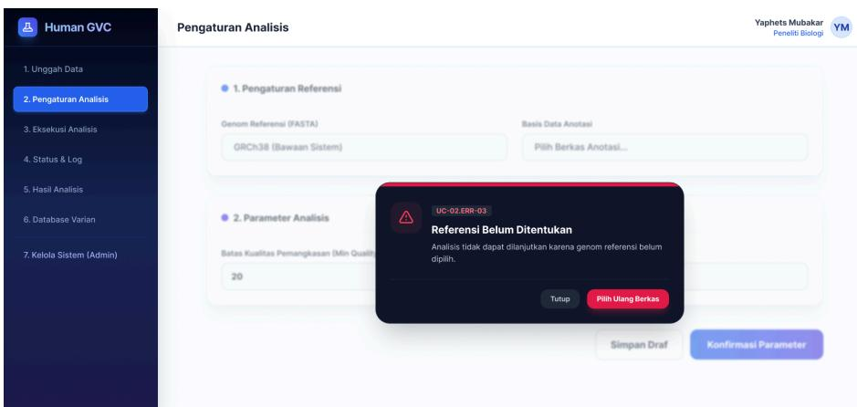

**Gambar 15** Notifikasi kesalahan UC-02.ERR-02 - hasil rancangan kelompok

# **3. Desain high-fidelity halaman eksekusi analisis (UC-03)**

Rancangan high-fidelity untuk halaman eksekusi analisis dikembangkan dari wireframe low-fidelity yang telah dibuat sebelumnya, dengan penambahan warna, tipografi, dan komponen visual yang konsisten. Tampilan high-fidelity ditunjukkan pada [Gambar](#page-23-3) 16.

The screenshot displays the 'Human GVC' analysis panel. On the left, the title is 'Human GVC'. The right side shows 'Yaphets Mubakar' and 'YM'. The 'Ringkasan Konfigurasi' section contains the following information:

- 1. Unggah Data
- 2. Pengaturan Analisis
- 3. Eksekusi Analisis
- 4. Status & Log
- 5. Hasil Analisis
- 6. Database Varian
- 7. Kolola Sistem (Admin)

The 'Data Masukan: 2 berkas FASTQ (Paired-end) -' is shown with a 'VALID' button.

'Metadata: Bogor, Jaringan Kanker -' is shown with a 'LENGKAP' button.

'Referensi: GRCh38 (Bawaan) -' is shown with a 'TERSEDIA' button.

'Parameter: Default -' is shown with a 'TERKONFIRMASI' button.

A diagram of the 'Alur Pemrosesan (Pipeline)' structure is shown at the bottom. It consists of three columns:

- **COC** (Control Operation Center): A blue box with a collapsed circle and the word 'COC' in blue text.
- **Trimming** (Trimming): A blue box with the word 'Trimming' in blue text.
- **Alignment** (Alignment): A blue box with the word 'Alignment' in blue text.
- **Variant Calling** (Variant Calling): A blue box with the word 'Variant Calling' in blue text.
- **Anotasi** (Anotasi): A blue box with the word 'Anotasi' in blue text.

A blue box at the bottom center contains the text 'Mulai Jalankan Analisis'.

**Gambar 16** Desain high-fidelity (UC-03) - hasil rancangan kelompok Bagian pada [Gambar](#page-23-3) 16 dapat dijelaskan sebagai berikut:

- 1. Kartu Ringkasan Konfigurasi menampilkan empat item konfigurasi (Data Masukan, Metadata, Referensi, Parameter) beserta label ringkas isian dan badge status berwarna biru muda (Valid, Lengkap, Tersedia, Terkonfirmasi) yang menandakan seluruh konfigurasi telah siap.
- 2. Panel Alur Pemrosesan (Pipeline) menggunakan latar gradasi biru-ungu untuk menonjolkan urutan tahapan yang akan dijalankan, yaitu QC, Trimming, Alignment, Variant Calling, dan Anotasi, dengan tahap Trimming ditandai warna lebih terang sebagai penanda urutan aktif berikutnya.
- 3. Tombol "Mulai Jalankan Analisis" menggunakan warna aksen utama (biru) sebagai aksi utama halaman, diposisikan di bawah panel alur agar menjadi langkah terakhir yang jelas bagi pengguna. Warna badge status pada kartu ringkasan konsisten dengan pola indikator status yang digunakan pada halaman lain, sehingga pengguna dapat mengenali kondisi "siap" tanpa perlu membaca detail teks. Setelah tombol "Mulai Jalankan Analisis" ditekan, pengguna diarahkan ke halaman pemantauan status dan log analisis (UC-04), sesuai alur yang telah

ditentukan pada tahap wireframe.

Selain tampilan normal, sistem juga menyediakan tampilan kondisi gagal apabila konfigurasi belum lengkap saat analisis akan dijalankan. Kondisi tersebut ditunjukkan pada [Gambar](#page-25-1) 17.

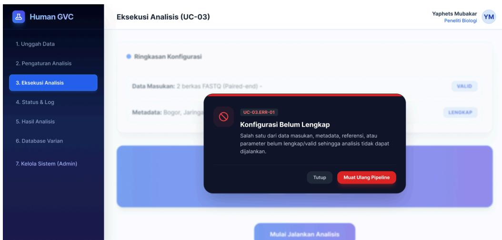

# **Gambar 17** Notifikasi kesalahan UC-03.ERR-01 - hasil rancangan kelompok

## **4. Desain high-fidelity halaman status dan log analisis (UC-04)**

Rancangan high-fidelity untuk halaman status dan log analisis dikembangkan dari wireframe low-fidelity yang telah dibuat sebelumnya, dengan penambahan warna, tipografi, dan komponen visual yang konsisten. Tampilan high-fidelity ditunjukkan pada [Gambar](#page-25-2) 18.

**Gambar 18** Desain high-fidelity (UC-04) - hasil rancangan kelompok Bagian pada [Gambar](#page-25-2) 18 dapat dijelaskan sebagai berikut:

- 1. Kartu status menampilkan tahap yang sedang berlangsung ("Status: Alignment (Sedang Berjalan)") beserta persentase progres keseluruhan (45%) dan bilah progres berwarna biru-ungu di bawahnya.
- 2. Panel log menggunakan latar gelap menyerupai terminal, dengan tiap baris log ditandai waktu dan jenis pesan berwarna berbeda (INFO abu-abu, SUCCESS hijau/biru, PROGRESS kuning) untuk memudahkan pembacaan status tiap tahap.
- 3. Panel Riwayat Tahapan menampilkan status tiap tahap pipeline (QC & Trimming, Alignment, Variant Calling, Anotasi) secara ringkas, dengan tahap yang telah selesai ditandai label "Selesai"

dan tahap yang sedang berjalan ditandai label "Berjalan" berwarna aksen biru.

- 4. Konsistensi tahapan pipeline (QC & Trimming, Alignment, Variant Calling, Anotasi) dijaga sama persis dengan urutan pada halaman eksekusi analisis (UC-03), sehingga pengguna dapat menelusuri proses tanpa kebingungan istilah.

Warna aksen biru digunakan konsisten untuk menandai elemen yang sedang aktif/berjalan, sementara label "Selesai" menggunakan warna berbeda untuk membedakan status yang telah rampung. Halaman ini terus diperbarui secara berkala hingga proses analisis selesai, kemudian pengguna dapat melanjutkan ke halaman hasil analisis (UC-05).

Selain tampilan normal, sistem juga menyediakan tampilan kondisi gagal apabila analisis mengalami kegagalan saat berjalan. Contoh kondisi tersebut ditunjukkan pada [Gambar](#page-26-0) 19.

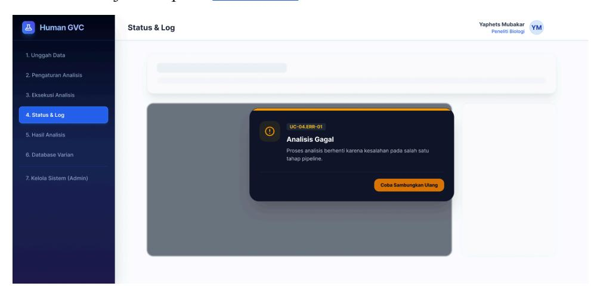

**Gambar 19** Notifikasi kesalahan UC-04.ERR-01 - hasil rancangan kelompok

Selain kondisi tersebut, sistem juga menampilkan notifikasi serupa untuk dua kondisi lain pada halaman ini menggunakan komponen yang sama, yaitu UC-04.ERR-02 (Log Belum Tersedia) apabila sistem belum menerima catatan log karena proses belum dimulai seperti yang ditunjukkan pada [Gambar](#page-27-1) 20, dan UC-04.ERR-03 (Proses Terhenti) apabila salah satu tahap pipeline berhenti merespons seperti yang ditunjukkan pada [Gambar](#page-27-2) 21.

# **Gambar 20** Notifikasi kesalahan UC-04.ERR-02 - hasil rancangan kelompok

**Gambar 21** Notifikasi kesalahan UC-04.ERR-03 - hasil rancangan kelompok

## **5. Desain high-fidelity halaman hasil analisis (UC-05)**

Halaman ini menyajikan output dari pipeline variant calling dalam bentuk representasi metrik yang mudah dipahami dan tabel data komprehensif. Tampilan high-fidelity ditunjukkan pada [Gambar](#page-28-0) 22.

**Gambar 22** Desain high fidelity (UC-05) - hasil rancangan kelompok

- a. Kartu Metrik (*Dashboard Cards*): Tiga kartu metrik di bagian atas dengan gradasi biru menyajikan data ringkasan krusial secara instan: Total Varian Ditemukan, Rasio Transisi/Transversi (Ti/Tv), dan Kualitas Rata-rata (QUAL).
- b. Tabel Kandidat Varian: Menampilkan hasil variant calling yang terstruktur (Kromosom, Posisi, Reference, Alternate, dan Kualitas). Perubahan basa nukleotida (REF ke ALT) disorot menggunakan badge khusus bergaya monospaced agar mutasi genetik mudah diidentifikasi oleh peneliti.
- c. Aksi Ekspor: Tombol unduhan disediakan di bagian bawah layar bagi pengguna untuk mengekspor data ke dalam format .csv atau .vcf untuk analisis lanjutan

Selain tampilan normal, sistem juga menyediakan tampilan kondisi gagal apabila hasil analisis belum atau tidak dapat ditampilkan. Contoh kondisi tersebut ditunjukkan pada [Gambar](#page-29-0) 23.

# **Gambar 23** Notifikasi kesalahan UC-05.ERR-01 - hasil rancangan kelompok

Selain kondisi tersebut, sistem juga menampilkan notifikasi serupa untuk dua kondisi lain pada halaman ini menggunakan komponen yang sama, yaitu UC-05.ERR-02 (Hasil Tidak Lengkap) apabila hasil tidak tersedia karena proses sebelumnya gagal seperti yang ditunjukkan pada [Gambar](#page-29-1) 24, dan UC-05.ERR-03 (Hasil Tidak Dapat Diubah) apabila pengguna mencoba mengubah hasil analisis yang telah final seperti yang ditunjukkan pada [Gambar](#page-30-1) 25.

**Gambar 24** Notifikasi kesalahan UC-05.ERR-02 - hasil rancangan kelompok

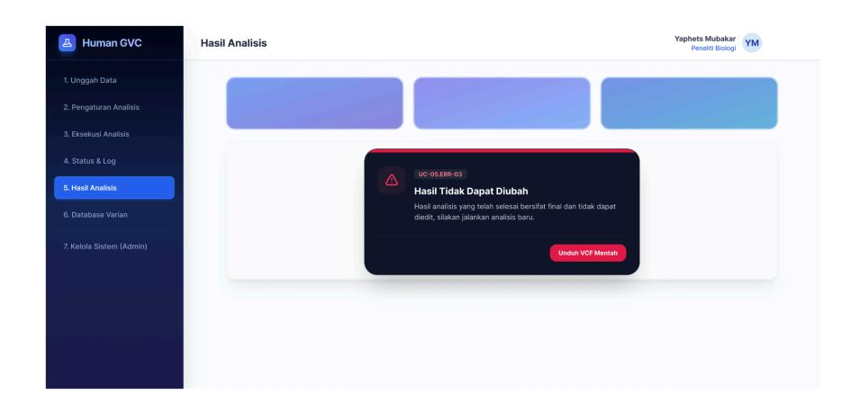

**Gambar 25** Notifikasi kesalahan UC-05.ERR-03 - hasil rancangan kelompok

### **6. Desain high-fidelity halaman database varian bersama (UC-06)**

Halaman ini merupakan repositori global yang menyimpan seluruh data varian yang telah berhasil dianalisis pada sistem, memungkinkan pencarian lintas sampel. Tampilan high-fidelity ditunjukkan pada [Gambar](#page-30-2) [26](#page-30-2).

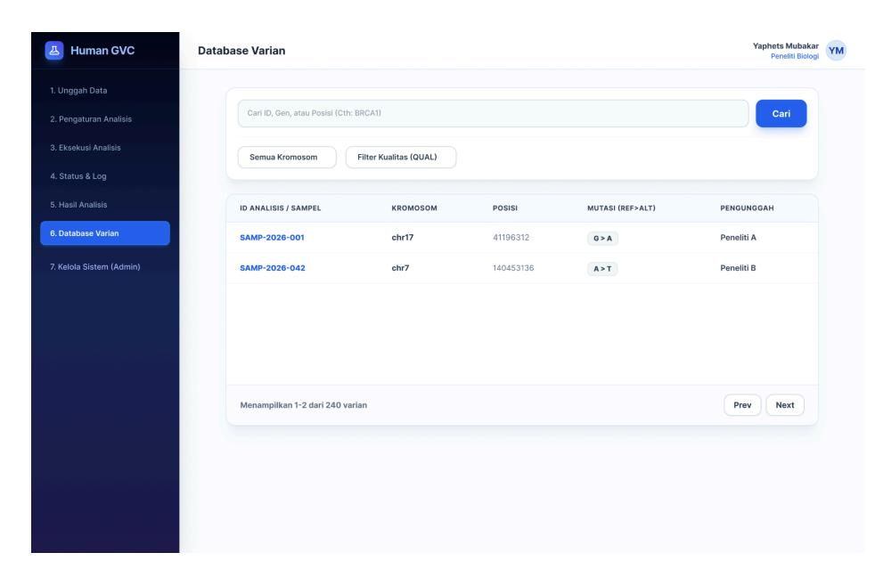

**Gambar 26** Desain high fidelity (UC-06) - hasil rancangan kelompok

- a. Modul Kueri dan Filtrasi Data: Mengimplementasikan instrumen pencarian dinamis (*search bar*) yang memungkinkan pengguna mengeksekusi query spesifik berlandaskan parameter Identifier (ID) Sampel, nomenklatur gen, maupun koordinat kromosom. Mekanisme ini didukung oleh fungsionalitas filtrasi sekunder melalui elemen *dropdown*.
- b. Tabel Repositori Komprehensif: Data di-render pada tabel berkapasitas besar dengan tata letak (*layout*) yang menunjang *horizontal scrolling* guna mengakomodasi ekstensivitas variabel metadata. Untuk memastikan optimalisasi kinerja antarmuka saat menyajikan himpunan data (dataset) masif, tabel ini diintegrasikan dengan fungsionalitas paginasi (*pagination).*

Selain tampilan normal, sistem juga menyediakan tampilan kondisi gagal apabila pencarian data varian tidak dapat diproses. Contoh kondisi tersebut ditunjukkan pada [Gambar](#page-31-0) 27.

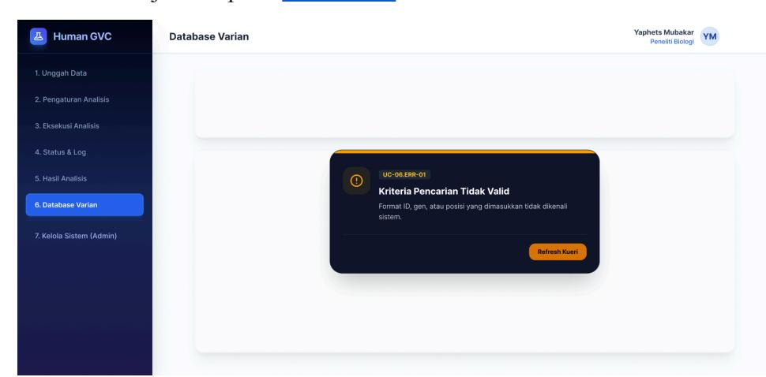

**Gambar 27** Notifikasi kesalahan UC-06.ERR-01 - hasil rancangan kelompok

Selain kondisi tersebut, sistem juga menampilkan notifikasi serupa untuk dua kondisi lain pada halaman ini menggunakan komponen yang sama, yaitu UC-06.ERR-02 (Varian Tidak Ditemukan) apabila tidak ada data varian yang sesuai dengan kriteria pencarian seperti yang ditunjukkan pada [Gambar](#page-32-1) 28, dan UC-06.ERR-03 (Akses Ditolak) apabila pengguna tidak memiliki hak akses terhadap data varian tersebut seperti yang ditunjukkan pada [Gambar](#page-32-2) 29.

# **Gambar 28** Notifikasi kesalahan UC-06.ERR-02 - hasil rancangan kelompok

**Gambar 29** Notifikasi kesalahan UC-06.ERR-03 - hasil rancangan kelompok

## **7. Desain high-fidelity halaman kelola akun dan data referensi (UC-07)**

Halaman ini berfungsi sebagai pusat kendali administrasi yang hanya dapat diakses oleh administrator saja. Modul ini dibagi menjadi dua area fungsional utama, yaitu manajemen akun pengguna dan pengelolaan data referensi genom. Berikut tampilan high-fidelity yang ditunjukkan pada [Gambar](#page-33-0) 30.

**Gambar 30** Desain high fidelity (UC-07) - hasil rancangan kelompok

- a. Modul Manajemen Akun pengguna memiliki fungsi utama untuk mengelola seluruh kredensial dan hak akses pengguna yang terdaftar dalam sistem. Tombol + Tambah Akun memungkinkan administrator untuk membuka formulir pendaftaran akun pengguna baru. Terakhir Tabel Informasi Pengguna menampilkan daftar akun aktif yang mencakup Nama lengkap dari pengguna terdaftar, Email resmi berbasis instansi, Peran yang menunjukkan tingkatan akses pengguna, dan Aksi untuk memperbarui data akun atau mengubah hak akses.
- b. Modul Manajemen Data Referensi Sistem berfungsi Mengelola berkas genom referensi dan basis data anotasi varian yang menjadi dependensi utama *pipeline* analisis bioinformatika. Tombol Akses (Unggah Referensi Baru) merupakan tombol aksi utama dengan ikon *upload* untuk menambahkan berkas FASTA atau VCF baru ke dalam repositori sistem. Tabel Berkas Referensi menampilkan riwayat dan status berkas referensi dengan struktur kolom yang terdiri dari nama berkas, jenis referensi, status, dan aksi.

Selain tampilan normal, sistem juga menyediakan tampilan kondisi gagal apabila perubahan akun atau data referensi tidak dapat diproses. Contoh kondisi tersebut ditunjukkan pada [Gambar](#page-34-0) 31.

![Screenshot of the Manajement Data Referensi Sistem (MDS) interface. The interface is divided into two main panels: a black sidebar on the left and a white sidebar on the right. The black sidebar on the left contains the title 'Human GVC' and a list of seven analysis types. The white sidebar on the right contains the title 'Manajement Data Referensi Sistem (MDS)' and a content box with a crossout icon and the title 'Data Akun Tidak Valid'. The content box includes a 'UC-07:ERR-01' text and a 'Data Akun Tidak Valid' title. A 'Tutup Log' button is provided in the bottom right of the content box.]()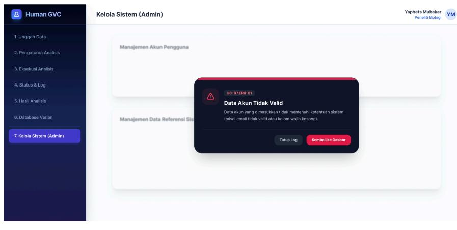

**Gambar 31** Notifikasi kesalahan UC-07.ERR-01 - hasil rancangan kelompok

Selain kondisi tersebut, sistem juga menampilkan notifikasi serupa untuk dua kondisi lain pada halaman ini menggunakan komponen yang sama, yaitu UC-07.ERR-02 (Data Referensi Tidak Valid) apabila berkas referensi yang diunggah tidak sesuai format atau tidak lengkap seperti yang ditunjukkan pada [Gambar](#page-35-0) 32, dan UC-07.ERR-03 (Gagal Menyimpan Perubahan) apabila sistem tidak dapat menyimpan perubahan yang dilakukan Administrator seperti yang ditunjukkan pada [Gambar](#page-35-1) 33.

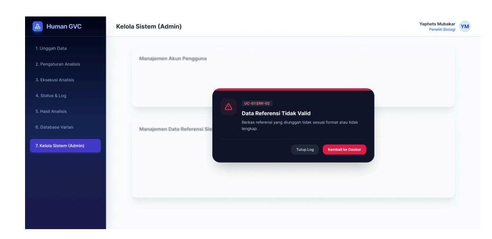

# **Gambar 32** Notifikasi kesalahan UC-07.ERR-02 - hasil rancangan kelompok

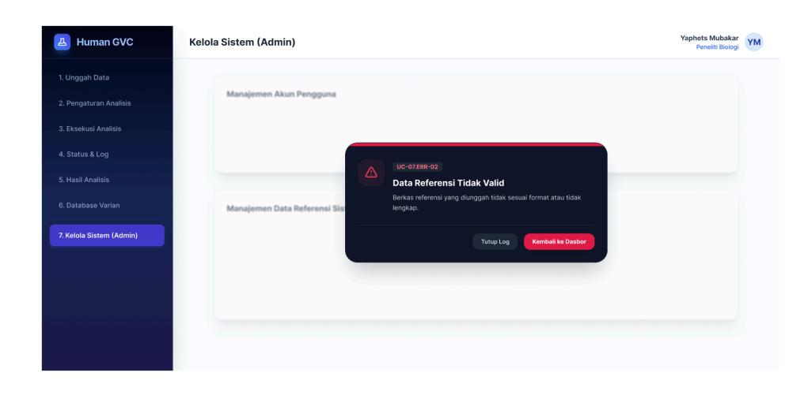

**Gambar 33** Notifikasi kesalahan UC-07.ERR-03 - hasil rancangan kelompok

# **Integrasi GitHub Project**

Seluruh proses pengerjaan Aktivitas 3 (Desain High-Fidelity) didokumentasikan dan dikelola melalui GitHub Issue dan GitHub Project agar progres pekerjaan dapat ditelusuri secara transparan oleh seluruh anggota kelompok.

- a. Tautan GitHub Issue: https://github.com/Pembangunan-Perangkat-Lunak-BIF-IPB/kelompok-03 /issues/5#issue-5550481091
- b. Tautan GitHub Project: https://github.com/orgs/Pembangunan-Perangkat-Lunak-BIF-IPB/projects/ 9/views/1

Pengelolaan pekerjaan dilakukan dengan membagi setiap use case (UC-01 hingga UC-07) sebagai task terpisah pada GitHub Project, masing-masing ditandai status *To Do*, *In Progress*, atau *Done* sesuai perkembangan pengerjaan. Setiap anggota memperbarui status task sesuai use case yang menjadi tanggung jawabnya, sehingga kemajuan proyek dapat dipantau secara langsung melalui papan Project tanpa perlu koordinasi manual berulang.

# **Kesimpulan**

Perancangan antarmuka aplikasi Human GVC telah menghasilkan desain high-fidelity yang mengacu langsung pada Dokumen Spesifikasi Kebutuhan Perangkat Lunak (SKPL). Rancangan ini memfasilitasi kebutuhan interaksi Pengguna Analisis dan Administrator melalui tujuh layar utama yang mencakup keseluruhan alur pipeline variant calling. Proses analisis yang umumnya mengandalkan antarmuka command-line berhasil diterjemahkan menjadi tampilan visual terstruktur, mulai dari tahap unggah data, pengaturan referensi dan parameter, pemantauan log proses, hingga penyajian hasil akhir. Desain ini juga telah mengakomodasi penyediaan umpan balik sistem yang jelas, termasuk skenario penanganan kondisi galat, sehingga pengguna selalu mendapatkan informasi yang tepat mengenai status pekerjaannya.

Sebagai bentuk evaluasi, rancangan high-fidelity yang ada saat ini masih menyisakan beberapa ruang untuk pengembangan. Susunan tata letak elemen antarmuka perlu ditingkatkan responsivitasnya melalui penerapan fitur auto layout yang lebih presisi, agar tampilan tetap rapi saat diakses pada berbagai ukuran layar. Pada halaman hasil analisis, penyajian informasi di dalam kartu metrik dapat dikembangkan dari sekadar angka statis menjadi visualisasi data grafis interaktif untuk menunjang proses interpretasi oleh peneliti. Hubungan antar layar pada prototipe juga dapat disempurnakan menggunakan animasi transisi, terutama saat menyimulasikan proses pemuatan log atau kemunculan jendela peringatan, agar sistem terasa lebih hidup. Untuk pengelolaan basis data varian, fitur pencarian perlu dilengkapi dengan kriteria filter lanjutan guna mempermudah penelusuran ketika volume data genomik semakin besar.