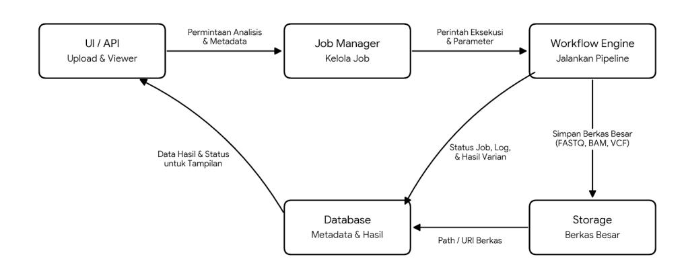
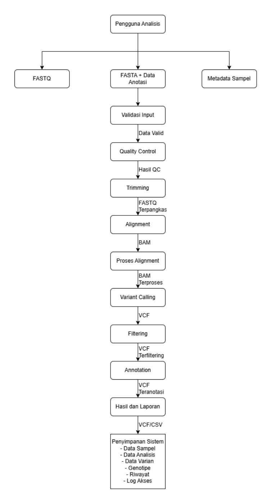
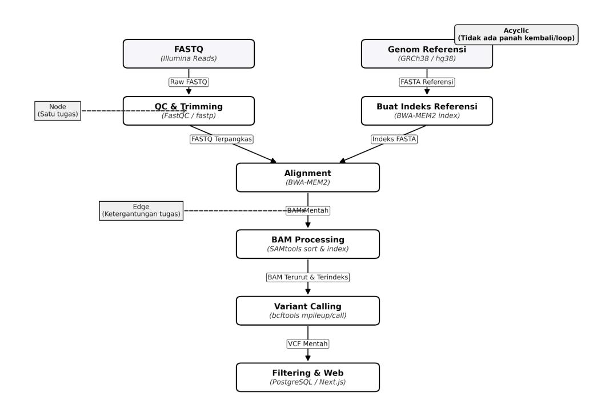

## **PERANCANGAN DESAIN MODULAR HUMAN GVC**

#### **Dosen Pengampu:**

Prof. Dr. Eng. Wisnu Ananta Kusuma, S.T., M.T.

#### **Asisten Praktikum:**

Said Thaufik Rizaldi, S.Kom., M.Kom. Gilland Fausta Putra Achyar, S.Mat., M.Kom.

#### **Disusun Oleh Kelompok GenoSys (3):**

Dhafin Fasya Arifin G0401241017 Rakazaki Putra Hendrawan G0401241056 Yafits Mubarak G0401241001 Muhammad Fattha Akbarsyah G0401241008 Abid Ra'fad Aziz G0401241029

**MATA KULIAH PEMBANGUNAN PERANGKAT LUNAK BIOINFORMATIKA**

**PROGRAM STUDI BIOINFORMATIKA FAKULTAS MATEMATIKA DAN ILMU PENGETAHUAN ALAM INSTITUT PERTANIAN BOGOR**

# **Daftar Isi**

| Daftar |            | Isi................................................................................................................. | 1                                        |
|--------|------------|----------------------------------------------------------------------------------------------------------------------|------------------------------------------|
| 1.     | Gambaran   | singkat sistem..................................................................................                     | 2                                        |
| 2.     | Arsitektur | modular............................................................................................                  | 3                                        |
| 3.     | Data       | flow.............................................................................................................    | 4                                        |
| 4.     | Interface  | dan Spesifikasi Modul.......................................................................                         | 6                                        |
|        | 4.1        | Modul 1: Manajemen Masukan dan Validasi                                                                              | (Input dan Validation)...........6       |
|        | 4.2        | Modul 2: Pemeriksaan kualitas dan pemangkasan                                                                        | data (QC dan Trimming)                   |
|        | 4.3        | Modul 3: Penyejajaran (Alignment)...........................................................10                       |                                          |
|        | 4.4        | Modul 4: Pemanggilan dan Penyaringan                                                                                 | Varian (Variant Calling)............ 11  |
|        | 4.5        | Modul 5: Anotasi Varian (Variant Annotation)..........................................                               | 13                                       |
|        | 4.6        | Modul 6: Penyajian Hasil dan Publikasi                                                                               | (Result & Publication)............... 15 |
| 5.     | Workflow   | / DAG pipeline................................................................................                       | 17                                       |
| 6.     | Asumsi     | desain...................................................................................................            | 18                                       |

# **1. Gambaran singkat sistem**

Sistem Human GVC merupakan perangkat lunak berbasis web yang menyatukan seluruh tahapan analisis *variant calling* ke dalam satu alur kerja terotomasi, mulai dari pengunggahan data sekuens hingga tersimpannya hasil varian pada basis data yang dapat diakses bersama. Sistem dikembangkan untuk mengatasi permasalahan analisis varian yang selama ini dijalankan secara terpisah menggunakan sejumlah perangkat lunak berbasis baris perintah, sehingga menuntut keahlian teknis tertentu, tidak menyediakan catatan kemajuan proses yang dapat dipantau, serta tidak meninggalkan rekaman parameter yang digunakan pada tiap tahapan.

Tujuan sistem adalah menyediakan alur analisis varian yang berjalan otomatis dan berurutan dari data sekuens mentah hingga diperolehnya hasil varian, memungkinkan peneliti menjalankan keseluruhan proses secara mandiri tanpa memerlukan keahlian baris perintah, memastikan setiap analisis tersimpan bersama parameter dan data masukan yang digunakan sehingga hasilnya dapat ditelusuri, menyajikan status dan informasi kemajuan analisis secara detail selama proses berlangsung, serta menyediakan basis data varian terpusat yang dapat diakses bersama.

Sistem digunakan oleh dua kelompok pengguna dengan kebutuhan yang berbeda. Pengguna Analisis (Peneliti) melakukan analisis terhadap data sekuens, menentukan referensi dan parameter, memantau proses, serta melihat dan mengelola hasil analisis yang dimilikinya. Administrator bertanggung jawab terhadap pengelolaan akun pengguna dan data referensi yang tersedia dalam sistem. Pemisahan kedua peran tersebut diperlukan agar hak akses terhadap data genomik dapat dibatasi dan setiap tindakan pada sistem dapat ditelusuri kepada pemiliknya.

Ruang lingkup sistem mencakup pengunggahan data sekuens FASTQ (*paired-end* maupun *single-end*) beserta validasinya, penerimaan berkas referensi FASTA dan berkas basis data anotasi, pencatatan metadata sampel, pengaturan parameter analisis, pelaksanaan pipeline inti *variant calling* secara otomatis dan berurutan, anotasi varian, penyajian status dan catatan proses, penyimpanan hasil pada basis data varian bersama, serta pencatatan jejak akses pengguna. Sasaran utama sistem adalah analisis data genomik manusia dengan berkas referensi genom manusia sebagai rujukan bawaan. Ruang lingkup sistem dibatasi pada pelaksanaan dan penelusuran proses analisis, bukan pada penafsiran makna biologis maupun klinis dari varian yang dihasilkan.

Proses utama sistem terdiri atas unggah data dan pemilihan referensi, validasi masukan, pemeriksaan mutu, pemangkasan, penyejajaran terhadap referensi, pemrosesan berkas hasil penyejajaran, pemanggilan varian, penyaringan, anotasi, hingga penyimpanan hasil beserta riwayatnya. Gambaran sistem pada laporan ini mengacu pada Dokumen Spesifikasi Kebutuhan Perangkat Lunak (SKPL) Human GVC yang telah disusun kelompok sebelumnya.

# **2. Arsitektur modular**

Arsitektur modular Human GVC memisahkan sistem menjadi lima komponen utama dengan tanggung jawab yang berbeda, sebagaimana disajikan pada [Gambar](#page-3-1) 1. Pemisahan ini memungkinkan setiap komponen dikembangkan, diuji, dan diubah secara independen tanpa memengaruhi komponen lain.

Gambar 1. Arsitektur modular *human gvc*

UI/API (Upload & Viewer) menjadi titik interaksi pengguna dengan sistem, menangani pengunggahan berkas serta penyajian status dan hasil analisis kepada pengguna. Komponen ini mewadahi Modul Manajemen Masukan dan Validasi serta Modul Penyajian Hasil dan Publikasi.

Job Manager bertanggung jawab menerima permintaan analisis dari UI/API, mencatat konfigurasi dan parameter yang digunakan, serta meneruskan permintaan tersebut ke Workflow Engine untuk dieksekusi.

Workflow Engine menjalankan tahapan komputasi inti pipeline secara otomatis dan berurutan sesuai DAG, meliputi *quality control*, *trimming*, *alignment*, pemrosesan BAM, *variant calling*, *filtering*, hingga anotasi. Komponen ini memantau status tiap tahap dan menghentikan proses apabila terjadi kegagalan.

Storage menyimpan berkas berukuran besar yang dihasilkan maupun digunakan selama pipeline berjalan, seperti berkas FASTQ, BAM, dan VCF, agar tidak membebani basis data relasional.

Database menyimpan data terstruktur yang mencakup metadata sampel, status *job*, parameter analisis, hasil varian, genotipe, riwayat analisis, dan log akses, sehingga setiap analisis dapat ditelusuri kembali.

# **3. Data flow**

*Data flow* menggambarkan aliran data pada sistem Human GVC mulai dari data yang dimasukkan oleh pengguna hingga menghasilkan informasi varian. Data input yang digunakan meliputi data sekuens dalam format FASTQ, genom referensi, metadata sampel, data anotasi, serta parameter analisis. Data tersebut selanjutnya diproses secara bertahap melalui validasi input, pemeriksaan kualitas, pemangkasan sekuens, *alignment*, pemrosesan hasil *alignment*, *variant calling*, *filtering*, dan anotasi. Setiap tahap menghasilkan data antara yang digunakan sebagai masukan pada tahap berikutnya hingga menghasilkan data output berupa informasi dan hasil analisis varian.

Gambar 2 *Data flow human gvc*

Berdasarkan *data flow* tersebut, proses analisis dimulai ketika pengguna memasukkan data sekuens, data referensi, metadata sampel, data anotasi, dan parameter analisis ke dalam sistem. Data sekuens kemudian melalui tahap validasi dan *quality control* untuk memastikan data dapat digunakan dalam proses analisis. Data yang memenuhi kriteria selanjutnya diproses melalui *trimming* untuk menghasilkan sekuens yang telah dibersihkan sebelum dilakukan *alignment* terhadap genom referensi.

Hasil *alignment* berupa data BAM selanjutnya diproses dan digunakan dalam tahap *variant calling* untuk menghasilkan data varian dalam format VCF. Data VCF kemudian melalui proses *filtering* untuk memperoleh varian yang memenuhi kriteria analisis. Varian hasil *filtering* selanjutnya dianotasi menggunakan data anotasi yang tersedia. Hasil akhir berupa data varian dan informasi pendukung disajikan kepada pengguna dalam bentuk tabel, file hasil, statistik, dan visualisasi, serta disimpan bersama data analisis dan riwayat proses dalam sistem.

# **4. Interface dan Spesifikasi Modul**

Bagian ini menguraikan spesifikasi antarmuka (*interface contract*) dan detail operasional untuk enam modul utama pada *pipeline Human GVC*. Spesifikasi ini disusun untuk memastikan setiap modul memiliki tanggung jawab yang terisolasi, serta aliran input dan output yang tervalidasi secara ketat. Rincian antarmuka dan spesifikasi untuk setiap modul disajikan berturut-turut pada [Tabel](#page-6-2) [1](#page-6-2) hingga [Tabel](#page-16-0) 12.

## **4.1 Modul 1: Manajemen Masukan dan Validasi (***Input* **dan** *Validation***)**

Modul ini bertugas menangani interaksi awal pengguna dengan sistem, mencakup pengunggahan berkas dan pengaturan parameter, sebelum *pipeline* komputasi dijalankan. Spesifikasi antarmuka dan operasional modul ini disajikan pada Tabel [1](#page-6-2) dan Tabel [2.](#page-7-0)

Tabel 1. Kontrak antarmuka modul manajemen masukan dan validasi

| Elemen Contoh                 | Keterangan |                 |
|-------------------------------|------------|-----------------|
| Input Berkas FASTQ, referensi |            |                 |
| FASTA, data anotasi,          |            |                 |
| dan metadata sampel.          |            |                 |
|                               | Modul      | menerima        |
|                               | unggahan   | data dari       |
|                               | pengguna   | serta identitas |
|                               | sampel     | yang akan       |

Tabel 1. Kontrak antarmuka modul manajemen masukan dan validasi (lanjutan)

| Elemen Contoh Keterangan          |               |
|-----------------------------------|---------------|
| Output Data masukan valid dan     |               |
| konfigurasi analisis              |               |
| Output                            | menyatakan    |
| bahwa                             | data siap dan |
| aman                              | diteruskan ke |
| tahap                             | komputasi     |
| Parameter Batas ukuran berkas dan |               |
| konfigurasi paired-end            |               |
| Nilai                             | parameter     |
| menentukan                        | apakah        |
| berkas                            | diterima dan  |
| kelengkapan                       | pasangan      |
| tervalidasi                       | dengan baik.  |
| Kesalahan Format tidak didukung   |               |
| atau pasangan                     |               |
| paired-end tidak cocok            |               |
| Modul                             | menolak       |
| unggahan,                         | menghentikan  |
| proses                            | awal, dan     |
| menampilkan                       | pesan         |
| penolakan                         | kepada        |

Tabel 2. Spesifikasi modul manajemen masukan dan validasi

| Elemen     | Spesifikasi                                           |
|------------|-------------------------------------------------------|
| Nama modul | Manajemen Masukan dan Validasi.                       |
| Tujuan     | Menerima data dari pengguna dan memastikan integritas |
|            | data sebelum pipeline komputasi dimulai.              |
| Input      | Berkas FASTQ, FASTA, basis data anotasi, dan formulir |
|            | metadata sampel.                                      |
| Output     | Berkas dan parameter valid yang siap diteruskan ke    |
|            | tahapan komputasi (Quality Control).                  |

Tabel 2. Spesifikasi modul manajemen masukan dan validasi (lanjutan)

| Elemen                    | Spesifikasi                                          |
|---------------------------|------------------------------------------------------|
| Proses utama              | Memeriksa tipe dan format berkas, memvalidasi        |
|                           | kelengkapan isian metadata, dan mengunci konfigurasi |
| Parameter penting Batasan | ukuran maksimal berkas dan aturan format             |
| metadata                  | sampel.                                              |
| Validasi Sistem           | menolak proses jika ekstensi tidak didukung,         |
| berkas                    | FASTQ paired-end tidak lengkap/cocok, atau           |
| metadata                  | kosong.                                              |

# **4.2 Modul 2: Pemeriksaan kualitas dan pemangkasan data (***QC* **dan** *Trimming***)**

Modul ini bertugas mengevaluasi data mentah hasil unggahan dan membersihkan sekuens dari anomali atau kualitas yang buruk. Spesifikasi antarmuka dan operasional modul ini disajikan pada Tabel [3](#page-8-1) dan Tabel [4.](#page-9-0)

Tabel 3. Kontrak antarmuka modul QC dan trimming

| Elemen Contoh                | Keterangan |                 |
|------------------------------|------------|-----------------|
| Input Berkas FASTQ dan ID    |            |                 |
| Modul                        |            | menerima lokasi |
| berkas                       | sekuens    | mentah          |
| serta                        | identitas  | sampel          |
| yang                         | akan       | diproses.       |
| Output FASTQ bersih, laporan |            |                 |
| QC, dan status proses        |            |                 |
| Output                       |            | menyatakan      |
| lokasi                       | berkas     | yang telah      |
|                              | dipangkas, | ringkasan       |
| mutu,                        | serta      | status lolos    |
| atau                         | gagal.     |                 |

Tabel 3. Kontrak antarmuka modul QC dan trimming (lanjutan)

| Elemen Contoh Keterangan         |              |           |
|----------------------------------|--------------|-----------|
| Parameter Batas kualitas minimum |              |           |
| Nilai                            | parameter    | harus     |
| sesuai                           | dengan       | rentang   |
| kualitas                         | yang         | diizinkan |
| sistem                           |              | untuk     |
| membersihkan                     |              | basa.     |
| Kesalahan Berkas FASTQ korup     |              |           |
| atau tidak terbaca.              |              |           |
| Modul                            | menghentikan |           |
| proses                           | terkait      | dan       |
| mengirimkan                      |              | pesan     |
| kesalahan                        |              | pembacaan |
| data                             | kepada       | sistem    |

Tabel 4. Spesifikasi modul QC & trimming

| Elemen Spesifikasi       |                                                    |
|--------------------------|----------------------------------------------------|
| Nama modul Pemeriksaan   | Kualitas dan Pemangkasan Data                      |
| Tujuan Memeriksa         | kualitas awal data sekuens dan membuang basa       |
| berkualitas              | rendah sebelum tahap penyejajaran                  |
| Input Berkas             | data sekuens FASTQ yang telah berstatus valid      |
| Output Data              | FASTQ bersih dan ringkasan mutu data sebelum serta |
| sesudah                  | pemangkasan                                        |
| Proses utama Menjalankan | pemeriksaan kualitas terhadap data masukan,        |
| mengeksekusi             | pemangkasan ( trimming ) basa, dan                 |
| membandingkan            | hasil dengan standar.                              |
| Batas                    | skor kualitas ( quality score ) minimum untuk      |
| pemangkasan              | basa.                                              |

Tabel 4. Spesifikasi modul QC & trimming (lanjutan)

| Elemen   | Spesifikasi         |                                     |
|----------|---------------------|-------------------------------------|
| Validasi | Berkas FASTQ harus  | dapat dibaca dengan baik oleh tools |
|          | analisis dan proses | pemangkasan tidak menghasilkan      |
|          | berkas kosong       |                                     |

# **4.3 Modul 3: Penyejajaran (***Alignment***)**

Modul ini bertugas memetakan sekuens yang telah dibersihkan terhadap genom referensi untuk mengetahui posisi genetiknya. Spesifikasi antarmuka dan operasional modul ini disajikan pada Tabel [5](#page-10-1) dan Tabel [6.](#page-11-1)

Tabel 5. Kontrak antarmuka modul alignment

| Elemen Contoh Keterangan      |                   |              |
|-------------------------------|-------------------|--------------|
| Input Berkas FASTQ bersih,    |                   |              |
| referensi FASTA, dan ID       |                   |              |
| Modul                         | menerima          | lokasi       |
| sekuens                       | yang              | telah        |
| dipangkas                     | beserta           | genom        |
| referensi                     | untuk             | pemetaan     |
| Output Berkas BAM terurut,    |                   |              |
| ringkasan penyejajaran,       |                   |              |
| dan status proses             |                   |              |
| Output                        |                   | menyatakan   |
| lokasi                        | berkas            | BAM yang     |
| terindeks,                    | jumlah            | reads        |
| ter-align                     | ,                 | serta status |
| keberhasilan                  |                   | pemetaan.    |
| Parameter Parameter algoritma |                   |              |
| penyejajaran bawaan           |                   |              |
| atau custom.                  |                   |              |
| Nilai                         |                   | parameter    |
| mengatur                      |                   | perilaku     |
| algoritma                     |                   | perangkat    |
| lunak                         | saat mengeksekusi |              |

Tabel 5. Kontrak antarmuka modul alignment (lanjutan)

| Elemen Contoh       |              | Keterangan             |
|---------------------|--------------|------------------------|
| Kesalahan Referensi |              | belum                  |
| ditentukan          | atau         | indeks                 |
| FASTA               | tidak valid. |                        |
|                     |              | Modul menghentikan     |
|                     |              | tahapan analisis dan   |
|                     |              | menampilkan pesan      |
|                     |              | bahwa berkas referensi |

Tabel 6. Spesifikasi modul alignment

| Elemen            | Spesifikasi  |           |                 |                |           |           |            |
|-------------------|--------------|-----------|-----------------|----------------|-----------|-----------|------------|
| Nama modul        | Penyejajaran |           | ( Alignment     | ).             |           |           |            |
| Tujuan            | Memetakan    |           | sekuens         | DNA bersih     | ke        | genom     | referensi  |
|                   | manusia      | bawaan    | sistem          | atau referensi |           | kustom    | pengguna   |
| Input             | Berkas       | FASTQ     | bersih          | dan berkas     | referensi | FASTA.    |            |
| Output            | Berkas       | hasil     | penyejajaran    | (BAM)          | terurut   | dan       | ringkasan  |
| Proses utama      | Melakukan    |           | penyejajaran    | sekuens        | terhadap  |           | referensi, |
|                   | mengurutkan  |           | hasil ( sorting | ), dan         | membuat   | indeks    | BAM        |
| Parameter penting | Nilai        | parameter | bawaan          | untuk          | algoritma |           | pemetaan   |
|                   | ( alignment  | )         |                 |                |           |           |            |
| Validasi          | Referensi    | FASTA     | harus           | tersedia       | dan       | berformat | benar;     |
|                   | proses       | akan      | dihentikan      | jika pembuatan |           | indeks    | gagal.     |

# **4.4 Modul 4: Pemanggilan dan Penyaringan Varian (Variant Calling)**

Modul ini mengeksekusi algoritma utama untuk mendeteksi variasi genetika pada sampel terhadap referensi. Spesifikasi antarmuka dan operasional modul ini disajikan pada Tabel [7](#page-12-0) dan Tabel [8](#page-12-1).

Tabel 7. Kontrak antarmuka modul variant calling

| Elemen Contoh Keterangan       |              |              |
|--------------------------------|--------------|--------------|
| Input Berkas BAM terurut       |              |              |
| beserta ID sampel              |              |              |
| Modul                          | menerima     | data         |
| hasil                          | penyejajaran | yang         |
| telah                          | terindeks    | untuk        |
| dilakukan                      |              | pemanggilan  |
| Output Berkas varian akhir,    |              |              |
| statistik ringkas, dan         |              |              |
| status selesai                 |              |              |
| Output                         |              | menyatakan   |
| lokasi                         | berkas       | VCF/CSV      |
| akhir                          | serta        | status       |
| penyelesaian                   |              | tahap        |
| variant                        | calling      |              |
| Parameter Kriteria penyaringan |              |              |
| ( quality score dan            |              |              |
| kedalaman minimal)             |              |              |
| Nilai                          |              | parameter    |
| membatasi                      |              | dan          |
| menyaring                      |              | kandidat     |
| varian                         | agar         | memenuhi     |
| standar                        | kualitas     | hasil.       |
| Kesalahan Kegagalan algoritma  |              |              |
| pemanggilan varian di          |              |              |
| tengah jalan                   |              |              |
| Sistem                         | menghentikan |              |
| analisis,                      | menandai     | status       |
| gagal,                         | menyimpan    | log          |
| kesalahan,                     |              | dan          |
| memblokir                      |              | publikasi ke |
| basis                          | data.        |              |

Tabel 8. Spesifikasi modul variant calling

|   | Elemen | Spesifikasi                         |
|----------------|--------|-------------------------------------|
| Nama modul     |        | Pemanggilan dan Penyaringan Varian. |

Tabel 8. Spesifikasi modul variant calling (lanjutan)

| Elemen       |               | Spesifikasi      |              |              |            |      |            |             |
|--------------|---------------|------------------|--------------|--------------|------------|------|------------|-------------|
| Tujuan       |               | Mengidentifikasi |              | variasi      | urutan     | basa |            | pada sampel |
|              |               | dibandingkan     | referensi    | dan          | menyaring  |      | hasil      | berdasarkan |
| Input        | Berkas        | BAM              | terurut      | dan          | terindeks. |      |            |             |
| Output       | Berkas        |                  | varian akhir | (VCF),       | tabel      |      | varian,    | dan detail  |
| Proses utama |               | Mengeksekusi     |              | pemanggilan  | varian     | (    | calling ), | melakukan   |
|              |               | penyaringan      | ( filtering  | ), dan       | menyimpan  |      | kandidat   | varian.     |
| Parameter    | penting Batas | minimal          |              | quality      | score      | dan  | kedalaman  | ( depth )   |
|              |               | pembacaan        | untuk        | penyaringan. |            |      |            |             |
| Validasi     | Format        | BAM              | harus        | valid dan    | memiliki   |      | indeks;    | parameter   |
|              |               | penyaringan      | tidak        | boleh        | berada di  | luar | rentang    | matematis   |
|              | yang          | diizinkan        | sistem.      |              |            |      |            |             |

### **4.5 Modul 5: Anotasi Varian (***Variant Annotation***)**

Modul ini bertugas melengkapi data varian mentah dengan informasi biologis, sesuai dengan berkas basis data anotasi yang diunggah. Spesifikasi antarmuka dan operasional modul ini disajikan pada Tabel [9](#page-13-1) dan Tabel [10.](#page-14-0)

Tabel 9. Kontrak antarmuka modul anotasi varian

| Elemen | Contoh      | Keterangan               |
|--------|-------------|--------------------------|
| Input  | Berkas      | VCF hasil                |
|        | penyaringan | dan berkas               |
| basis  | data        | anotasi.                 |
|        |             | Modul menerima           |
|        |             | kandidat varian VCF dan  |
|        |             | data anotasi yang berisi |
|        |             | referensi informasi      |

Tabel 9. Kontrak antarmuka modul anotasi varian (lanjutan)

| Elemen Contoh Keterangan            |                     |
|-------------------------------------|---------------------|
| Output Berkas VCF beranotasi Output | menyatakan          |
| lokasi                              | berkas VCF yang     |
| telah                               | berhasil            |
| ditambahkan                         | informasi           |
| Parameter Konfigurasi bawaan        |                     |
| untuk pencocokan                    |                     |
| Nilai                               | parameter           |
| menentukan                          | metode              |
| pencocokan                          | posisi              |
| genetik                             | dengan data         |
| referensi                           | anotasi.            |
| Kesalahan Berkas basis data anotasi |                     |
| tidak tersedia di sistem.           |                     |
| Berkas                              | basis data anotasi  |
| tidak                               | tersedia di sistem. |

Tabel 10. Spesifikasi modul anotasi varian

| Elemen     | Spesifikasi  |             |                   |                  |
|------------|--------------|-------------|-------------------|------------------|
| Nama modul | Anotasi      | Varian.     |                   |                  |
| Tujuan     | Melengkapi   | data        | varian            | dengan           |
|            | informasi    | biologis    | dan               | genetik (tingkat |
|            | gen/posisi)  | dari basis  | data              | referensi.       |
| Input      | Berkas       | VCF         | pasca-penyaringan | dan              |
|            | berkas basis | data        | anotasi           |                  |
| Output     | Berkas VCF   | beranotasi. |                   |                  |

Tabel 10. Spesifikasi modul anotasi varian (lanjutan)

| Elemen    |         | Spesifikasi |              |               |                     |
|-----------|---------|-------------|--------------|---------------|---------------------|
| Proses    | utama   | Mencocokkan |              | (             | cross-referencing ) |
|           |         | posisi      | varian pada  | VCF           | dengan data         |
|           |         | pada        | berkas       | anotasi       | untuk               |
|           |         | menambahkan | atribut      | informasi.    |                     |
| Parameter | penting | Parameter   | spesifik     | pencocokan    | urutan              |
|           |         | pada tools  | anotasi      |               |                     |
| Validasi  |         | Integritas  | baris (      | header )      | berkas VCF          |
|           |         | dan berkas  | anotasi      | harus         | sesuai,             |
|           |         | apabila     | tidak, tahap | ini dilewati. |                     |

# **4.6 Modul 6: Penyajian Hasil dan Publikasi (***Result & Publication***)**

Modul ini adalah tahapan akhir di mana sistem mengonversi hasil komputasi menjadi visualisasi data pada dasbor dan menyimpannya ke pangkalan data kolektif. Spesifikasi antarmuka dan operasional modul ini disajikan pada Tabel [11](#page-15-1) dan Tabel [12.](#page-16-0)

Tabel 11. Kontrak antarmuka modul penyajian hasil dan publikasi

| Elemen Contoh Keterangan   |              |           |
|----------------------------|--------------|-----------|
| Input Berkas VCF akhir dan |              |           |
| metadata analisis          |              |           |
| Modul                      | menerima     | hasil     |
| akhir                      | pendeteksian |           |
| varian                     | untuk        | disajikan |
| kepada                     |              | pengguna  |

Tabel 11. Kontrak antarmuka modul penyajian hasil dan publikasi (lanjutan)

| Elemen Contoh Keterangan       |          |                 |
|--------------------------------|----------|-----------------|
| Output Tabel/grafik dasbor,    |          |                 |
| berkas unduhan                 |          |                 |
| CSV/VCF, dan rekaman           |          |                 |
| basis data                     |          |                 |
| Output                         |          | menyajikan      |
| representasi                   |          | hasil visual    |
| ke                             | pengguna | dan             |
| menyimpannya                   |          | secara          |
| terpusat                       |          | pada basis data |
| Parameter Format unduhan hasil |          |                 |
| dan kriteria                   |          |                 |
| Nilai                          |          | parameter       |
| mengontrol                     |          | bagaimana       |
| antarmuka                      |          | merender        |
| tabel                          | dan      | mengekspor      |
| berkas                         | unduhan. |                 |
| Kesalahan Percobaan mengubah   |          |                 |
| hasil yang telah               |          |                 |
| Sistem                         |          | menolak         |
| manipulasi                     |          | data dan        |
| memastikan                     |          | analisis        |
| yang                           |          | gagal tidak     |
| dipublikasikan                 |          | ke basis        |
| data                           | varian   | bersama.        |

Tabel 12. Spesifikasi modul penyajian hasil dan publikasi

| Elemen     | Spesifikasi                           |
|------------|---------------------------------------|
| Nama modul | Penyajian Hasil dan Publikasi.        |
| Tujuan     | Menyajikan hasil akhir secara visual, |
|            | memfasilitasi pengunduhan laporan,    |
|            | dan mempublikasikan temuan valid ke   |
|            | basis data bersama.                   |

Tabel 12. Spesifikasi modul penyajian hasil dan publikasi (lanjutan)

| Elemen Spesifikasi         |             |          |                 |          |
|----------------------------|-------------|----------|-----------------|----------|
| Input Berkas               | VCF         | akhir    | dan ID/metadata |          |
| Output Antarmuka           |             | dasbor   | hasil           | (tabel,  |
| statistik,                 | dan         | grafik), | berkas          | unduhan  |
| (CSV/VCF),                 |             | dan      | rekaman         | riwayat  |
| Proses utama Mengekstrak   |             | matriks  | statistik       | dari     |
| VCF,                       | merender    |          | tabel varian    | pada     |
| antarmuka                  |             | web,     | dan menyimpan   |          |
| varian                     | ke          | tabel    | relasional      | database |
| Parameter penting Kriteria | pencarian,  |          | pemfilteran     | tabel    |
| viewer                     | , dan       | retensi  | penyimpanan.    |          |
| Validasi Sistem            | memvalidasi |          | bahwa           | hanya    |
| hasil                      | analisis    | yang     | sukses penuh    | yang     |
| dipublikasikan;            |             | hasil    | yang            | sudah    |
| dikunci                    |             | ( locked | ) tidak         | dapat    |

# **5. Workflow / DAG pipeline**

DAG (Directed Acyclic Graph) merupakan cara menggambar pipeline berdasarkan adanya ketergantungan tugas. Pada DAG setiap kotak disebut *node* dan menyatakan tugas sedangkan tanda panah disebut *edge* atau sisi yang menyatakan hubungan ketergantungan, dimana tugas pada ujung panah hanya dapat dimulai setelah tugas sebelumnya menghasilkan input yang diperlukan.

Gambar 3. DAG Pipeline

Analisis dimulai dari dua cabang input terpisah, yaitu pemrosesan berkas mentah *reads* (FASTQ) menggunakan FastQC/fastp untuk kontrol kualitas dan *trimming*, serta pemrosesan Genom Referensi (GRCh38/hg38) untuk pembuatan indeks. *Node* Alignment (BWA-MEM2) bertindak sebagai titik temu utama yang memetakan *reads* ke genom referensi. Proses dilanjutkan secara sekuensial ke *node* BAM Processing (SAMtools) untuk pengurutan dan konversi format, Variant Calling (bcftools mpileup) untuk identifikasi mutasi, hingga tahap akhir Filtering & Web (PostgreSQL/Next.js) untuk penyaringan varian dan penyajian hasil pada antarmuka pengguna.

# **6. Asumsi desain**

Rancangan pipeline Human GVC disusun berdasarkan sejumlah asumsi yang membatasi ruang lingkup perancangan sekaligus menjelaskan alasan aliran data dan ketergantungan antartugas ditetapkan sebagaimana disajikan pada bagian sebelumnya. Asumsi desain yang digunakan diuraikan sebagai berikut.

Asumsi terkait data masukan. Data sekuens yang diproses sistem diasumsikan berupa data *short read* berformat FASTQ, baik *paired-end* maupun

*single-end*, dan telah tersedia pada perangkat pengguna. Sistem tidak mengambil data secara langsung dari mesin sekuenser maupun pangkalan data daring. Berkas referensi diasumsikan berformat FASTA dengan genom manusia sebagai rujukan bawaan sistem, sedangkan referensi organisme lain dapat digunakan sepanjang diunggah oleh pengguna. Berkas basis data anotasi diasumsikan telah tersedia pada sistem; apabila tidak tersedia, analisis tetap diselesaikan tanpa tahap anotasi disertai keterangan pada hasil.

Asumsi terkait lingkungan pelaksanaan. Sistem diasumsikan dijalankan pada lingkungan komputasi tunggal tanpa infrastruktur terdistribusi berskala produksi, sesuai batasan pengembangan dalam lingkungan praktikum. Analisis dijalankan secara asinkron sehingga antarmuka tetap dapat digunakan selama proses berlangsung. Ukuran berkas unggahan dan masa retensi riwayat analisis diasumsikan dibatasi melalui parameter konfigurasi sistem.

Alasan aliran data ditetapkan demikian. Setiap tahap pada pipeline hanya dapat dijalankan setelah tahap sebelumnya menghasilkan berkas keluaran yang valid, karena setiap tahap mengonsumsi format data yang secara spesifik dihasilkan tahap sebelumnya. Tahap *quality control* dan *trimming* ditempatkan sebelum penyejajaran dengan asumsi bahwa basa berkualitas rendah dapat menurunkan ketepatan pemetaan terhadap referensi. Tahap pemrosesan BAM ditempatkan setelah penyejajaran karena pemanggilan varian mensyaratkan berkas BAM yang telah terurut dan terindeks. Tahap penyaringan ditempatkan setelah pemanggilan varian dengan asumsi bahwa kandidat varian perlu dibatasi berdasarkan kualitas dan kedalaman pembacaan sebelum digunakan lebih lanjut. Tahap anotasi ditempatkan paling akhir sebelum penyajian hasil karena informasi biologis hanya relevan ditambahkan pada varian yang telah lolos penyaringan.

Alasan ketergantungan antartugas diperlukan. Pada DAG, node Alignment memiliki dua ketergantungan masukan, yaitu data hasil *trimming* dan indeks genom referensi. Kedua tugas tersebut tidak saling bergantung sehingga dapat dijalankan secara paralel, namun penyejajaran tidak dapat dimulai sebelum keduanya selesai karena algoritma pemetaan memerlukan indeks referensi yang telah terbentuk. Pemisahan cabang ini juga memberi keuntungan dari sisi pengulangan proses: apabila penyejajaran gagal, tahap *quality control* dan

pembuatan indeks referensi tidak perlu diulang selama hasilnya masih tersedia. Sifat *acyclic* pada rancangan menjamin tidak terdapat alur yang kembali ke tugas sebelumnya, sehingga setiap analisis memiliki titik awal dan titik akhir yang jelas serta dapat ditelusuri.

Asumsi terkait validasi dan keterlacakan. Setiap keluaran yang digunakan pada tahap berikutnya diasumsikan telah divalidasi sebagaimana diuraikan pada spesifikasi modul, sehingga kesalahan dapat ditemukan lebih awal sebelum diteruskan ke proses berikutnya. Analisis yang gagal pada salah satu tahap diasumsikan dihentikan seluruhnya, ditandai berstatus gagal, disimpan log kesalahannya, dan tidak dipublikasikan ke basis data varian bersama. Seluruh parameter, referensi, dan data masukan yang digunakan pada suatu analisis diasumsikan tersimpan bersama hasilnya agar analisis dapat direproduksi secara konsisten.

Asumsi terkait perangkat lunak yang digunakan. Rancangan mengasumsikan penggunaan perangkat lunak analisis yang telah tersedia dan tidak mengembangkan algoritma *variant calling* baru. Perangkat lunak yang dirujuk pada DAG meliputi FastQC/fastp untuk pemeriksaan mutu dan pemangkasan, BWA-MEM2 untuk penyejajaran, SAMtools untuk pemrosesan BAM, bcftools untuk pemanggilan varian, serta PostgreSQL dan Next.js untuk penyimpanan dan penyajian hasil. Versi spesifik perangkat lunak diasumsikan dicatat pada tahap implementasi.