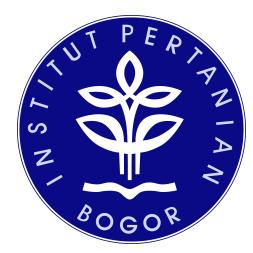
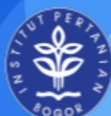

# **SOFTWARE DEVELOPMENT PLAN AUTOMATED WEB-BASED VARIANT CALLING PLATFORM UNTUK ANALISIS DATA GENOMIK**

#### **Dosen Pengampu:**

Prof. Dr. Eng. Wisnu Ananta Kusuma S.T., M.T.

#### **Asisten Praktikum:**

Said Thaufik Rizaldi, S.Kom., M.Kom Gilland Fauta Putra Achyar, S.Mat., M.Kom.

#### **Disusun Oleh Kelompok GenoSys (3):**

| Dhafin   | Fasya   | Arifin           | G0401241017 |
|----------|---------|------------------|-------------|
| Rakazaki | Putra   | Hendrawan        | G0401241056 |
| Yafits   | Mubarak |                  | G0401241001 |
| Muhammad |         | Fattha Akbarsyah | G0401241008 |
| Abid     | Ra’fad  | Aziz             | G0401241029 |

**MATA KULIAH PEMBANGUNAN PERANGKAT LUNAK BIOINFORMATIKA**

**PROGRAM STUDI BIOINFORMATIKA FAKULTAS MATEMATIKA DAN ILMU PENGETAHUAN ALAM INSTITUT PERTANIAN BOGOR**

#### **DAFTAR ISI**

|    | DAFTAR  |                 | ISI........................................................................................................... 1   |
|----|---------|-----------------|--------------------------------------------------------------------------------------------------------------------|
| 1. |         | Gambaran Proyek | (Project Overview).........................................................................2                       |
| 2. |         | Organisasi      | Proyek.......................................................................................................... 3 |
| 3. | Rencana | Manajemen       | Proyek.........................................................................................5                   |
|    | 3.1     | Work Breakdown  | Structure (WBS)......................................................................... 5                         |
|    | 3.2     | Jadwal dan      | Milestone pada SDP..............................................................................9                  |
|    | 3.3     | Rencana         | Sumber Daya dan Anggaran Proyek.......................................................10                           |
|    | 3.4     | Manajemen       | Risiko Proyek.....................................................................................12               |
| 4. | Rencana | Teknis          | Pengembangan..................................................................................14                   |
|    | 4.1     | Kebutuhan       | dan Prioritas Fitur................................................................................14              |
|    | 4.2     | Arsitektur      | dan Workflow Solusi............................................................................ 21                 |
| 5. | Rencana | Pendukung       | Proyek....................................................................................... 23                   |
|    | 5.1     | Rencana         | Pengujian dan Penjaminan Kualitas........................................................24                        |
|    | 5.2     | Dokumentasi,    | Indikator Keberhasilan, dan Pelacakan Konfigurasi...................... 24                                         |

## **1. Gambaran Proyek (Project Overview)**

Bagian ini menjelaskan konteks dan arah proyek secara ringkas, mencakup masalah yang melatarbelakangi pengembangan, pengguna sasaran, tujuan perangkat lunak, ruang lingkup, batasan, serta gambaran solusi yang ditawarkan. Seluruh isi bagian ini disusun konsisten dengan proposal penawaran yang telah direvisi.

**Tabel 1** Gambaran proyek

| Aspek Luaran                  | dalam laporan    |                   |             |
|-------------------------------|------------------|-------------------|-------------|
| Identitas proyek Proyek       | "Human           | GVC"              | oleh        |
| Kelompok                      | GenoSys          | (3)               |             |
| Masalah dan konteks Proses    | analisis variant | calling           | saat ini    |
| umumnya                       | dilakukan        | secara            | manual      |
| menggunakan                   |                  | berbagai          | perangkat   |
| lunak                         | bioinformatika   | terpisah          | melalui     |
| command                       | line. Pendekatan |                   | ini sangat  |
| kompleks,                     | rentan           | terhadap          | kesalahan   |
| ( human                       | error )          | dalam             | pengaturan  |
| parameter,                    |                  | dan               | menyulitkan |
| pengelolaan                   | output           | file              | sequencing  |
| berukuran                     | besar            | antar-tahapan     | yang        |
| tidak terintegrasi.           |                  |                   |             |
| Pengguna sasaran Pengguna     | utamanya         | adalah            | analis data |
| genomik,                      | peneliti,        | atau              | praktisi    |
| bioinformatika                |                  | yang membutuhkan  |             |
| platform                      | untuk memproses  |                   | alur kerja  |
| variant                       | calling secara   | terstruktur       | dan         |
| terotomatisasi                | tanpa            | harus             | mengetik    |
| perintah                      | command          | line yang         | rumit.      |
| Tujuan perangkat lunak Sistem | membantu         |                   | pengguna    |
| menyelesaikan                 |                  | kerumitan         | eksekusi    |
| dan                           | pengelolaan      | analisis          | genomik     |
| manual                        | melalui          | integrasi         | antarmuka   |
| web,                          | basis            | data,             | dan alur    |
| bioinformatika                |                  | agar menghasilkan |             |
| luaran                        | informasi        | variasi genetik   | (VCF        |
| & CSV)                        | yang             | mudah             | diakses dan |

**Tabel 1** Gambaran proyek (lanjutan)

| Aspek Luaran                            | dalam                 | laporan          |              |
|-----------------------------------------|-----------------------|------------------|--------------|
| Ruang lingkup Fokus                     | pada Germline         | Variant          | Calling      |
| untuk                                   | Whole                 | Exome            | Sequencing   |
| (WES)                                   | dan                   | targeted         | panel        |
| menggunakan                             |                       | genom referensi  | Homo         |
| sapiens                                 | (GRCh38/hg38).        |                  | Pipeline     |
| meliputi                                | validasi              | file, quality    | control      |
| (FastQC),                               | trimming              | (fastp),         | alignment    |
| (BWA-MEM2),                             |                       | pengolahan       | BAM          |
| (SAMtools),                             |                       | dan              | variant      |
| calling/filtering                       |                       | (bcftools).      | Serta        |
| mencakup                                | antarmuka             | unggah           | data,        |
| progress                                | tracker,              | dan result       | viewer       |
| Batasan dan asumsi Terbatas             | pada                  | input            | sequencing   |
| short-reads                             |                       | Illumina         | berformat    |
| FASTQ/FASTQ.GZ                          |                       | paired-end       | Tidak        |
| mencakup                                | Whole                 | Genome           | Sequencing   |
| (WGS),                                  | analisis              | struktural       | variant      |
| skala                                   | besar,                | dan mutasi       | somatik      |
| (tumor-normal                           |                       | pairing ).       | Sistem tidak |
| menjamin                                | kompatibilitas        |                  | di luar      |
| Illumina                                | dan                   | tidak dirancang  | untuk        |
| komputasi                               | terdistribusi         | skala            | produksi     |
| Usulan solusi dan deliverable Solusinya | berupa                | prototype        | aplikasi     |
| web                                     | terintegrasi          | dengan           | arsitektur   |
| frontend                                | (Next.js),            | backend          | (FastAPI),   |
| task                                    | queue (Celery/Redis), |                  | dan basis    |
| data                                    | (PostgreSQL)          | yang             | dikemas      |
| dalam                                   | container             | docker           | Deliverable  |
| akhir                                   | mencakup              | prototype        | perangkat    |
| lunak,                                  | source code,          | laporan          | pengujian    |
| (testing                                | report),              | dokumentasi      | sistem       |
| (pengguna                               | &                     | teknis), riwayat | versi,       |
| serta                                   | demonstrasi           | aplikasi.        |              |

# **2. Organisasi Proyek**

Bagian ini menjelaskan pembagian peran dalam tim beserta tanggung jawab dan luaran yang menjadi tanggung jawab masing-masing anggota. Tim proyek terdiri atas lima anggota dengan peran *Project Manager*, *System Analyst*,

*Front-End Developer*, *Back-End Developer*, dan *Quality Assurance*, sebagaimana disajikan pada [Tabel](#page-4-0) 2.

**Tabel 2** Organisasi proyek

| Peran Anggota/PIC Tanggung jawab           |                    |
|--------------------------------------------|--------------------|
|                                            | Output atau        |
| Project Manager Dhafin Fasya               |                    |
| koordinasi                                 | tugas              |
| tim, komunikasi                            |                    |
| dengan                                     | klien,             |
| serta pemantauan                           |                    |
| jadwal                                     | dan                |
|                                            | Plan (SDP),        |
|                                            | laporan progress,  |
|                                            | dan keputusan      |
|                                            | mitigasi risiko.   |
| System Analyst Yafits Mubarak Menganalisis |                    |
| kebutuhan sistem,                          |                    |
| perangkat lunak,                           |                    |
| mendesain                                  | basis              |
| data,                                      | dan                |
| memodelkan                                 | alur               |
|                                            | kebutuhan, Entity  |
|                                            | Diagram (ERD),     |
|                                            | arsitektur, dan    |
|                                            | flowchart sistem.  |
| Abid Ra’fad Aziz Mengembangkan             |                    |
| antarmuka                                  | web                |
| Next.js/React                              | dan                |
| API di sisi                                | klien              |
| ( client-side ).                           |                    |
|                                            | Kode sumber        |
|                                            | front-end ,        |
|                                            | pengguna (UI)      |
|                                            | aplikasi, dan      |
|                                            | komponen web       |
|                                            | result viewer      |
| Rakazaki Putra                             |                    |
| API, mengelola                             |                    |
| basis data,                                | dan                |
| pipeline variant                           |                    |
| calling dengan                             |                    |
| task queue                                 |                    |
|                                            | Kode sumber        |
|                                            | back-end , API     |
|                                            | endpoints , skema  |
|                                            | basis data, dan    |
|                                            | script otomatisasi |

**Tabel 2** Organisasi proyek (lanjutan)

| Peran Anggota/PIC Tanggung | jawab               |
|----------------------------|---------------------|
|                            | Output atau         |
| Fattha Akbarsyah           |                     |
| Merancang                  | dan                 |
| pengujian                  | sistem,             |
| melacak                    | bug,                |
| serta                      | memastikan          |
| sistem                     | sesuai              |
| dengan                     | spesifikasi         |
|                            | pengujian ( test    |
|                            | cases ), laporan    |
|                            | pengujian ( testing |
|                            | report ), dan tiket |
|                            | pelaporan bug       |

## **3. Rencana Manajemen Proyek**

Bagian ini menerjemahkan ruang lingkup proyek menjadi pekerjaan yang terukur, mencakup pemecahan pekerjaan (WBS), jadwal dan *milestone*, kebutuhan sumber daya, serta manajemen risiko selama periode pengembangan 14 minggu.

# **3.1** *Work Breakdown Structure* **(WBS)**

Pekerjaan proyek dipecah menjadi paket-paket kerja yang spesifik dan dapat diperiksa hasilnya, mengikuti urutan tahapan pengembangan mulai dari perencanaan, analisis kebutuhan, perancangan, implementasi, hingga pengujian dan penyerahan sistem. Setiap pekerjaan memiliki PIC utama dan dependensi terhadap pekerjaan sebelumnya, sebagaimana disajikan pada [Tabel](#page-5-2) 3.

**Tabel 3** *Work breakdown structure*

| No. | Pekerjaan           |             | Deliverabe/ |       |             |             |
|-----|---------------------|-------------|-------------|-------|-------------|-------------|
|     |                     |             |             |       | PIC         | Dependensi  |
| 1   | Penyusunan          | Rencana     |             |       |             |             |
|     | Manajemen           | Proyek      |             |       |             |             |
|     | ( Software          | Development |             |       |             |             |
|     | Plan )              |             |             |       |             |             |
| 2.1 | Wawancara/kuesioner |             |             |       |             |             |
|     | kebutuhan           | pengguna    |             |       |             |             |
|     |                     |             | Catatan     | hasil |             |             |
|     |                     |             |             |       | Yafits (SA) | Pekerjaan 1 |

**Tabel 3** *Work breakdown structure* (lanjutan)

| No. | Pekerjaan                    | Deliverable/    |             |              |
|-----|------------------------------|-----------------|-------------|--------------|
|     |                              |                 | PIC         | Dependensi   |
| 2.2 | Penyusunan use case dan      |                 |             |              |
|     | dokumen SRS                  |                 |             |              |
|     |                              |                 | Yafits (SA) | Pekerjaan    |
| 3.1 | Perancangan wireframe alur   |                 |             |              |
|     | unggah, tracker , dan result |                 |             |              |
|     |                              |                 | Abid (FE)   | Pekerjaan    |
| 3.2 | Pembuatan high-fidelity      |                 |             |              |
|     | prototype antarmuka          |                 |             |              |
|     |                              | Prototipe UI    |             |              |
|     |                              |                 | Abid (FE)   | Pekerjaan    |
| 4.1 | Perancangan diagram          |                 |             |              |
|     | arsitektur sistem            |                 |             |              |
|     |                              |                 | Yafits (SA) | Pekerjaan    |
| 4.2 | Perancangan ERD skema        |                 |             |              |
|     | basis data                   |                 |             |              |
|     |                              |                 | Yafits (SA) | Pekerjaan    |
| 4.3 | Perancangan flowchart alur   |                 |             |              |
|     | pipeline bioinformatika      |                 |             |              |
|     |                              |                 | Yafits (SA) | Pekerjaan    |
| 5.1 | Implementasi skema tabel     |                 |             |              |
|     | Sample dan Analysis          |                 |             |              |
|     |                              | Skrip DDL       |             |              |
|     |                              |                 |             | Pekerjaa 4.2 |
| 5.2 | Implementasi skema tabel     |                 |             |              |
|     | Variant dan Genotype         |                 |             |              |
|     |                              | Skrip DDL       |             |              |
| 5.3 | Migrasi skema dan seeding    |                 |             |              |
|     | data uji                     |                 |             |              |
|     |                              | Basis data      |             |              |
|     |                              | terisi data uji |             |              |
| 6.1 | Pengembangan endpoint        |                 |             |              |
|     | unggah & validasi FASTQ      |                 |             |              |
|     |                              | API /upload     |             |              |
| 6.2 | Pengembangan endpoint        | Endpoint        | Rakazaki    | Pekerjaan    |

status & progres analisis API /status (BE) [6.1](#)

**Tabel 3** Work breakdown structure (WBS) (lanjutan)

| No. | Pekerjaan                                                                              | Deliverabe/ Bukti                        | PIC           | Dependensi                                                      |
|-----|----------------------------------------------------------------------------------------|---------------------------------------------|---------------|-----------------------------------------------------------------|
| 6.3 | Pengembangan endpoint hasil & unduh (VCF/CSV)                                          | Endpoint API /result, /download             | Rakazaki (BE) | <a href="#">Pekerjaan 6.2</a>                                   |
| 6.4 | Penyusunan dokumentasi API otomatis                                                    | Dokumentasi Swagger/Op enAPI                | Rakazaki (BE) | <a href="#">Pekerjaan 6.3</a>                                   |
| 7.1 | Pembuatan <i>script</i> tahap <i>Quality Control</i> & <i>Trimming</i> (FastQC, fastp) | Skrip QC-Trimming                           | Rakazaki (BE) | <a href="#">Pekerjaan 4.3</a>                                   |
| 7.2 | Pembuatan <i>script</i> tahap <i>Alignment</i> & pengolahan BAM (BWA-MEM2, SAMtools)   | Skrip <i>Alignment-B</i> AM Processing      | Rakazaki (BE) | <a href="#">Pekerjaan 7.1</a>                                   |
| 7.3 | Pembuatan <i>script</i> tahap <i>Variant Calling</i> & <i>Filtering</i> (bcftools)     | Skrip <i>Variant Calling-Filtering</i>      | Rakazaki (BE) | <a href="#">Pekerjaan 7.2</a>                                   |
| 7.4 | Orkestrasi seluruh tahap pipeline menggunakan Nextflow/Snakemake                       | Konfigurasi <i>workflow</i> orkestrasi      | Rakazaki (BE) | <a href="#">Pekerjaan 7.3</a>                                   |
| 8.1 | <i>Setup</i> Celery <i>worker</i> dan Redis <i>broker</i>                              | Layanan <i>worker</i> & <i>broker</i> aktif | Rakazaki (BE) | <a href="#">Pekerjaan 7.4</a>                                   |
| 8.2 | Integrasi <i>dispatch job</i> dari API ke <i>task queue</i>                            | Mekanisme <i>job dispatch</i> berfungsi     | Rakazaki (BE) | <a href="#">Pekerjaan 6.3</a> dan <a href="#">pekerjaan 8.1</a> |
| 8.3 | Implementasi pembaruan status <i>real-time</i> ke basis data                           | Status <i>pipeline</i> terupdate otomatis   | Rakazaki (BE) | <a href="#">Pekerjaan 8.2</a>                                   |
| 9.1 | Pengembangan halaman unggah data                                                       | Halaman unggah FASTQ                        | Abid (FE)     | <a href="#">Pekerjaan 3.2</a> dan <a href="#">pekerjaan 6.1</a> |

**Tabel 3** *Work breakdown structure* (WBS) (lanjutan)

| No. Pekerjaan Deliverabe/            |                       |
|--------------------------------------|-----------------------|
|                                      | PIC Dependensi        |
| 9.2 Pengembangan progress            |                       |
|                                      | Abid (FE) Pekerjaan   |
|                                      | 9.1 dan               |
| 9.3 Pengembangan Result              |                       |
| Viewer (tabel, statistik,            |                       |
|                                      | Abid (FE) Pekerjaan   |
| 9.4 Implementasi fitur unduh         |                       |
| hasil (VCF/CSV)                      |                       |
|                                      | Abid (FE) Pekerjaan   |
| 10.1 Unit testing tiap modul         |                       |
| backend dan frontend                 |                       |
| Laporan                              | unit                  |
|                                      | Fattha (QA) Pekerjaan |
|                                      | 8.3 dan               |
| 10.2 Integration testing API dan     |                       |
| task queue                           |                       |
|                                      | Fattha (QA) Pekerjaan |
| 10.3 Validasi akurasi hasil          |                       |
| variant calling dengan               |                       |
| dataset benchmark                    |                       |
|                                      | Fattha (QA) Pekerjaan |
| 10.4 Uji beban ( stress test ) untuk |                       |
| file sequencing berukuran            |                       |
| stress                               | test                  |
|                                      | Fattha (QA) Pekerjaan |
| 11.1 Kontainerisasi seluruh          |                       |
| service menggunakan                  |                       |
| Dockerfile                           | &                     |
| 11.2 Konfigurasi deployment ke       |                       |
| server cloud (Biznet GIO)            |                       |
| Aplikasi                             | live                  |
| di                                   | server                |
|                                      | (BE) /                |
| 11.3 Konfigurasi domain dan          |                       |
| sertifikat SSL                       |                       |
| dapat                                | diakses               |
| via                                  | HTTPS                 |

**Tabel 3** *Work breakdown structure* (WBS) (lanjutan)

| No.  | Pekerjaan  | Deliverabe/           |
|------|------------|-----------------------|
|      |            | PIC Dependensi        |
| 12.1 | Penyusunan | User Guide Dokumen    |
| 12.2 | Penyusunan | Technical             |
|      | Guide      | (arsitektur, ERD,     |
|      |            | Fattha (QA) Pekerjaan |
| 12.3 | Penyusunan | slide presentasi      |
| &    | skrip demo |                       |
|      |            | presentasi &          |
|      |            | 12.1 dan              |

# **3.2 Jadwal dan** *Milestone* **pada SDP**

Jadwal pengembangan disusun berdasarkan paket pekerjaan pada WBS, dikelompokkan ke dalam tujuh periode sepanjang 14 minggu. Setiap periode memiliki target pekerjaan dan bukti keberhasilan yang dapat diperiksa untuk memantau progres proyek.

**Tabel 4** Jadwal dan *milestone* pada SDP

| Periode Milestone Target | pekerjaan Bukti    |
|--------------------------|--------------------|
| Minggu 1–2 Inisiasi &    |                    |
| Penyusunan               | Proposal           |
| &                        | Rencana            |
| Manajemen                | Proyek             |
|                          | Penawaran &        |
|                          | Dokumen SDP        |
| Minggu 3–4 Finalisasi    |                    |
| Analisis                 | kebutuhan          |
| pengguna,                | use case ,         |
| dan                      | spesifikasi teknis |
| Minggu 5–6 Desain        |                    |
| Arsitektur &             |                    |
| tampilan                 | UI web,            |
| skema                    | basis data, dan    |
| arsitektur               | pipeline           |
|                          | Prototipe UI       |
|                          | interaktif &       |
|                          | Arsitektur Sistem  |

**Tabel 4** Jadwal dan *milestone* pada SDP (lanjutan)

| Periode Milestone Target pekerjaan | Bukti             |
|------------------------------------|-------------------|
| Minggu 7–9 Integrasi               |                   |
| Backend &                          |                   |
| Basis Data                         |                   |
| pembuatan                          | API               |
| FastAPI,                           | serta             |
| prototipe                          | awal              |
|                                    | Basis Data        |
|                                    | terintegrasi API  |
|                                    | & Prototipe awal  |
|                                    | dapat dijalankan  |
| Minggu 10–11 Integrasi             |                   |
| Pipeline &                         |                   |
| Integrasi                          | tools             |
| dengan                             | Celery/Redis      |
| &                                  | pembuatan         |
| antarmuka                          | Next.js           |
|                                    | Pipeline variant  |
|                                    | calling berjalan  |
|                                    | penuh dari        |
|                                    | antarmuka web     |
| Minggu 12–13 Pengujian,            |                   |
| Perbaikan, &                       |                   |
| perbaikan                          | bug, serta        |
| hosting                            | ke server         |
|                                    | Dokumen Testing   |
|                                    | Report &          |
|                                    | Aplikasi aktif di |
|                                    | server cloud      |
| Minggu 14 Serah Terima             |                   |
| & Presentasi                       |                   |
| pengguna/teknis                    | serta             |
| demonstrasi                        | produk            |
|                                    | Pengguna &        |
|                                    | Presentasi produk |

#### **3.3 Rencana Sumber Daya dan Anggaran Proyek**

Kebutuhan sumber daya proyek mencakup honorarium tim, infrastruktur komputasi dan penyimpanan, layanan pendukung, serta kebutuhan pengujian dan dokumentasi. Estimasi biaya disusun berdasarkan spesifikasi teknis yang telah ditentukan pada arsitektur solusi, dengan total anggaran Rp50.000.000,00.

**Tabel 5** Rencana sumber daya dan anggaran proyek

| No | Komponen                   | Keterangan        | Estimasi Biaya |
|----|----------------------------|-------------------|----------------|
| 1  | Honorarium Project Manager | Koordinasi,       |                |
|    |                            | komunikasi client |                |

**Tabel 5** Rencana sumber daya dan anggaran proyek (lanjutan)

| No | Komponen | Keterangan | Estimasi Biaya |
|----|----------|------------|----------------|
|    |          |            |                |

| 2 Honorarium System Analyst Analisis        |             |
|---------------------------------------------|-------------|
| sistem                                      | &           |
| 3 Honorarium Front-End                      |             |
| antarmuka                                   | &           |
| integrasi                                   | API         |
| 4 Honorarium Back-End                       |             |
| API,                                        | database ,  |
| integrasi                                   | pipeline    |
| 5 Honorarium Software Tester /QA Pengujian, |             |
| validasi                                    | sistem,     |
| dokumentasi                                 | uji         |
| 6 Computational resource : AWS              |             |
| EC2 (8vCPU, 32 GB RAM)                      |             |
| Cloud                                       | compute     |
| untuk                                       | alignment   |
| & variant                                   | calling     |
| 7 Storage data : AWS S3 dengan              |             |
| kapasitas 1 TB Standard Storage             |             |
| Penyimpanan                                 | data        |
| sequencing                                  | &           |
| hasil                                       | analisis    |
| 8 Hosting/deployment : Biznet GIO           |             |
| Cloud VPS app server (4 vCPU,               |             |
| 8 GB RAM), registrasi domain,               |             |
| sertifikat SSL                              |             |
| Server                                      | untuk       |
| deployment                                  | &           |
| demo                                        | prototype   |
| 9 Software/service pendukung:               |             |
| Trello ( Standard plan ) & GitHub           |             |
| ( Enterprise )                              |             |
| Version                                     | control ,   |
| task                                        | management  |
| tools ,                                     | dan alokasi |
| CI/CD                                       | minutes     |
| (GitHub                                     | Actions)    |
| 10 Pengujian Dataset                        |             |
| benchmark                                   | & uji       |

**Tabel 5** Rencana sumber daya dan anggaran proyek (lanjutan)

| No | Komponen | Keterangan | Estimasi Biaya |
|----|----------|------------|----------------|
|    |          |            |                |

| 11 Dokumentasi dan kebutuhan |                 |
|------------------------------|-----------------|
| Penyusunan                   | user            |
| &                            | technical       |
| TOTAL                        | Rp50.000.000,00 |

# **3.4 Manajemen Risiko Proyek**

Risiko proyek diidentifikasi berdasarkan potensi kendala teknis, operasional, dan pengelolaan tim selama periode pengembangan. Setiap risiko dicatat beserta penyebab, dampak, tindakan mitigasi atau rencana cadangan, dan PIC yang bertanggung jawab memantaunya.

**Tabel 6** Manajemen risiko proyek

| Tabel 6 Manajemen      | risiko proyek  |
|------------------------|----------------|
| Risiko Penyebab Dampak | Mitigasi/renc  |
| Ukuran file            |                |
| input besar &          |                |
| Ukuran file            |                |
| TQ.GZ yang             |                |
| sangat besar           |                |
| terhenti               | di             |
| tengah                 | jalan,         |
| atau                   | storage        |
| server                 | penuh.         |
|                        | Batasi ukuran  |
|                        | data uji untuk |
|                        | validasi file  |
|                        | sejak awal,    |
|                        | dan jalankan   |
|                        | otomatis file  |
|                        | setelah hasil  |
|                        | akhir VCF      |

**Tabel 6** Manajemen risiko proyek (lanjutan)

| Risiko | Penyebab | Dampak | Mitigasi/renc | PIC |
|--------|----------|--------|---------------|-----|
|        |          |        |               |     |

|                                                                                                                                                              | ana cadangan                                                                                                              |
|--------------------------------------------------------------------------------------------------------------------------------------------------------------|---------------------------------------------------------------------------------------------------------------------------|
| pada basis                                                                                                                                                   |                                                                                                                           |
| data / data                                                                                                                                                  |                                                                                                                           |
| kueri, migrasi                                                                                                                                               |                                                                                                                           |
| skema yang                                                                                                                                                   |                                                                                                                           |
| terputus, atau                                                                                                                                               |                                                                                                                           |
| crash pada                                                                                                                                                   |                                                                                                                           |
| Data Kesalahan Kegagalan analisis                                                                                                                            | hasil Terapkan Rakazaki pengecekan (BE)                                                                                   |
| hilang,                                                                                                                                                      | status integritas                                                                                                         |
| corrupt                                                                                                                                                      | , atau                                                                                                                    |
| dengan                                                                                                                                                       | benar.                                                                                                                    |
| hilang proses server tidak                                                                                                                                   | data, validasi skema relasional,                                                                                          |
| PostgreSQL.                                                                                                                                                  | serta lakukan tersimpan pencadangan                                                                                       |
|                                                                                                                                                              | ( backup )                                                                                                                |
|                                                                                                                                                              | basis data secara berkala.                                                                                                |
| tidak valid                                                                                                                                                  |                                                                                                                           |
| atau integrasi                                                                                                                                               |                                                                                                                           |
| format file                                                                                                                                                  |                                                                                                                           |
| yang salah                                                                                                                                                   |                                                                                                                           |
| atau file                                                                                                                                                    |                                                                                                                           |
| berjalan,                                                                                                                                                    | hasil                                                                                                                     |
| analisis                                                                                                                                                     | tidak                                                                                                                     |
| akurat,                                                                                                                                                      | atau                                                                                                                      |
| fitur                                                                                                                                                        | terhenti.                                                                                                                 |
|                                                                                                                                                              | dan validasi                                                                                                              |
|                                                                                                                                                              | ekstensi/ head                                                                                                            |
|                                                                                                                                                              | er data di                                                                                                                |
|                                                                                                                                                              | awal sebelum                                                                                                              |
| Data Pengguna Pipeline masukan mengunggah gagal gagal FASTQ terdistorsi. Keterbatasan Proses Proses kemampuan alignment analisis komputasi (BWA-MEM berjalan | Yafits (SA) / Terapkan modul Rakazaki pengecekan (BE) masuk pipeline pengolahan. Jalankan Rakazaki pemrosesan (BE) secara |
| n CPU dan                                                                                                                                                    |                                                                                                                           |
| RAM tinggi                                                                                                                                                   |                                                                                                                           |
| batas server.                                                                                                                                                |                                                                                                                           |
| sangat server 2)                                                                                                                                             | lama, asynchronous                                                                                                        |
| timout, membutuhka server                                                                                                                                    | atau menggunakan Celery/Redis                                                                                             |
| Out                                                                                                                                                          | of                                                                                                                        |
|                                                                                                                                                              | task queue , mengalami                                                                                                    |
| melampaui                                                                                                                                                    | serta batasi                                                                                                              |
| Memory                                                                                                                                                       | kapasitas data                                                                                                            |
| (OOM).                                                                                                                                                       | uji coba.                                                                                                                 |

**Tabel 6** Manajemen risiko proyek (lanjutan)

| Risiko    |          | Penyebab      | Dampak   |          | Mitigasi/renc  |
|-----------|----------|---------------|----------|----------|----------------|
| analisis  | gagal    |               |          |          |                |
| di        | tengah   |               |          |          |                |
|           |          | runtime pada  |          |          |                |
|           |          | a (misal:     |          |          |                |
|           |          |               | terhenti | tanpa    |                |
|           |          |               | yang     | jelas    |                |
|           |          |               |          |          | log ( logging  |
|           |          |               |          |          | system ) yang  |
|           |          |               |          |          | handling di    |
| an        | antar    |               |          |          |                |
| peranti   | lunak    |               |          |          |                |
|           |          | atau pustaka  |          |          |                |
|           |          | a di          |          |          |                |
|           |          | OS server.    |          |          |                |
|           |          |               | Pipeline | tidak    |                |
|           |          |               | saat     | dipindah |                |
|           |          |               | server   | cloud    |                |
|           |          |               |          |          | docker untuk   |
|           |          |               |          |          | seluruh tools  |
|           |          |               |          |          | dalam satu     |
| Terjadi   | bug      |               |          |          |                |
| pada      | aplikasi |               |          |          |                |
|           |          | logika pada   |          |          |                |
|           |          | integrasi API |          |          |                |
|           |          |               | Fitur    | result   |                |
|           |          |               | viewer   | atau     |                |
|           |          |               | progres  | tidak    |                |
|           |          |               |          |          | aplikasi (unit |
|           |          |               |          |          | & integration  |
|           |          |               |          |          | testing )      |
|           |          |               |          |          | dan berulang   |
|           |          |               |          |          | sebelum rilis. |
|           |          |               |          |          | Abid (FE) /    |
|           |          |               |          |          | Fattha (QA)    |
| kebutuhan | di       |               |          |          |                |
|           |          | fitur di luar |          |          |                |
|           |          |               |          |          | ( freeze )     |
|           |          |               |          |          | sistem setelah |
|           |          |               |          |          | Dhafin (PM)    |

|                          |                                        |                                |  |  |  |
|---------------------------------------|----------------------------------------|---------------------------------------------|--|---------------|--|
| awal proposal ( <i>scope creep</i> ). | mengganggu jadwal penyelesaian proyek. | fase <i>Requirement Analysis</i> disetujui. |  |               |  |

#### **4. Rencana Teknis Pengembangan**

Bagian Rencana Teknis Pengembangan menguraikan spesifikasi perangkat lunak secara ringkas, berfokus pada definisi sistem yang akan dibangun beserta mekanisme operasionalnya. Spesifikasi ini mencakup pemetaan kebutuhan fungsional dan nonfungsional yang disusun berdasarkan skala prioritas pengerjaan guna mencapai target *Minimum Viable Product* (MVP) secara efisien. Selain itu, bagian ini juga menyajikan gambaran umum mengenai rancangan arsitektur dan aliran kerja (*workflow*) solusi, yang mendeskripsikan integrasi antarkomponen mulai dari tahapan penerimaan masukan (*Input*), orkestrasi pemrosesan komputasi (*Process/Workflow*), manajemen penyimpanan data (*Storage*), hingga penyajian hasil analisis pada antarmuka pengguna (*Output/UI*).

## **4.1 Kebutuhan dan Prioritas Fitur**

Spesifikasi perangkat lunak pada proyek ini didasarkan pada identifikasi kebutuhan fungsional dan nonfungsional yang telah diselaraskan dengan tujuan sistem. Kebutuhan fungsional mendefinisikan kapabilitas operasi utama sistem, sedangkan kebutuhan nonfungsional memastikan standar kualitas seperti keandalan dan responsivitas terpenuhi. Seluruh kebutuhan tersebut dievaluasi dan diklasifikasikan menggunakan skala prioritas untuk memastikan efisiensi waktu pengerjaan. Rangkaian fitur dengan prioritas utama (*Must-have*) akan diimplementasikan terlebih dahulu untuk membentuk *Minimum Viable Product* (MVP), yang berfungsi sebagai landasan operasional sistem sebelum fitur lanjutan (*Should-have* atau *Could-have*) ditambahkan.

**Tabel 7** Kebutuhan dan prioritas fitur

| Jenis Kebutuhan/       |              |
|------------------------|--------------|
| Prioritas Kriteria     |              |
| Fungsional Unggah Data |              |
| Must-have Pengguna     |              |
| web                    | dan          |
| menerima               | file         |
| yang                   | sesuai       |
| dengan                 | format       |
|                        | Abid (FE)    |
|                        | dan Rakazaki |
| Fungsional Validasi    |              |
| Input Data             |              |
| Must-have Sistem       | dapat        |
| ekstensi               | file,        |
| ukuran                 | file,        |
| pasangan               | read         |
| (R1/R2),               | serta        |
| struktur               | dasar        |
| FASTQ                  | dan          |
| pesan                  | apabila      |
| input                  | tidak        |
|                        | Abid (FE)    |
|                        | dan Rakazaki |

**Tabel 7** Kebutuhan dan prioritas fitur (lanjutan)

| Jenis Kebutuhan/     |              |
|----------------------|--------------|
| Prioritas Kriteria   |              |
| Fungsional Pemilihan |              |
| Must-have Sistem     |              |
| yang                 | telah        |
| tersedia             | pada         |
| tidak                | perlu        |
| secara               | manual.      |
|                      | Yafits (SA)  |
|                      | dan Rakazaki |
| Fungsional Eksekusi  |              |
| Must-have Pengguna   |              |
| dapat                | memulai      |
| analisis             | setelah      |
| input                | valid dan    |
| variant              | calling      |
|                      | Yafits (SA)  |
|                      | dan Rakazaki |
| Fungsional Quality   |              |
| (QC) Data            |              |
| Must-have Sistem     |              |
| terhadap             | data         |
| raw                  | reads dan    |
| keluaran             | QC           |
| yang                 | dapat        |
| kualitas             | data.        |
|                      | Yafits (SA)  |
|                      | dan Rakazaki |

**Tabel 7** Kebutuhan dan prioritas fitur (lanjutan)

| Jenis Kebutuhan/     |              |
|----------------------|--------------|
| Prioritas Kriteria   |              |
| Fungsional Trimming  |              |
| Must-have Sistem     |              |
| fastp                | dan          |
| clean                | reads        |
| sebagai              | input        |
|                      | Yafits (SA)  |
|                      | dan Rakazaki |
| Fungsional Alignment |              |
| Must-have Sistem     | dapat        |
| reads                | terhadap     |
| file                 | hasil        |
|                      | Yafits (SA)  |
|                      | dan Rakazaki |
| Fungsional BAM       |              |
| Must-have Sistem     | dapat        |
| sorting              | dan          |
| indexing             | file         |
| SAMtools             | dan          |
|                      | Yafits (SA)  |
|                      | dan Rakazaki |
| Fungsional Variant   |              |
| Must-have Sistem     |              |
| bcftools             | untuk        |
| kandidat             | SNP          |
| dan Indel            | dari         |
|                      | Yafits (SA)  |
|                      | dan Rakazaki |

**Tabel 7** Kebutuhan dan prioritas fitur (lanjutan)

| Jenis Kebutuhan/      |                  |
|-----------------------|------------------|
| Prioritas             | Kriteria         |
| Fungsional Penyimpana |                  |
| n Hasil               |                  |
| Must-have             | Metadata         |
|                       | analisis, status |
| proses,               | dan              |
| hasil                 | variant          |
| calling               | dapat            |
|                       | disimpan dan     |
| dengan                | sampel           |
| yang                  | sesuai.          |
| Fungsional Monitoring |                  |
| Must-have             | Pengguna         |
| dapat                 | melihat          |
| status                | dan              |
|                       | Abid (FE)        |
|                       | dan Rakazaki     |
| Fungsional Result     |                  |
| Must-have Sistem      |                  |
| dalam                 | bentuk           |
| tabel                 | yang             |
| posisi,               | REF,             |
| ALT,                  | dan              |
| quality               | score            |
|                       | Abid (FE)        |

**Tabel 7** Kebutuhan dan prioritas fitur (lanjutan)

| Jenis Kebutuhan/        |                 |
|-------------------------|-----------------|
| Prioritas               | Kriteria        |
| Fungsional Unduh Hasil  |                 |
| Must-have               | Pengguna        |
| hasil                   | analisis        |
| dalam                   | format          |
| VCF                     | dan CSV         |
|                         | Abid (FE)       |
|                         | dan Rakazaki    |
| Fungsional Visualisasi  |                 |
| Should-have Sistem      |                 |
|                         | Abid (FE)       |
| Fungsional Riwayat      |                 |
| Should-have             | Pengguna        |
| dapat                   | melihat         |
| daftar                  | analisis        |
| yang                    | pernah          |
|                         | sampel, status, |
| dan                     | waktu           |
|                         | Abid (FE)       |
| Fungsional Detail Hasil |                 |
| Should-have             | Pengguna        |
| dapat                   | melihat         |
| terkait                 | varian          |
| dan                     | genotipe        |
| pada                    | Result          |
|                         | Abid (FE)       |
|                         | dan Rakazaki    |

**Tabel 7** Kebutuhan dan prioritas fitur (lanjutan)

| Jenis Kebutuhan/           |             |
|----------------------------|-------------|
| Prioritas Kriteria         |             |
| Nonfungsional Usability    |             |
| Must-have Pengguna         |             |
| utama                      | melalui     |
| web                        | tanpa       |
| command                    | line        |
|                            | Abid (FE)   |
| Nonfungsional Responsivita |             |
| s Sistem                   |             |
| Must-have Proses           |             |
| web                        | berhenti    |
| selama                     | analisis    |
| Nonfungsional Validasi dan |             |
| Must-have Sistem           |             |
| menolak                    | input       |
| yang                       | tidak       |
| sesuai                     | dan         |
| akses                      | terhadap    |
| data                       | serta hasil |
| analisis                   | sesuai      |

**Tabel 7** Kebutuhan dan prioritas fitur (lanjutan)

| Jenis Kebutuhan/           |              |
|----------------------------|--------------|
| Prioritas Kriteria         |              |
| Nonfungsional Maintainabil |              |
| Should-have Komponen       |              |
| frontend                   | ,            |
| backend                    | ,            |
| database                   | , dan        |
| sehingga                   | dapat        |
| atau                       | diperbaiki   |
|                            | Seluruh Tim  |
| Nonfungsional Monitoring   |              |
| dan Logging                |              |
| Should-have Sistem         |              |
| status                     | proses       |
| dan                        | pesan        |
| analisis                   | dapat        |
| Nonfungsional Scalability  |              |
| Could-have Arsitektur      |              |
| n penambahan               |              |
| apabila                    | sistem       |
| ke                         | skala yang   |
| lebih                      | besar.       |
|                            | Yafits (SA)  |
|                            | dan Rakazaki |

## **4.2 Arsitektur dan** *Workflow* **Solusi**

Guna merealisasikan seluruh fungsionalitas yang telah didefinisikan, arsitektur sistem dirancang secara terintegrasi dengan pendekatan aliran kerja (*workflow*) data yang terstruktur. Rancangan arsitektur ini memecah keseluruhan

sistem ke dalam empat komponen operasional utama, yaitu fase penanganan data masukan (*Input*), orkestrasi pemrosesan *pipeline* komputasi di latar belakang (*Process/Workflow*), manajemen penyimpanan metadata dan berkas skala besar (*Storage*), serta penyajian hasil akhir dan visualisasi kepada pengguna (*Output/UI*). Pemetaan komponen sistem beserta spesifikasi teknologi pendukungnya diuraikan pada [Tabel](#page-23-0) 8.

**Tabel 8** Arsitektur dan workflow solusi

| Komponen Rancangan | yang         | Dijelaskan   |                 | Teknologi/Tools |
|--------------------|--------------|--------------|-----------------|-----------------|
| Input File         | sequencing   | short-read   |                 | Illumina        |
| paired-end         |              | dalam        |                 | format          |
| FASTQ/FASTQ.GZ.    |              |              |                 | Sistem          |
| menerima           | R1           | dan R2       | serta melakukan |                 |
| validasi           | format,      | ekstensi,    | ukuran,         | dan             |
| pasangan           | file.        | Parameter    |                 | analisis        |
| menggunakan        |              | GRCh38/hg38  |                 | sebagai         |
| genom              | referensi.   |              |                 |                 |
| : Input Validation |              |              |                 |                 |
| Sistem             | memeriksa    |              | kelayakan       | file            |
| sebelum            | analisis     | dijalankan.  |                 | Input           |
| yang               | tidak        | sesuai       | ditolak         | dan             |
| pengguna           |              | memperoleh   | informasi       |                 |
|                    |              |              |                 | Python, FastAPI |
| : Quality Control  |              |              |                 |                 |
| Pemeriksaan        |              | kualitas     | raw reads       | untuk           |
| mengetahui         |              | kondisi      | awal            | data            |
| : Trimming         |              |              |                 |                 |
| Membersihkan       |              | reads        | berkualitas     |                 |
| rendah             | dan          | sisa adapter |                 | sebelum         |
| proses             | alignment.   |              |                 |                 |
| : Alignment        |              |              |                 |                 |
| Memetakan          |              | clean        | reads           | terhadap        |
| genom              |              | referensi    |                 | manusia         |
| : BAM Processing   |              |              |                 |                 |
| Mengolah           | hasil        | alignment    |                 | dengan          |
| melakukan          |              | sorting      | dan             | indexing        |
| untuk              | menghasilkan |              | BAM yang        | siap            |
| digunakan          | pada         | tahap        | variant         | calling         |
| : Variant Calling  |              |              |                 |                 |
| Mendeteksi         | kandidat     |              | varian dari     | hasil           |
| alignment,         | dengan       | fokus        | pada            | SNP             |
| dan Indel.         |              |              |                 |                 |

| Komponen Rancangan     | yang              | Dijelaskan       | Teknologi/Tools  |
|------------------------|-------------------|------------------|------------------|
| : Variant Filtering    |                   |                  |                  |
| Menyaring              |                   | kandidat         | varian           |
| berdasarkan            | kriteria          | kualitas         | dan              |
| depth                  | untuk memperoleh  |                  | hasil varian     |
| : Orchestration        |                   |                  |                  |
| Mengatur               | urutan            | eksekusi         | setiap           |
| tahapan                | pipeline          | , dependensi     | antar            |
| proses,                |                   | serta            | status           |
| keberhasilan/kegagalan |                   | proses.          |                  |
| : Asynchronous         |                   |                  |                  |
| Menjalankan            | proses            | komputasi        | berat            |
| di background          |                   | sehingga         | proses           |
| variant                | calling           | tidak menghambat |                  |
| respons                | antarmuka         | web.             |                  |
|                        |                   |                  | Celery, Redis    |
| Menyimpan              |                   | identitas        | sampel,          |
| informasi              | file              | input,           | parameter        |
| analisis,              | status            | proses, dan      | progres          |
| Storage: Variant       |                   |                  |                  |
| Menyimpan              | informasi         | varian           | yang             |
| dihasilkan,            | seperti           | kromosom,        | posisi,          |
| REF,                   | ALT, dan          | informasi        | kualitas.        |
| Informasi              | genotipe          | dapat            | dikaitkan        |
| dengan                 | sampel dan        | varian.          |                  |
| Storage: Genomic       |                   |                  |                  |
| Menyimpan              | file              | FASTQ,           | hasil            |
| intermediate           | seperti           | BAM,             | serta file       |
| hasil VCF              | dan CSV.          |                  |                  |
|                        |                   |                  | Object Storage / |
|                        |                   |                  | Cloud Storage    |
| Menyediakan            | lingkungan        |                  | eksekusi         |
| terisolasi             | dan konsisten     |                  | untuk tools      |
| Menampilkan            | status            | analisis         | dan              |
| persentase             | progres           | pipeline         | kepada           |
| pengguna               | melalui           | progress         | tracker          |
|                        |                   |                  | Next.js, React   |
| Output/UI: Result      |                   |                  |                  |
| Menampilkan            | hasil             | SNP/Indel        | dalam            |
| tabel                  | beserta informasi |                  | kromosom,        |
| posisi,                | REF, ALT,         | dan quality      | score            |
|                        |                   |                  | Next.js, React   |
| Menampilkan            | statistik         | ringkas          | berupa           |
| total                  | varian, jumlah    | SNP,             | jumlah           |
| Indel,                 | dan rata-rata     | quality          | score            |

| Komponen Rancangan | yang Dijelaskan | Teknologi/Tools |
|--------------------|-----------------|-----------------|
| Menampilkan        | visualisasi     | sederhana       |
| distribusi         | varian          | berdasarkan     |
|                    |                 | React + library |
| Menyediakan        | hasil           | analisis untuk  |
| diunduh            | dalam format    | VCF dan CSV.    |
|                    |                 | FastAPI, Object |

#### **5. Rencana Pendukung Proyek**

Bagian ini menguraikan rencana pendukung yang memastikan kualitas dan keberlanjutan sistem setelah tahap pengembangan utama selesai, mencakup rencana pengujian dan penjaminan kualitas, serta dokumentasi, indikator keberhasilan, dan pelacakan konfigurasi proyek. Rencana pendukung ini disusun agar hasil akhir sistem tidak hanya berfungsi sesuai spesifikasi, tetapi juga dapat dipahami, ditelusuri, dan dipelihara oleh pihak lain di luar tim pengembang.

#### **5.1 Rencana Pengujian dan Penjaminan Kualitas**

Pengujian dilakukan untuk memastikan sistem memenuhi kebutuhan fungsional dan nonfungsional. Setiap fitur utama diuji dengan skenario yang jelas, memiliki kriteria keberhasilan, serta bukti hasil yang terdokumentasi. Rencana pengujian ditunjukkan pada [Tabel](#page-25-2) 9.

**Tabel 9** Rencana pengujian dan penjaminan kualitas

| Objek yang                    |               |
|-------------------------------|---------------|
| Metode/Skenario               | Kriteria      |
|                               | Bukti Hasil   |
| Unggah dan                    |               |
| Unit test, workflow test File |               |
| error                         | ditolak       |
|                               | Log validasi, |
| Workflow test dengan dataset  |               |
| Alur                          | workflow      |
|                               | VCF, CSV,     |
|                               | dan result    |
| web ( upload,                 |               |
| viewer )                      |               |
| Uji skenario pengguna UI      | responsif,    |
| hasil                         | tampil        |
|                               | Screenshot ,  |

| Objek yang       |               |
|------------------|---------------|
| Metode/Skenario  | Kriteria      |
|                  | Bukti Hasil   |
| Integrasi API    |               |
| dan task         |               |
| Integration test | API berjalan, |
|                  | task queue    |
|                  | Swagger doc , |
|                  | log eksekusi  |

#### **5.2 Dokumentasi, Indikator Keberhasilan, dan Pelacakan Konfigurasi**

Dokumentasi, indikator keberhasilan, dan pelacakan konfigurasi disusun agar hasil pengembangan dapat dipahami, ditelusuri, dan dipelihara. Rencana pendukung tersebut disajikan pada [Tabel](#page-26-1) 10.

**Tabel 10.** Dokumentasi, indikator keberhasilan, dan pelacakan konfigurasi

| Aspek Rencana                                 | Bukti/lokasi |
|-----------------------------------------------|--------------|
| Dokumentasi User Guide (unggah data, progress |              |
| tracker, result viewer), Technical            |              |
| Guide (arsitektur, ERD, API,                  |              |
| workflow pipeline), README                    |              |
| Folder                                        | docs,        |
| GitHub                                        | wiki,        |
| laporan                                       | akhir        |
| Pipeline berjalan penuh dari input            |              |
| FASTQ menjadi output VCF/CSV,                 |              |
| hasil dapat diunduh, aplikasi live di         |              |
| cloud server                                  |              |
| Laporan                                       | uji, demo    |
| aplikasi,                                     | file VCF     |
| dan                                           | CSV contoh   |
| Konfigurasi dan                               |              |
| GitHub repositori dengan struktur             |              |
| branch , milestone , issue , assignee ;       |              |
| Docker untuk dependency konsisten             |              |
| Tautan                                        | repositori   |
| GitHub,                                       | riwayat      |