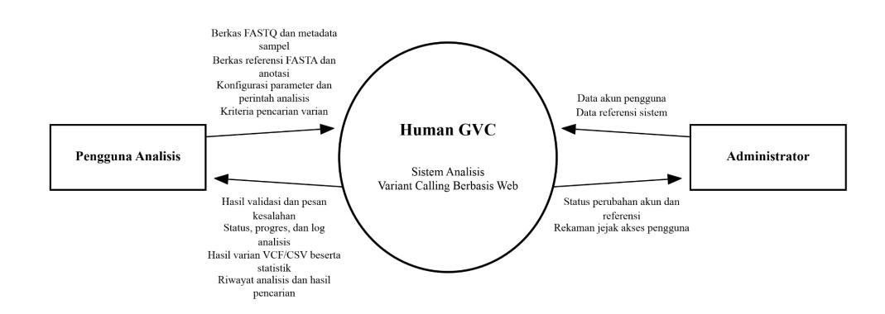
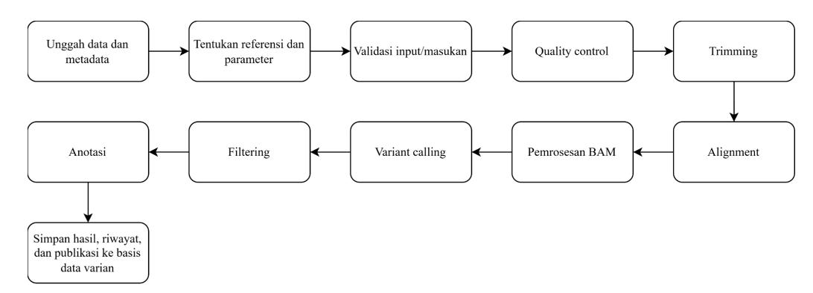
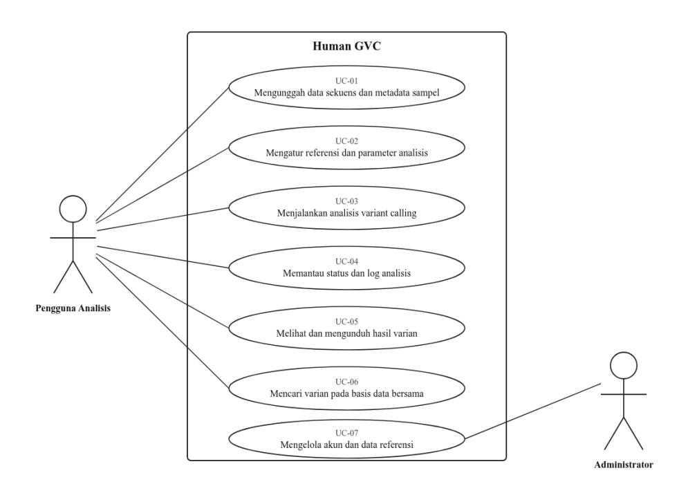

## **SPESIFIKASI KEBUTUHAN PERANGKAT LUNAK (SKPL) AUTOMATED WEB-BASED VARIANT CALLING PLATFORM "HUMAN GVC"**

**Dosen Pengampu:**

Prof. Dr. Eng. Wisnu Ananta Kusuma, S.T., M.T.

#### **Asisten Praktikum:**

Said Thaufik Rizaldi, S.Kom., M.Kom. Gilland Fausta Putra Achyar, S.Mat., M.Kom.

#### **Disusun Oleh Kelompok GenoSys (3):**

Dhafin Fasya Arifin G0401241017 Rakazaki Putra Hendrawan G0401241056 Yafits Mubarak G0401241001 Muhammad Fattha Akbarsyah G0401241008 Abid Ra'fad Aziz G0401241029

**MATA KULIAH PEMBANGUNAN PERANGKAT LUNAK BIOINFORMATIKA**

**PROGRAM STUDI BIOINFORMATIKA FAKULTAS MATEMATIKA DAN ILMU PENGETAHUAN ALAM INSTITUT PERTANIAN BOGOR 2026**

## **Daftar Isi**

| 1. |            | Pendahuluan   | dan          | Tujuan                                                                                                      | Sistem...................................................................... 2 |
|----|------------|---------------|--------------|-------------------------------------------------------------------------------------------------------------|--------------------------------------------------------------------------------|
| 2. | Ruang      | Lingkup       |              | Sistem.......................................................................................4              |                                                                                |
| 3. | Target     | Pengguna      | dan          | Aktor..............................................................................                         | 7                                                                              |
| 4. | Deskripsi  | Umum          |              | Sistem.....................................................................................8                |                                                                                |
| 5. |            | Kebutuhan     |              | Fungsional.....................................................................................10           |                                                                                |
| 6. | Proses     | Utama         | atau         | MVP..................................................................................12                     |                                                                                |
| 7. |            | Kebutuhan     |              | nonfungsional...............................................................................                | 13                                                                             |
| 8. |            | Kebutuhan     | input,       | output, dan                                                                                                 | data................................................................ 14        |
| 9. | Use        | case dan      |              | spesifikasinya.............................................................................                 | 15                                                                             |
|    | 9.1        | UC-01:        | Mengunggah   | Data Sekuens dan Metadata                                                                                   | Sampel....................... 16                                               |
|    | 9.2        | UC-02:        | Mengatur     | Referensi dan Parameter                                                                                     | Analisis.................................17                                    |
|    | 9.3        | UC-03:        | Menjalankan  | Analisis Variant                                                                                            | Calling...........................................18                           |
|    | 9.4        | UC-04:        | Memantau     | Status dan Log                                                                                              | Analisis...............................................20                      |
|    | 9.5        | UC-05:        | Melihat      | dan Mengunduh Hasil                                                                                         | Varian.......................................... 21                            |
|    | 9.6        | UC-06:        | Mencari      | Varian pada Basis Data                                                                                      | Bersama.................................... 22                                 |
|    | 9.7        | UC-07:        | Mengelola    | Akun dan Data                                                                                               | Referensi............................................ 23                       |
|    | 10. Aturan |               |              | bisnis...................................................................................................24 |                                                                                |
|    | 11.        | Acceptance    |              | Criteria........................................................................................24          |                                                                                |
|    | 12.        | Prioritas dan | traceability |                                                                                                             | matrix.................................................................. 31    |

## **1. Pendahuluan dan Tujuan Sistem**

Analisis *variant calling* merupakan salah satu tahapan penting dalam penelitian genomika untuk mengidentifikasi variasi urutan basa pada suatu sampel terhadap urutan referensi. Proses ini melibatkan rangkaian tahapan yang panjang dan saling bergantung, mulai dari pemeriksaan kualitas data sekuens, pemangkasan basa berkualitas rendah, penyejajaran terhadap referensi, pemanggilan varian, penyaringan hasil, hingga anotasi varian yang diperoleh.

Berdasarkan hasil wawancara analisis kebutuhan yang dilaksanakan pada 2 September 2026 bersama pihak klien, rangkaian tahapan tersebut saat ini dijalankan secara terpisah menggunakan sejumlah perangkat lunak berbasis baris perintah. Cara kerja tersebut membutuhkan keahlian teknis tertentu, tidak menyediakan catatan kemajuan proses yang dapat dipantau, serta tidak meninggalkan rekaman parameter yang digunakan pada tiap tahapan. Akibatnya, hasil analisis sulit ditelusuri kembali dan sulit diulang oleh peneliti lain.

Permasalahan tersebut diperkuat oleh beberapa kebutuhan yang disampaikan klien pada saat wawancara, yaitu tersedianya status dan catatan proses yang detail selama analisis berjalan, terekamnya jejak akses pengguna terhadap data, terlindunginya data genomik yang diunggah, serta tersedianya basis data varian yang dapat diakses oleh pengguna lain sehingga hasil analisis tidak berhenti sebagai berkas pribadi masing-masing peneliti. Klien juga menegaskan bahwa sistem harus menyediakan nilai parameter bawaan sekaligus memberi keleluasaan bagi pengguna untuk mengubah parameter sesuai kebutuhan eksplorasinya.

Berdasarkan kondisi tersebut, diperlukan sebuah sistem yang mengintegrasikan seluruh tahapan analisis varian ke dalam satu alur kerja yang berjalan otomatis, dapat dipantau, dan dapat ditelusuri, serta dapat digunakan tanpa mengharuskan penggunanya menguasai perangkat berbasis baris perintah. Dokumen Spesifikasi Kebutuhan Perangkat Lunak (SKPL) ini disusun untuk menetapkan kebutuhan sistem tersebut sebagai dasar bersama antara pengembang dan pemangku kepentingan sebelum tahap perancangan dan implementasi dimulai.

Permasalahan yang teridentifikasi dari hasil wawancara beserta dampaknya terhadap proses kerja penelitian dan tujuan sistem yang dirumuskan untuk mengatasinya disajikan pada [Tabel](#page-3-0) 1.

**Tabel 1** Rumusan masalah, dampak, dan tujuan sistem

| Kode Masalah Dampak          | Tujuan sistem |
|------------------------------|---------------|
| M-01 Tahapan analisis        |               |
| varian dijalankan            |               |
| satu per satu                |               |
| perangkat yang               |               |
| terpisah dan                 |               |
| tidak saling                 |               |
| Waktu analisis menjadi       |               |
| panjang, urutan tahapan      |               |
| rawan keliru, dan proses     |               |
| harus diulang dari awal      |               |
| apabila terjadi kesalahan di |               |
| tengah jalan                 |               |
| Menyediakan                  | alur          |
| analisis                     | varian yang   |
| berjalan                     | otomatis dan  |
| berurutan                    | dari data     |
| sekuens                      | mentah        |
| hingga                       | diperolehnya  |
| hasil                        | varian        |
| M-02 Pelaksanaan             |               |
| analisis menuntut            |               |
| berbasis baris               |               |
| Peneliti yang tidak          |               |
| memiliki keahlian tersebut   |               |
| bergantung pada pihak lain   |               |
| sehingga pekerjaan analisis  |               |
| peneliti                     | menjalankan   |
| keseluruhan                  | proses        |
| analisis                     | secara        |
| mandiri                      | tanpa         |
| memerlukan                   | keahlian      |
| baris                        | perintah      |
| M-03 Parameter yang          |               |
| digunakan pada               |               |
| tiap tahapan                 |               |
| analisis tidak               |               |
| tercatat secara              |               |
| Hasil analisis sulit         |               |
| direproduksi dan sulit       |               |
| ketika ditinjau kembali      |               |
| Memastikan                   | setiap        |
| analisis                     | tersimpan     |
| bersama                      | parameter     |
| dan                          | data masukan  |
| yang                         | digunakan     |
| sehingga                     | hasilnya      |
| dapat                        | ditelusuri    |

| Kode Masalah         | Dampak                | Tujuan sistem        |
|----------------------|-----------------------|----------------------|
| M-04 Kemajuan proses |                       |                      |
| analisis yang        |                       |                      |
| lama tidak dapat     |                       |                      |
| Pengguna             | tidak                 | mengetahui           |
| tahapan              | yang                  | sedang               |
| berjalan             | maupun                | penyebab             |
| kegagalan            |                       | sehingga             |
| penanganan           |                       | masalah              |
| menjadi              | lambat                |                      |
|                      |                       | Menyajikan status    |
|                      |                       | dan informasi        |
|                      |                       | kemajuan analisis    |
|                      |                       | secara detail selama |
|                      |                       | proses berlangsung,  |
|                      |                       | termasuk ketika      |
|                      |                       | proses mengalami     |
| M-05 Hasil analisis  |                       |                      |
| tersimpan secara     |                       |                      |
| terpisah pada        |                       |                      |
| Temuan               | varian                | sulit                |
| dibagikan            | dan tidak             | tersedia             |
| rujukan              | bersama               | yang dapat           |
|                      | dimanfaatkan peneliti | lain                 |
|                      |                       | Menyediakan basis    |
|                      |                       | data varian terpusat |
|                      |                       | yang dapat diakses   |
| M-06 Tidak terdapat  |                       |                      |
| catatan mengenai     |                       |                      |
| pihak yang           |                       |                      |
| mengakses data       |                       |                      |
| dan hasil analisis   |                       |                      |
| Kerahasiaan          | data                  | genomik              |
| sulit                | dijaga dan            | kepemilikan          |
| hasil                | penelitian            | sulit                |
|                      |                       | Memastikan setiap    |
|                      |                       | akses terhadap data  |
|                      |                       | dan hasil analisis   |
|                      |                       | tercatat serta hanya |
|                      |                       | dapat dilakukan oleh |
|                      |                       | pihak yang berhak    |

## **2. Ruang Lingkup Sistem**

Sistem yang dikembangkan merupakan perangkat lunak berbasis web yang menyatukan seluruh tahapan analisis *variant calling* ke dalam satu alur kerja terotomasi, mulai dari pengunggahan data sekuens hingga tersimpannya hasil varian pada basis data yang dapat diakses bersama. Sasaran utama sistem adalah analisis data genomik manusia dengan berkas referensi genom manusia sebagai rujukan bawaan, sementara berkas referensi organisme lain tetap dapat digunakan sepanjang diunggah oleh pengguna. Ruang lingkup sistem dibatasi pada

pelaksanaan dan penelusuran proses analisis, bukan pada penafsiran makna biologis maupun klinis dari varian yang dihasilkan.

Sistem berinteraksi dengan pengguna melalui peramban web dan menerima seluruh data masukan, yaitu berkas sekuens, berkas referensi, berkas anotasi, serta metadata sampel, dari pengguna. Sistem tidak mengambil data secara langsung dari mesin sekuenser maupun dari pangkalan data daring. Keluaran sistem berupa berkas hasil varian, tabel varian, ringkasan analisis, dan catatan proses yang tersimpan di dalam sistem serta dapat diunduh oleh pengguna.

Pembatasan ruang lingkup disusun berdasarkan kebutuhan yang disampaikan klien pada saat wawancara analisis kebutuhan. Rincian cakupan, hal-hal yang berada di luar cakupan, serta batasan awal pengembangan disajikan pada [Tabel](#page-5-0) 2.

Tabel 2 Ruang lingkup sistem

| Aspek Uraian   |              |                    |             |             |             |                 |              |
|----------------|--------------|--------------------|-------------|-------------|-------------|-----------------|--------------|
| 1.             | Pengunggahan | data               | sekuens     | FASTQ,      | baik        | paired-end      | maupun       |
| single-end     | , beserta    | validasi           | berkas      | sebelum     | analisis    | dijalankan      |              |
| 2. Penerimaan  |              | berkas             | referensi   | FASTA       | dan berkas  | basis           | data anotasi |
| sebagai        | masukan      | analisis,          | dengan      | referensi   | genom       | manusia         | sebagai      |
| rujukan        | bawaan       | sistem             |             |             |             |                 |              |
| 3.             | Pencatatan   | metadata           | sampel,     | meliputi    |             | antara          | lain lokasi, |
| karakteristik, |              | dan strain         |             |             |             |                 |              |
| 4.             | Pengaturan   | parameter          | analisis,   | mencakup    |             | penyediaan      | nilai        |
| bawaan         | dan          | penyesuaian        | parameter   | oleh        | pengguna    |                 |              |
| 5.             | Pelaksanaan  | pipeline           | inti        | variant     | calling     | secara otomatis | dan          |
| berurutan,     |              | meliputi           | pemeriksaan |             | kualitas,   | pemangkasan,    |              |
| penyejajaran,  |              | pemanggilan        | varian,     | dan         | penyaringan | varian          |              |
| 6.             | Anotasi      | varian menggunakan |             | berkas      | basis       | data anotasi    | yang         |
| tersedia       | pada         | sistem             |             |             |             |                 |              |
| 7.             | Penyajian    | status, kemajuan,  |             | dan catatan | proses      | analisis        | selama       |
| proses         | berlangsung, | termasuk           |             | saat proses | gagal       |                 |              |

| Aspek Uraian |              |                |                  |                    |                 |               |             |
|--------------|--------------|----------------|------------------|--------------------|-----------------|---------------|-------------|
| 8.           | Penyimpanan  | progres        | analisis         | sebagai            | draf            | serta         | penyediaan  |
| riwayat      | analisis     | pengguna       |                  |                    |                 |               |             |
| 9.           | Penguncian   | hasil          | analisis yang    | telah              | selesai         | sehingga      | hasil dan   |
| parameternya |              | tidak dapat    | diubah           |                    |                 |               |             |
| 10.          | Penyajian    | dan            | pengunduhan      | hasil              | varian          | beserta       | statistik   |
| 11.          | Penyimpanan  | hasil          | varian           | pada basis         | data            | varian        | yang dapat  |
| diakses      | pengguna     | lain,          | memuat           | sekurang-kurangnya |                 |               | posisi dan  |
| kualitas     | varian       |                |                  |                    |                 |               |             |
| 12.          | Pencatatan   | jejak akses    | pengguna         | terhadap           | data            | dan hasil     | analisis    |
| 13.          | Pengelolaan  | akun           | pengguna         | dan                | data referensi  |               | sistem oleh |
| Di luar      |              |                |                  |                    |                 |               |             |
| 1.           | Penafsiran   | klinis         | varian, termasuk | penentuan          |                 | patogenisitas | dan         |
| pemberian    |              | rekomendasi    | medis            |                    |                 |               |             |
| 2.           | Pengembangan |                | algoritma        | variant            | calling         | baru;         | sistem      |
| memanfaatkan |              | metode         | analisis         | yang telah         | tersedia        |               |             |
| 3.           | Analisis     | varian somatik | dan              | skema tumor-normal |                 |               |             |
| 4.           | Pendeteksian | varian         | struktural       | berukuran          | besar           |               |             |
| 5.           | Pengolahan   | data sekuens   | dari             | platform           | selain short    | read          | berformat   |
| 6.           | Sinkronisasi | dua            | arah maupun      | pertukaran         | data            | otomatis      | dengan      |
| portal       | basis        | data varian    | eksternal.       | Portal             | isnip.ipb.ac.id | yang          | disebut     |
| klien        | diperlakukan | sebagai        | rujukan          | rancangan          |                 | mengenai      | informasi   |
| yang         | sebaiknya    | tersedia       | pada             | sistem,            | bukan sebagai   | sistem        | yang        |
| 7.           | Penyediaan   | infrastruktur  |                  | komputasi          | terdistribusi   |               | berskala    |
| 8.           | Perancangan  | eksperimen     | dan              | pengambilan        | data            | sekuens;      | sistem      |
| menerima     |              | data yang      | sudah tersedia   |                    |                 |               |             |

| Aspek | Uraian      |              |                |                 |             |             |           |             |
|-------|-------------|--------------|----------------|-----------------|-------------|-------------|-----------|-------------|
| 1.    | Sistem      | diakses      | melalui        | peramban        | web         | dan         | tidak     | menyediakan |
|       | antarmuka   | baris        | perintah       | maupun          | aplikasi    | luring      |           |             |
| 2.    |             | Referensi    | bawaan         | sistem          | adalah      | genom       | manusia;  | referensi   |
|       | organisme   | lain         | dapat          | digunakan       | sepanjang   | diunggah    | oleh      | pengguna.   |
|       | Sistem      | tidak        | menyediakan    |                 | pengunduhan | berkas      | referensi | secara      |
|       | otomatis    | dari         | sumber luar    |                 |             |             |           |             |
| 3.    |             | Anotasi      | hanya dapat    | dilakukan       |             | sepanjang   | berkas    | basis data  |
|       | anotasi     | tersedia     | pada           | sistem          |             |             |           |             |
| 4.    | Ukuran      | berkas       | unggahan       | dan             | masa        | penyimpanan | riwayat   | analisis    |
|       | dibatasi    | melalui      | parameter      | konfigurasi     |             | sistem      |           |             |
| 5.    |             | Ketepatan    | hasil analisis | bergantung      | pada        | mutu        | data      | masukan dan |
|       | kesesuaian  |              | referensi yang | dipilih         | pengguna    |             |           |             |
| 6.    |             | Pengembangan |                | dilaksanakan    | dalam       | lingkungan  | praktikum | dengan      |
|       | sumber      | daya         | komputasi      | terbatas,       | sehingga    |             | pengujian | dilakukan   |
|       | menggunakan |              | data           | berukuran wajar |             |             |           |             |

### **3. Target Pengguna dan Aktor**

Sistem digunakan oleh dua kelompok pengguna dengan kebutuhan yang berbeda, yaitu peneliti yang menjalankan analisis varian dan pengelola yang menjaga ketersediaan akun serta data referensi. Pemisahan kedua peran tersebut diperlukan agar hak akses terhadap data genomik dapat dibatasi dan setiap tindakan pada sistem dapat ditelusuri kepada pemiliknya. Target pengguna, aktor, karakteristik, dan akses utama masing-masing disajikan pada [Tabel](#page-8-1) 3.

**Tabel 3** Target pengguna dan aktor

| Aktor                     | Karakteristik Akses Utama |
|---------------------------|---------------------------|
| Peneliti atau             |                           |
| Melakukan                 | analisis                  |
| terhadap                  | data                      |
| referensi                 | dan                       |
| memantau                  | proses,                   |
| serta                     | melihat dan               |
| mengelola                 | hasil                     |
| analisis                  | yang                      |
|                           | Mengunggah data dan       |
|                           | metadata, menentukan      |
|                           | referensi dan             |
|                           | menjalankan analisis,     |
|                           | memantau status dan       |
|                           | log, melihat serta        |
|                           | mengunduh hasil, dan      |
|                           | mencari varian pada       |
|                           | basis data bersama        |
| Administrator Bertanggung | jawab                     |
| pengelolaan               | akun                      |
| pengguna                  | dan data                  |
| referensi                 | yang                      |
| tersedia                  | dalam                     |
|                           | Mengelola akun            |
|                           | pengguna dan data         |

# **4. Deskripsi Umum Sistem**

Sistem merupakan platform yang membantu pengguna melakukan analisis *variant calling* secara terstruktur mulai dari pengunggahan data, penentuan referensi dan parameter, validasi masukan, pemrosesan data, hingga menghasilkan dan menyimpan hasil varian. Pengguna analisis dapat mengunggah data sekuens FASTQ, referensi FASTA, data anotasi, dan metadata sampel. Pengguna juga dapat menggunakan parameter bawaan atau menyesuaikannya sebelum analisis dijalankan. Sistem kemudian menjalankan proses analisis dan menampilkan status serta log secara bertahap sehingga pengguna dapat memantau perkembangan

analisis. Kemampuan tersebut mencakup penanganan FASTQ *paired-end* maupun *single-end*, penggunaan referensi dan anotasi, parameter yang dapat diubah, serta pemantauan progres.

Setelah analisis selesai, sistem menyediakan hasil varian dalam format VCF dan menampilkan hasil beserta statistik ringkas. Halaman hasil mencakup tabel varian, distribusi varian, serta keluaran dalam format VCF dan CSV. Hasil analisis yang telah selesai melalui proses dikunci agar tidak dapat diubah, sedangkan hasil yang gagal atau tidak lengkap tidak dipublikasikan sebagai hasil varian bersama. Administrator memiliki akses untuk mengelola akun pengguna dan data referensi. Sistem juga mencatat jejak akses terhadap data dan hasil analisis serta menerapkan perlindungan terhadap data pengguna sesuai kebutuhan keamanan dan keterlacakan.

Sistem berinteraksi dengan dua pihak luar, yaitu pengguna analisis yang menjalankan proses analisis varian dan administrator yang mengelola akun serta data referensi. Seluruh data masukan berasal dari kedua pihak tersebut melalui peramban web, dan sistem tidak menerima maupun mengirimkan data secara otomatis dari sistem lain di luar batasnya. Batas sistem, pihak luar yang berinteraksi dengannya, serta aliran data di antara keduanya disajikan pada [Gambar](#page-9-0) 1.

Gambar 1 Diagram konteks Human GVC

# **5. Kebutuhan Fungsional**

Kebutuhan fungsional dirumuskan sebagai kemampuan yang harus dimiliki sistem untuk memenuhi tujuan dan tetap berada dalam ruang lingkup sistem. Setiap kebutuhan diberi pengenal FR agar dapat dirujuk kembali pada use case, kriteria penerimaan, dan kasus uji. Prioritas ditetapkan menggunakan pendekatan MoSCoW, dengan Must sebagai kebutuhan yang harus tersedia agar sistem dapat digunakan, Should sebagai kebutuhan pelengkap yang penting, dan Could sebagai kebutuhan tambahan yang dikerjakan apabila sumber daya memungkinkan. Daftar kebutuhan fungsional disajikan pada [Tabel](#page-10-1) 4.

**Tabel 4** Kebutuhan fungsional

|       | Deskripsi    | Kebutuhan   |                 |                  |                | Prioritas |
|-------|--------------|-------------|-----------------|------------------|----------------|-----------|
| FR-01 | Sistem       | dapat       | menerima        | unggahan         | berkas         | FASTQ     |
|       | yang         | valid, baik | paired-end      | maupun           | single-end     |           |
| FR-02 | Sistem       | dapat       | memvalidasi     | berkas           | yang           | diunggah  |
|       | sebelum      | analisis    | dijalankan      |                  |                |           |
| FR-03 | Sistem       | dapat       | menerima        | berkas referensi | FASTA          | dan       |
|       | data         | anotasi     | sebagai masukan | analisis         |                |           |
| FR-04 | Sistem       | dapat       | menerima        | metadata         | sampel         | yang      |
|       | mencakup     | informasi   | seperti         | lokasi,          | karakteristik, | dan       |
| FR-05 | Sistem       | dapat       | menjalankan     | proses           | inti analisis  | variant   |
|       | calling      | secara      | otomatis        |                  |                |           |
| FR-06 | Sistem       | dapat       | menyediakan     | parameter        | default        | dan       |
|       | memungkinkan |             | pengguna        | mengubah         |                | parameter |

|       |           | Deskripsi   | Kebutuhan     |                 |               | Prioritas       |
|-------|-----------|-------------|---------------|-----------------|---------------|-----------------|
| FR-07 | Sistem    | dapat       | menampilkan   | status          | dan           | log proses      |
|       | analisis  | secara      | detail        | selama proses   | berjalan      |                 |
| FR-08 | Sistem    | dapat       | menyimpan     | progres         | analisis      | sebagai         |
| FR-09 | Sistem    | dapat       | menghasilkan  | dan             | menyediakan   | berkas          |
|       | hasil     | varian      | dalam format  | VCF             |               |                 |
| FR-10 | Sistem    | dapat       | mengunci      | hasil           | analisis      | yang telah      |
|       | selesai   | sehingga    | hasil         | dan             | parameternya  | tidak dapat     |
| FR-11 | Sistem    | dapat       | menyimpan     | hasil           | varian pada   | basis data      |
|       | varian    | bersama     | yang          | dapat           | diakses       | pengguna lain   |
|       | dan       | memuat      | minimal       | posisi serta    | kualitas      | varian          |
| FR-12 | Sistem    | dapat       |               | menampilkan     | hasil varian  | beserta         |
|       | statistik |             | ringkasnya    | kepada pengguna |               |                 |
| FR-13 | Sistem    | dapat       | mencatat      | jejak akses     | pengguna      | terhadap        |
|       | data      | dan hasil   | analisis      |                 |               |                 |
| FR-14 | Sistem    | dapat       | menjalankan   |                 | pemeriksaan   | kualitas dan    |
|       |           | trimming    | terhadap data | masukan         |               |                 |
| FR-15 | Sistem    | dapat       |               | melakukan       | alignment     | terhadap        |
|       | referensi | dan         | menampilkan   |                 | ringkasannya, | termasuk        |
|       | jumlah    | reads       | yang          | teralign        |               |                 |
| FR-16 | Sistem    |             | dapat         | melakukan       | anotasi       | varian          |
|       |           | menggunakan | data          | anotasi yang    | tersedia      |                 |
| FR-17 | Sistem    | dapat       | menyediakan   | riwayat         | analisis      | pengguna Should |

|       | Deskripsi | Kebutuhan |                    |             |            | Prioritas |
|-------|-----------|-----------|--------------------|-------------|------------|-----------|
| FR-18 | Sistem    | dapat     | menampilkan        | detail      | varian     | dan       |
| FR-19 | Sistem    | dapat     | menyediakan        | unduhan     | hasil      | dalam     |
|       | format    | tabular   | CSV                |             |            |           |
| FR-20 | Sistem    | dapat     | menampilkan        | visualisasi | distribusi |           |
| FR-21 | Sistem    | dapat     | menyediakan        | pengelolaan | akun       | dan       |
|       | data      | referensi | bagi administrator |             |            |           |

# **6. Proses Utama atau MVP**

Proses utama menggambarkan alur kerja minimum yang harus dapat dijalankan sistem dari awal hingga akhir sehingga pengguna memperoleh hasil varian yang utuh. Alur ini menjadi acuan urutan pengembangan, yaitu unggah data dan pemilihan referensi, pemeriksaan mutu, pemangkasan, penyejajaran, pemrosesan berkas hasil penyejajaran, pemanggilan varian, penyaringan, anotasi, hingga penyimpanan hasil beserta riwayatnya. Alur proses utama sistem disajikan pada [Gambar](#page-12-1) 2.

**Gambar 2** Proses utama atau MVP Human GVC

# **7. Kebutuhan nonfungsional**

Kebutuhan nonfungsional dirumuskan agar dapat diperiksa secara objektif tanpa menetapkan angka target layanan yang belum disepakati bersama klien. Daftar kebutuhan nonfungsional disajikan pada [Tabel](#page-13-1) 5.

**Tabel 5** Kebutuhan nonfungsional Human GVC

| ID Aspek     | Kebutuhan      |                  |                    |            |
|--------------|----------------|------------------|--------------------|------------|
| Keamanan     | Sistem         | menyimpan        | data               | genomik    |
|              | pengguna       | dalam            | bentuk terenkripsi |            |
| Keamanan     | Sistem         | membatasi        | akses hasil        | analisis   |
|              | hanya          | kepada           | pemilik            | data dan   |
|              | pengguna       | yang diberi      | hak                | akses      |
| Keterlacakan | Sistem         | menampilkan      | riwayat            | akses      |
|              | terhadap       | data dan         | hasil analisis     |            |
| Kinerja      | Sistem         | menjalankan      | analisis           | secara     |
|              | asinkron       | sehingga         | antarmuka          | dapat      |
|              | digunakan      | selama           | proses             |            |
| Kinerja      | Sistem         | memperbarui      | status             | progres    |
|              | analisis       | selama proses    | berjalan           |            |
| Usability    | Sistem         | dapat dijalankan |                    | sepenuhnya |
|              | melalui        | antarmuka        | web                | tanpa      |
|              | memerlukan     | perintah         | baris              |            |
| Usability    | Sistem         | menampilkan      | pesan              | kesalahan  |
|              | yang           | menjelaskan      | penyebab           | ketika     |
|              | berkas         | atau parameter   | tidak              | valid      |
| Keandalan    | Sistem         | menyimpan        | log                | kesalahan  |
|              | setiap         | kegagalan        | analisis           | dan        |
|              | menampilkannya |                  | kepada pengguna    |            |

## **8. Kebutuhan input, output, dan data**

Bab ini menetapkan data yang diterima, dihasilkan, dan disimpan oleh sistem sebagai dasar perancangan antarmuka dan basis data. Kebutuhan masukan dan keluaran mencakup jenis data beserta formatnya, sedangkan kebutuhan data mencakup entitas yang harus disimpan agar setiap analisis dapat ditelusuri kembali beserta parameter dan hasilnya. Kebutuhan masukan dan keluaran disajikan pada [Tabel](#page-14-1) 6, sedangkan entitas data yang disimpan sistem disajikan pada [Tabel](#page-15-1) 7.

**Tabel 6** Kebutuhan input dan output sistem

| Jenis Data Format               | Keterangan  |
|---------------------------------|-------------|
| Input Data sampel FASTQ Berkas  | yang        |
| diunggah                        | oleh        |
| pengguna                        | untuk       |
| Input Data referensi FASTA Data | referensi   |
| yang                            | dipilih     |
| sebelum                         | analisis    |
| Output Hasil                    |             |
| VCF dan CSV Hasil               | varian yang |
| telah                           | dianalisis  |
| Output Laporan analisis         |             |
| dan visualisasi                 |             |
| Laporan                         | hasil       |
| analisis                        | varian      |
| dalam                           | bentuk      |

**Tabel 7** Entitas data yang disimpan oleh sistem

| Entitas          | Atribut  | utama         | Primary key  |
|------------------|----------|---------------|--------------|
| Pengguna         | nama,    | email         | id_pengguna  |
| Sampel           | nama     | sampel,       | lokasi,      |
|                  | strain,  | karakteristik |              |
| Referensi        | nama     | referensi,    | status       |
|                  | bawaan   | atau          | unggahan     |
| Analisis         | tanggal, |               | status,      |
|                  |          | parameter,    | referensi    |
|                  | yang     | dipakai       |              |
| Varian           |          | kromosom,     | posisi, REF, |
|                  | ALT,     | quality       | score        |
| Genotipe         |          | genotipe,     | kedalaman,   |
|                  | kualitas | genotipe      |              |
| Riwayat analisis | tanggal, | waktu         | proses,      |
|                  | masa     | retensi,      | lokasi       |
|                  | berkas   | hasil         |              |
| Log akses        | waktu,   | pengguna,     | objek        |
|                  | yang     | diakses,      | jenis aksi   |

## **9.** *Use case* **dan spesifikasinya**

*Use case* menguraikan cara aktor berinteraksi dengan sistem untuk memenuhi kebutuhan fungsional pada bagian 5. Setiap *use case* dirinci ke dalam delapan elemen, yaitu pengenal, nama, aktor, prakondisi, pemicu, alur utama, alur alternatif, dan pascakondisi, sehingga perilaku sistem pada kondisi normal maupun kondisi gagal terdefinisi dengan jelas. Sistem memiliki tujuh use case

yang disajikan pada [Gambar](#page-16-1) 3 dan spesifikasinya disajikan pada [Tabel](#page-16-2) 8 sampai dengan [Tabel](#page-23-1) 14.

**Gambar 3** *Use case diagram* Human GVC

#### **9.1 UC-01: Mengunggah Data Sekuens dan Metadata Sampel**

**Tabel 8** Spesifikasi UC-01 mengunggah data sekuens dan metadata sampel

| Elemen       | Spesifikasi                                             |
|--------------|---------------------------------------------------------|
| Use Case ID  | UC-01                                                   |
| Nama         | Mengunggah data sekuens dan metadata sampel             |
| Aktor        | Pengguna Analisis                                       |
| Precondition | Pengguna telah masuk ke sistem dan halaman pengunggahan |
|              | data tersedia                                           |
| Trigger      | Pengguna memilih berkas FASTQ dan memasukkan metadata   |
|              | sampel untuk diunggah                                   |

| Elemen Spesifikasi |          |             |             |                |               |             |
|--------------------|----------|-------------|-------------|----------------|---------------|-------------|
| Main flow 1.       | Pengguna | memilih     | berkas      | FASTQ          |               |             |
| 2.                 | Pengguna | memasukkan  | metadata    | sampel         |               |             |
| 3.                 | Sistem   | menerima    | unggahan    |                |               |             |
| 4.                 | Sistem   | memvalidasi | berkas      |                |               |             |
| 5.                 | Sistem   | memeriksa   | kesesuaian  | pasangan       | apabila       | data        |
| 6.                 | Sistem   | menampilkan | informasi   | data           | yang berhasil | diterima    |
| 1.                 | Berkas   | tidak       | valid:      | Sistem menolak |               | berkas dan  |
| menampilkan        |          | penyebab    | penolakan   |                |               |             |
| 2.                 | Pasangan | paired-end  | tidak       | lengkap/tidak  | cocok:        | Sistem      |
| menolak            |          | unggahan    | dan meminta | pasangan       | berkas        | yang sesuai |
| 3.                 | Metadata | tidak       | lengkap:    | Sistem         | meminta       | pengguna    |
| melengkapi         |          | metadata    | sebelum     | unggahan       | dapat         | digunakan   |
| untuk              | analisis |             |             |                |               |             |
| Postcondition Data | sekuens  | dan         | metadata    | yang valid     | tersedia      | sebagai     |
| masukan            |          | analisis    |             |                |               |             |

#### **9.2 UC-02: Mengatur Referensi dan Parameter Analisis**

### **Tabel 9** Spesifikasi UC-02 mengatur referensi dan parameter analisis

| Elemen       | Spesifikasi                               |        |      |       |
|--------------|-------------------------------------------|--------|------|-------|
| Use Case ID  | UC-02                                     |        |      |       |
| Nama         | Mengatur referensi dan parameter analisis |        |      |       |
| Aktor        | Pengguna Analisis                         |        |      |       |
| Precondition | Data masukan telah tersedia dan pengguna  | berada | pada | tahap |
|              | pengaturan analisis                       |        |      |       |

| Elemen Spesifikasi      |           |                 |                  |                                |
|-------------------------|-----------|-----------------|------------------|--------------------------------|
| Trigger Pengguna        |           | memilih         | referensi        | dan mengubah atau              |
| mempertahankan          |           |                 | parameter        | analisis                       |
| Main flow 1.            | Pengguna  | memilih         | atau mengunggah  | referensi                      |
| 2.                      | Sistem    | menyediakan     | parameter        | default                        |
| 3.                      | Pengguna  | memeriksa       | parameter        |                                |
| 4.                      | Pengguna  | dapat           | mengubah         | parameter                      |
| 5.                      | Sistem    | memvalidasi     | nilai            | parameter                      |
| 6.                      | Sistem    | menyimpan       | konfigurasi      | analisis                       |
| 7.                      | Pengguna  | dapat           | menyimpan        | konfigurasi yang belum lengkap |
| sebagai                 |           | draf untuk      | dilanjutkan      | kemudian                       |
| 1.                      | Referensi | tidak           | valid: Sistem    | menolak referensi dan meminta  |
| referensi               |           | yang sesuai     |                  |                                |
| 2.                      | Parameter | tidak           | valid: Sistem    | menolak nilai parameter di     |
| luar                    | rentang   | dan menampilkan |                  | pesan kesalahan                |
| 3.                      | Referensi | belum           | ditentukan:      | Sistem tidak mengizinkan       |
| analisis                |           | dijalankan      | sampai referensi | ditentukan                     |
| Postcondition Referensi |           | dan parameter   | analisis         | yang valid tersimpan dan siap  |
| digunakan               |           | atau sebagai    | draf             | untuk dilanjutkan kemudian     |

#### **9.3 UC-03: Menjalankan Analisis** *Variant Calling*

## **Tabel 10** Spesifikasi UC-03 menjalankan analisis *variant calling*

| Elemen      | Spesifikasi                          |
|-------------|--------------------------------------|
| Use Case ID | UC-03                                |
| Nama        | Menjalankan analisis variant calling |
| Aktor       | Pengguna Analisis                    |

| Elemen        | Spesifikasi |               |              |              |                 |               |                 |
|---------------|-------------|---------------|--------------|--------------|-----------------|---------------|-----------------|
| Precondition  | Data        | sekuens       | dan metadata | yang         | valid           | telah         | tersedia, serta |
|               | referensi   | dan           | parameter    | analisis     | telah tersimpan |               |                 |
| Trigger       | Pengguna    | menekan       | perintah     | untuk        | menjalankan     |               | analisis        |
| Main flow 1.  | Sistem      | memeriksa     |              | kelengkapan  | data            | masukan,      | referensi, dan  |
| 2.            | Sistem      |               | menjalankan  | pemeriksaan  | kualitas        | dan           | pemangkasan     |
| 3.            | Sistem      | menjalankan   |              | penyejajaran | terhadap        | referensi     |                 |
| 4.            | Sistem      | memproses     | berkas       | hasil        | penyejajaran    |               |                 |
| 5.            | Sistem      |               | menjalankan  | pemanggilan  | varian          | dan           | penyaringan     |
| 6.            | Sistem      |               | menjalankan  | anotasi      | varian          | apabila       | berkas anotasi  |
| 7.            | Sistem      |               | menyimpan    | hasil        | analisis        | beserta       | parameter yang  |
|               | digunakan   | dan           | menandai     | analisis     | sebagai         | selesai       |                 |
| 1.            | Data        | masukan,      | referensi,   | atau         | parameter       | belum         | lengkap:        |
|               | sistem      | tidak         | menjalankan  | analisis     | dan             | menampilkan   | bagian          |
|               | yang        | belum lengkap |              |              |                 |               |                 |
| 2.            | Salah       | satu          | tahap        | gagal:       | sistem          | menghentikan  | analisis,       |
|               | menandai    | status        | gagal,       | dan          | menyimpan       | log           | kesalahan tahap |
| 3.            | Berkas      | anotasi       | tidak        | tersedia:    | sistem          | menyelesaikan | analisis        |
|               | tanpa       | tahap anotasi | dan          | mencatatnya  | pada            | keterangan    | hasil           |
| Postcondition | Hasil       | varian        | tersimpan    | dan siap     | ditampilkan     | apabila       | analisis        |
|               | berhasil;   | apabila       | gagal,       | status       | kegagalan       | dan log       | kesalahan       |
|               | tersimpan   | serta         | hasil tidak  |              | dipublikasikan  | ke basis      | data varian     |

#### **9.4 UC-04: Memantau Status dan Log Analisis**

**Tabel 11** Spesifikasi UC-04 memantau status dan log analisis

| Elemen        | Spesifikasi |                 |             |              |             |             |                  |
|---------------|-------------|-----------------|-------------|--------------|-------------|-------------|------------------|
| Use Case ID   | UC-04       |                 |             |              |             |             |                  |
| Nama          | Memantau    | status          | dan log     | analisis     |             |             |                  |
| Aktor         | Pengguna    | Analisis        |             |              |             |             |                  |
| Precondition  | Pengguna    | memiliki        | analisis    | yang         | sedang      | atau telah  | dijalankan.      |
| Trigger       | Pengguna    | membuka         |             | halaman      | pemantauan  | analisis.   |                  |
| Main flow 1.  | Sistem      |                 | menampilkan | status       | analisis    |             |                  |
| 2.            | Sistem      |                 | menampilkan | tahap        | proses      | yang sedang | berlangsung      |
| 3.            | Sistem      |                 | memperbarui | informasi    | progres     |             |                  |
| 4.            | Sistem      |                 | menampilkan | log          | proses      |             |                  |
| 5.            |             | Pengguna        | melihat     | perkembangan |             | analisis    | sampai selesai   |
|               | atau        | gagal           |             |              |             |             |                  |
| 1.            |             | Analisis gagal: | Sistem      |              | menampilkan | status      | gagal dan log    |
| 2.            | Log         | tidak           | tersedia:   | Sistem       | menampilkan |             | informasi bahwa  |
|               | log         | belum tersedia  |             |              |             |             |                  |
| 3.            | Proses      | berhenti        | pada        | suatu        | tahap:      | Sistem      | mempertahankan   |
|               | status      | terakhir        | dan         | menampilkan  |             | informasi   | tahap yang       |
|               | mengalami   |                 | kegagalan   |              |             |             |                  |
| Postcondition | Pengguna    |                 | memperoleh  | informasi    |             | status,     | progres, dan log |

#### **9.5 UC-05: Melihat dan Mengunduh Hasil Varian**

**Tabel 12** Spesifikasi UC-05 melihat dan mengunduh hasil varian

| Elemen        | Spesifikasi |             |                |               |              |             |                |
|---------------|-------------|-------------|----------------|---------------|--------------|-------------|----------------|
| Use Case ID   | UC-05       |             |                |               |              |             |                |
| Nama          | Melihat     | dan         | mengunduh      | hasil varian  |              |             |                |
| Aktor         | Pengguna    | Analisis    |                |               |              |             |                |
| Precondition  | Analisis    | telah       | selesai dan    | hasil         | analisis     | tersedia    |                |
| Trigger       | Pengguna    | membuka     | hasil          | analisis      |              |             |                |
| Main flow 1.  | Sistem      |             | menampilkan    | hasil varian  |              |             |                |
| 2.            | Sistem      |             | menampilkan    | statistik     | ringkas      |             |                |
| 3.            | Sistem      |             | menampilkan    | informasi     | varian       | seperti     | kromosom,      |
|               | posisi,     | REF, ALT,   | dan            | quality score |              |             |                |
| 4.            | Pengguna    | dapat       | mengunduh      | hasil         | dalam        | format      | VCF            |
| 5.            |             | Pengguna    | dapat          | mengunduh     | hasil        | dalam       | format CSV     |
|               | apabila     | tersedia    |                |               |              |             |                |
| 1.            | Hasil       | belum       | selesai:       | Sistem        | tidak        | menampilkan | hasil akhir    |
|               | dan         | menampilkan | status         | analisis      |              |             |                |
| 2.            | Hasil       | tidak       | lengkap        | akibat        | kegagalan:   |             | Sistem tidak   |
|               | menyediakan |             | hasil tersebut | sebagai       | hasil        | akhir       |                |
| 3.            |             | Pengguna    | mencoba        | mengubah      | hasil        | yang telah  | dikunci:       |
|               | Sistem      | menolak     | perubahan      | dan           | mengarahkan  |             | pengguna untuk |
|               | membuat     | analisis    | baru           |               |              |             |                |
| Postcondition | Pengguna    | dapat       | melihat        | hasil         | analisis dan | memperoleh  | berkas         |
|               | hasil yang  | tersedia    | untuk          | diunduh       |              |             |                |

#### **9.6 UC-06: Mencari Varian pada Basis Data Bersama**

**Tabel 13** Spesifikasi UC-06 mencari varian pada basis data bersama

| Elemen        | Spesifikasi |                |             |             |             |             |               |
|---------------|-------------|----------------|-------------|-------------|-------------|-------------|---------------|
| Use Case ID   | UC-06       |                |             |             |             |             |               |
| Nama          | Mencari     | varian         | pada basis  | data        | bersama     |             |               |
| Aktor         | Pengguna    | Analisis       |             |             |             |             |               |
| Precondition  | Pengguna    | telah          | masuk ke    | sistem dan  | data        | varian      | tersedia pada |
|               | basis       | data bersama   |             |             |             |             |               |
| Trigger       | Pengguna    | membuka        | fitur       | pencarian   | varian      | dan         | memasukkan    |
|               | kriteria    | pencarian      |             |             |             |             |               |
| Main flow 1.  |             | Pengguna       | membuka     | pencarian   | varian      |             |               |
| 2.            |             | Pengguna       | memasukkan  | kriteria    | pencarian   |             |               |
| 3.            | Sistem      | memproses      |             | permintaan  | pencarian   |             |               |
| 4.            | Sistem      | menampilkan    |             | varian yang | sesuai      |             |               |
| 5.            | Sistem      | menampilkan    |             | minimal     | informasi   | posisi      | dan kualitas  |
| 1.            |             | Parameter      | pencarian   | tidak       | valid:      | Sistem      | menolak       |
|               | permintaan  | dan            | meminta     | kriteria    | diperbaiki  |             |               |
| 2.            | Tidak       | ditemukan      | varian:     | Sistem      |             | menampilkan | informasi     |
|               | bahwa       | tidak terdapat | hasil       | yang sesuai |             |             |               |
| 3.            | Data        | varian         | tidak dapat | diakses:    | Sistem      |             | menampilkan   |
|               | pesan       | kesalahan      | dan tidak   |             | menampilkan | data        | yang tidak    |
|               | memiliki    | hak akses      |             |             |             |             |               |
| Postcondition | Pengguna    |                | memperoleh  | daftar      | varian yang | sesuai      | dengan        |
|               | kriteria    | dan hak        | aksesnya    |             |             |             |               |

## **9.7 UC-07: Mengelola Akun dan Data Referensi**

**Tabel 14** Spesifikasi UC-07 mengelola akun dan data referensi

| Elemen        |           | Spesifikasi   |             |                |              |             |              |               |
|---------------|-----------|---------------|-------------|----------------|--------------|-------------|--------------|---------------|
| Use Case ID   | UC-07     |               |             |                |              |             |              |               |
| Nama          |           | Mengelola     | akun dan    | data           | referensi    |             |              |               |
| Aktor         |           | Administrator |             |                |              |             |              |               |
| Precondition  |           | Administrator | telah       | masuk          | ke           | sistem      | dan          | memiliki hak  |
| Trigger       |           | Administrator |             | membuka        | fitur        | pengelolaan | akun         | atau data     |
| Main flow     | 1.        | Administrator |             | memilih        | pengelolaan  | akun        | atau         | referensi     |
|               | 2.        | Administrator |             | melakukan      | perubahan    | yang        | diperlukan   |               |
|               | 3.        | Sistem        | memvalidasi | data           |              |             |              |               |
|               | 4.        | Sistem        | menyimpan   |                | perubahan    |             |              |               |
|               | 5.        | Sistem        | menampilkan |                | status       | perubahan   |              |               |
|               | 1.        | Data akun     | tidak       | valid:         | Sistem       | menolak     |              | perubahan dan |
|               |           | menampilkan   | pesan       | kesalahan      |              |             |              |               |
|               | 2.        | Data          | referensi   | tidak          | valid:       | Sistem      | menolak data | referensi     |
|               | dan       | meminta       | data        | yang           | sesuai       |             |              |               |
|               | 3.        | Terjadi       | kegagalan   |                | penyimpanan: | Sistem      | tidak        | menerapkan    |
|               | perubahan | dan           |             | menampilkan    | pesan        | kegagalan   |              |               |
| Postcondition | Data      | akun atau     | data        | referensi      | berhasil     |             | diperbarui   | apabila valid |
|               | jika      | tidak,        | sistem      | mempertahankan |              | data        | sebelumnya   |               |

## **10. Aturan bisnis**

[Tabel](#page-24-2) 15 menunjukkan aturan bisnis yang ditetapkan untuk memastikan konsistensi, integritas data, dan validitas proses analisis dalam sistem, serta akan menjadi acuan utama dalam pengembangan sistem.

**Tabel 15** Aturan bisnis Human GVC

| ID    | Aturan    | bisnis           |              |             |             |                |              |
|-------|-----------|------------------|--------------|-------------|-------------|----------------|--------------|
| BR-01 | Analisis  | tidak            | dapat        | dijalankan  | sebelum     | berkas         | referensi    |
| BR-02 | Berkas    | hanya            | diproses     | apabila     | formatnya   | termasuk       | format yang  |
|       | didukung  | sistem           |              |             |             |                |              |
| BR-03 |           | Unggahan         | paired-end   | hanya       | diproses    | apabila        | kedua berkas |
|       | pasangan  | tersedia         | dan          | cocok       |             |                |              |
| BR-04 | Parameter | di               | luar rentang | yang        | diizinkan   | sistem         | tidak dapat  |
| BR-05 | Hasil     | analisis         | yang telah   | selesai     | tidak dapat | diubah,        | hanya dapat  |
|       |           | dijalankan ulang | sebagai      | analisis    | baru        |                |              |
| BR-06 | Hasil     | analisis         | yang         | gagal       | atau tidak  | lengkap        | tidak        |
|       |           | dipublikasikan   | ke basis     | data varian | bersama     |                |              |
| BR-07 | Pengguna  | hanya            | dapat        | melihat     | riwayat     | analisis milik | akunnya      |
| BR-08 | Riwayat   | analisis         | dihapus      | otomatis    | setelah     | melewati       | masa         |
|       | retensi   | yang             | ditetapkan   | sistem      |             |                |              |

## **11. Acceptance Criteria**

Kriteria penerimaan menetapkan kondisi yang harus dipenuhi agar sebuah kebutuhan dinyatakan selesai dan dapat diterima. Setiap kriteria dirumuskan dalam format Given-When-Then, yaitu kondisi awal, tindakan yang dilakukan,

dan hasil yang diharapkan, sehingga pemenuhannya dapat diperiksa secara objektif tanpa bergantung pada penafsiran penguji. Kriteria penerimaan disusun untuk seluruh kebutuhan berprioritas Must dan Should, sedangkan kebutuhan berprioritas Could diuji setelah kedua kelompok tersebut terpenuhi. Kriteria penerimaan sistem disajikan pada [Tabel](#page-25-0) 16.

**Tabel 16** Acceptance criteria

| ID Given When         | Then                 |
|-----------------------|----------------------|
| AC-01 Pengguna telah  |                      |
| masuk ke sistem dan   |                      |
| berada pada halaman   |                      |
| pengunggahan data     |                      |
| mengunggah            | berkas               |
| FASTQ                 | yang valid,          |
| baik sepasang         | berkas               |
| paired-end            | maupun               |
| satu berkas           | single-end           |
|                       | Sistem menerima      |
|                       | berkas tersebut dan  |
|                       | ringkasan berkas     |
|                       | yang berhasil        |
| AC-02 Pengguna        |                      |
| mengunggah berkas     |                      |
| dengan format tidak   |                      |
| didukung atau         |                      |
| pasangan paired-end   |                      |
| yang tidak lengkap    |                      |
| Sistem                | melakukan            |
| validasi              | terhadap             |
| berkas yang           | diunggah             |
|                       | Sistem menolak       |
|                       | berkas sebelum       |
|                       | analisis dijalankan  |
|                       | dan menampilkan      |
| AC-03 Pengguna berada |                      |
| pada tahap            |                      |
| pengaturan analisis   |                      |
| referensi             | genom                |
| manusia               | bawaan               |
| sistem                | atau                 |
| mengunggah            | berkas               |
| referensi             | FASTA                |
| beserta berkas        | anotasi              |
|                       | Sistem menyimpan     |
|                       | referensi dan berkas |
|                       | anotasi tersebut     |
|                       | sebagai masukan      |

| ID Given When Then       |                 |
|--------------------------|-----------------|
| AC-04 Pengguna mengisi   |                 |
| formulir metadata        |                 |
| Pengguna menyimpan       |                 |
| metadata yang            |                 |
| memuat lokasi,           |                 |
| karakteristik, dan       |                 |
| Sistem                   | menyimpan       |
| metadata                 | tersebut        |
| bersama                  | data            |
| sampel                   | yang            |
| AC-05 Data masukan telah |                 |
| valid serta referensi    |                 |
| dan parameter            |                 |
| analisis telah           |                 |
| menjalankan analisis     |                 |
| Sistem                   | menjalankan     |
| seluruh                  | tahapan         |
| pipeline                 | secara          |
| otomatis                 | dan             |
| berurutan                | tanpa           |
| perintah                 | tambahan        |
| dari                     | pengguna        |
| AC-06 Pengguna berada    |                 |
| pada halaman             |                 |
| pengaturan parameter     |                 |
| Pengguna mengubah        |                 |
| nilai parameter, baik    |                 |
| ke nilai yang diizinkan  |                 |
| maupun ke nilai di       |                 |
| luar rentang             |                 |
| menampilkan              | nilai           |
| menyimpan                | nilai           |
| yang                     | berada dalam    |
| rentang,                 | serta           |
| menolak                  | nilai di        |
| luar                     | rentang beserta |
| pesan                    | kesalahannya    |

| ID Given When Then           |                |
|------------------------------|----------------|
| AC-07 Analisis milik         |                |
| pengguna sedang              |                |
| Pengguna membuka             |                |
| halaman pemantauan           |                |
| menampilkan                  | status         |
| analisis,                    | tahap yang     |
| sedang                       | berlangsung,   |
| dan                          | catatan proses |
| yang                         | diperbarui     |
| selama                       | analisis       |
| AC-08 Pengguna telah         |                |
| mengisi sebagian             |                |
| konfigurasi analisis         |                |
| Pengguna menyimpan           |                |
| pekerjaannya sebagai         |                |
| draf lalu membukanya         |                |
| Sistem                       | menyimpan      |
| progres                      | tersebut dan   |
| kembali                      | sehingga       |
| pengguna                     | dapat          |
| melanjutkan                  | tanpa          |
| mengisi                      | ulang          |
| AC-09 Analisis telah selesai |                |
| Pengguna membuka             |                |
| hasil analisis               |                |
| berkas                       | hasil varian   |
| berformat                    | VCF            |
| yang                         | dapat diunduh  |
| AC-10 Analisis telah selesai |                |
| dan hasilnya berstatus       |                |
| Pengguna mencoba             |                |
| mengubah hasil               |                |
| analisis atau parameter      |                |
| yang digunakan               |                |
| Sistem                       | menolak        |
| perubahan                    | tersebut       |
| dan                          | mengarahkan    |
| pengguna                     | untuk          |
| analisis                     | baru           |

| ID Given When Then           |                |
|------------------------------|----------------|
| AC-11 Analisis telah selesai |                |
| dengan status berhasil       |                |
| Sistem menyimpan             |                |
| hasil analisis               |                |
| Varian                       | hasil analisis |
| tersimpan                    | pada           |
| basis                        | data varian    |
| bersama                      | dengan         |
| posisi                       | dan kualitas   |
| varian                       | sehingga       |
| dapat                        | dilihat        |
| pengguna                     | lain,          |
| sedangkan                    | hasil          |
| analisis                     | yang gagal     |
| tidak                        | disimpan ke    |
| basis data                   | tersebut       |
| AC-12 Hasil analisis         |                |
| pengguna telah               |                |
| Pengguna membuka             |                |
| halaman hasil analisis       |                |
| menampilkan                  | tabel          |
| varian                       | yang memuat    |
| kromosom,                    | posisi,        |
| REF,                         | ALT, dan       |
| quality                      | score ,        |
| beserta                      | statistik      |
| ringkas                      | hasil          |

| ID Given When Then       |               |
|--------------------------|---------------|
| AC-13 Pengguna mengakses |               |
| data sampel atau hasil   |               |
| analisis pada sistem     |               |
| Akses tersebut           |               |
| Sistem                   | mencatat      |
| waktu                    | akses,        |
| pengguna                 | yang          |
| mengakses,               | objek         |
| yang                     | diakses, dan  |
| jenis                    | tindakannya,  |
| pada                     | riwayat akses |
| AC-14 Berkas FASTQ yang  |               |
| valid telah tersedia     |               |
| sebagai masukan          |               |
| Sistem menjalankan       |               |
| tahap pemeriksaan        |               |
| kualitas dan             |               |
| ringkasan                | mutu data     |
| beserta                  | data hasil    |
| pemangkasan              | yang          |
| digunakan                | pada          |
| tahap                    | selanjutnya   |
| AC-15 Data hasil         |               |
| pemangkasan dan          |               |
| berkas referensi telah   |               |
| Sistem menjalankan       |               |
| tahap penyejajaran       |               |
| terhadap referensi       |               |
| berkas                   | hasil         |
| penyejajaran             | dan           |
| termasuk                 | jumlah        |
| reads                    | yang berhasil |

| ID Given When Then       |               |
|--------------------------|---------------|
| AC-16 Hasil varian telah |               |
| tersedia dan berkas      |               |
| basis data anotasi       |               |
| tersedia pada sistem     |               |
| Sistem menjalankan       |               |
| tahap anotasi varian     |               |
| Sistem                   | melengkapi    |
| varian                   | dengan        |
| informasi                | anotasi       |
| pada                     | tingkat gen   |
| dan posisi;              | apabila       |
| berkas                   | anotasi tidak |
| tersedia,                | analisis      |
| tetap                    | diselesaikan  |
| tanpa                    | anotasi       |
| disertai                 | keterangan    |
| pada hasil               |               |
| AC-17 Pengguna telah     |               |
| sejumlah analisis        |               |
| Pengguna membuka         |               |
| halaman riwayat          |               |
| riwayat                  | analisis      |
| milik                    | akunnya       |
| sendiri                  | beserta       |
| tanggal                  | dan           |
| statusnya,               | dan tidak     |
| analisis                 | yang telah    |
| melewati                 | masa          |
| AC-18 Hasil varian suatu |               |
| analisis telah tersedia  |               |
| Pengguna memilih         |               |
| salah satu varian pada   |               |
| tabel hasil              |               |
| menampilkan              | detail        |
| varian                   | beserta       |
| informasi                | genotipe,     |
| kedalaman,               | dan           |

| ID    | Given          | When         |         | Then                |
|-------|----------------|--------------|---------|---------------------|
| AC-19 | Hasil analisis | telah        |         |                     |
|       |                | Pengguna     | memilih |                     |
|       |                | pengunduhan  | hasil   |                     |
|       |                | dalam format | tabular |                     |
|       |                |              |         | berkas CSV yang     |
|       |                |              |         | memuat kolom        |
|       |                |              |         | sesuai tabel varian |
|       |                |              |         | yang ditampilkan    |
|       |                |              |         | pada halaman hasil  |

# **12. Prioritas dan traceability matrix**

Bab ini menghubungkan setiap kebutuhan fungsional dengan use case, kriteria penerimaan, dan kasus uji yang bersangkutan. Penelusuran tersebut digunakan untuk memastikan tidak ada kebutuhan yang belum memiliki rancangan interaksi maupun rencana pengujian, dan sebaliknya tidak ada pengujian yang tidak berpangkal pada kebutuhan. Penelusuran antarkebutuhan sistem disajikan pada [Tabel](#page-31-1) 17 dan [Tabel](#page-32-0) 18.

**Tabel 17** Prioritas dan Traceability Matrix

| Kebutuhan | Prioritas | Use case | Acceptance |        |        |
|-----------|-----------|----------|------------|--------|--------|
|           |           |          |            | Kasus  | uji    |
| FR-01     | Must      | UC-01    | AC-01      | TC-01, | TC-20  |
| FR-02     | Must      | UC-01    | AC-02      | TC-02, | TC-20, |
| FR-03     | Must      | UC-02    | AC-03      | TC-03, | TC-25  |
| FR-04     | Must      | UC-01    | AC-04      | TC-04  |        |
| FR-05     | Must      | UC-03    | AC-05      | TC-05, | TC-23  |
| FR-06     | Must      | UC-02    | AC-06      | TC-06, | TC-22  |
| FR-07     | Must      | UC-04    | AC-07      | TC-07, | TC-23  |

| Kebutuhan | Prioritas | Use case | Acceptance  |               |
|-----------|-----------|----------|-------------|---------------|
|           |           |          |             | Kasus uji     |
| FR-08     | Must      | UC-02    | AC-08       | TC-08         |
| FR-09     | Must      | UC-03,   | UC-05 AC-09 | TC-09         |
| FR-10     | Must      | UC-05    | AC-10       | TC-10         |
| FR-11     | Must      | UC-03,   | UC-06 AC-11 | TC-11, TC-23, |
| FR-12     | Must      | UC-05    | AC-12       | TC-12         |
| FR-13     | Must      | UC-04,   |             |               |
|           |           | UC-05,   | UC-06       |               |
|           |           |          | AC-13       | TC-13, TC-24  |
| FR-14     | Should    | UC-03    | AC-14       | TC-14         |
| FR-15     | Should    | UC-03    | AC-15       | TC-15         |
| FR-16     | Should    | UC-03    | AC-16       | TC-16         |
| FR-17     | Should    | UC-04    | AC-17       | TC-17         |
| FR-18     | Should    | UC-05    | AC-18       | TC-18         |
| FR-19     | Should    | UC-05    | AC-19       | TC-19         |
| FR-20     | Could     | UC-05    |             |               |
| FR-21     | Could     | UC-07    |             |               |

**Tabel 18** Daftar kasus uji

| ID    | Kasus uji                    |                                      |
|-------|------------------------------|--------------------------------------|
| TC-01 | Mengunggah sepasang berkas   | FASTQ paired-end yang valid dan satu |
|       | berkas single-end yang valid |                                      |

| ID    | Kasus       | uji          |               |             |            |             |             |                 |
|-------|-------------|--------------|---------------|-------------|------------|-------------|-------------|-----------------|
| TC-02 |             | Mengunggah   | berkas        | FASTQ       | valid dan  | memastikan  |             | validasi berkas |
|       | dijalankan  | sebelum      | analisis      | dimulai     |            |             |             |                 |
| TC-03 |             | Menggunakan  | referensi     | genom       |            | manusia     | bawaan      | sistem serta    |
|       | mengunggah  |              | referensi     | FASTA       | dan berkas | anotasi     | sendiri     |                 |
| TC-04 | Mengisi     | dan          | menyimpan     | metadata    | sampel     | berisi      | lokasi,     | karakteristik,  |
|       | dan         | strain       |               |             |            |             |             |                 |
| TC-05 |             | Menjalankan  | analisis dari | data        | yang       | lengkap dan | memastikan  | seluruh         |
|       | tahapan     | berjalan     | otomatis      | dan         | berurutan  |             |             |                 |
| TC-06 |             | Menjalankan  | analisis      | menggunakan |            | parameter   | bawaan,     | kemudian        |
|       | menjalankan | ulang        | dengan        |             | parameter  | yang diubah | dalam       | rentang yang    |
| TC-07 | Memantau    | halaman      | status        | selama      | analisis   | berjalan    | dan         | memastikan      |
|       | status,     | tahap, serta | log           | diperbarui  |            |             |             |                 |
| TC-08 | Menyimpan   |              | konfigurasi   | analisis    | sebagai    | draf,       | keluar      | dari halaman,   |
|       | lalu        | melanjutkan  | draf          | tersebut    |            |             |             |                 |
| TC-09 | Mengunduh   | berkas       | hasil         | varian      | berformat  | VCF         | dari        | analisis yang   |
|       | telah       | selesai      |               |             |            |             |             |                 |
| TC-10 | Mencoba     | mengubah     | hasil         | dan         | parameter  | analisis    | yang telah  | terkunci        |
| TC-11 | Memeriksa   | varian       | hasil         | analisis    | yang       | berhasil    | pada basis  | data varian     |
|       | bersama     | dari akun    | pengguna      | lain        |            |             |             |                 |
| TC-12 | Membuka     | halaman      | hasil         | dan         | memeriksa  |             | kelengkapan | tabel varian    |
|       | beserta     | statistik    | ringkasnya    |             |            |             |             |                 |
| TC-13 | Mengakses   | data         | dan           | hasil       | analisis,  | lalu        | memeriksa   | kelengkapan     |
|       | catatan     | pada riwayat | akses         |             |            |             |             |                 |

| ID    | Kasus       | uji            |               |                 |               |                |           |                |
|-------|-------------|----------------|---------------|-----------------|---------------|----------------|-----------|----------------|
| TC-14 | Memeriksa   |                | ringkasan     | mutu            | data sebelum  | dan            | sesudah   | tahap          |
| TC-15 | Memeriksa   | ringkasan      | hasil         |                 | penyejajaran, | termasuk       | jumlah    | reads yang     |
| TC-16 | Menjalankan | analisis       | dengan        | berkas          | anotasi       | tersedia,      | lalu      | menjalankan    |
|       | analisis    | tanpa berkas   | anotasi       |                 |               |                |           |                |
| TC-17 | Membuka     | riwayat        | analisis      | dari            | dua akun      | berbeda        | dan       | memastikan     |
|       | riwayat     | tidak          | saling        | terlihat, serta | memastikan    |                | analisis  | yang telah     |
|       | melewati    | masa           | retensi tidak | lagi            | ditampilkan   |                |           |                |
| TC-18 | Membuka     | detail         | salah satu    | varian          | dan           | memeriksa      | informasi | genotipe       |
|       | yang        | ditampilkan    |               |                 |               |                |           |                |
| TC-19 | Mengunduh   | hasil          | analisis      | dalam           | format        | CSV            | dan       | memeriksa      |
|       | kesesuaian  | kolomnya       | dengan        | tabel           | varian        |                |           |                |
| TC-20 | Mengunggah  | berkas         | dengan        | format          | yang          | tidak didukung |           | sistem         |
| TC-21 | Mengunggah  | data           | paired-end    |                 | dengan        | pasangan       | berkas    | yang tidak     |
|       | lengkap     | atau tidak     | cocok         |                 |               |                |           |                |
| TC-22 | Menyimpan   | nilai          | parameter     | di luar         | rentang       | yang           | diizinkan | sistem         |
| TC-23 | Menjalankan | analisis       | yang          | gagal           | pada salah    | satu tahap     | dan       | memeriksa      |
|       | status,     | log kesalahan, | serta         | memastikan      |               | hasilnya tidak |           | dipublikasikan |
| TC-24 | Membuka     | hasil          | analisis      | milik           | pengguna lain | tanpa          | hak akses |                |
| TC-25 | Menjalankan |                | analisis      | tanpa           | menentukan    | berkas         | referensi | terlebih       |

| ID    | Kasus uji                                  |      |                    |
|-------|--------------------------------------------|------|--------------------|
| TC-26 | Melakukan pencarian varian dengan kriteria | yang | tidak menghasilkan |
|       | data dan dengan kriteria yang tidak valid  |      |                    |